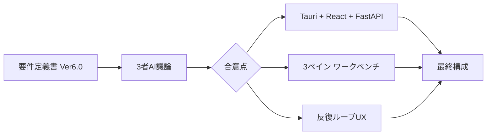
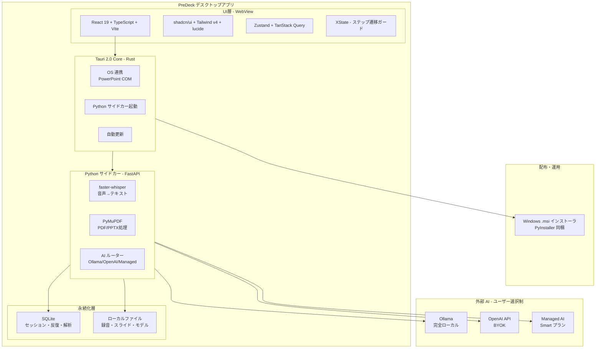
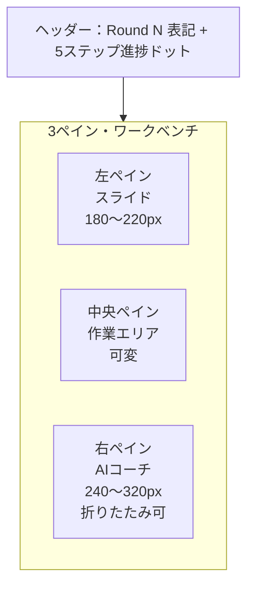
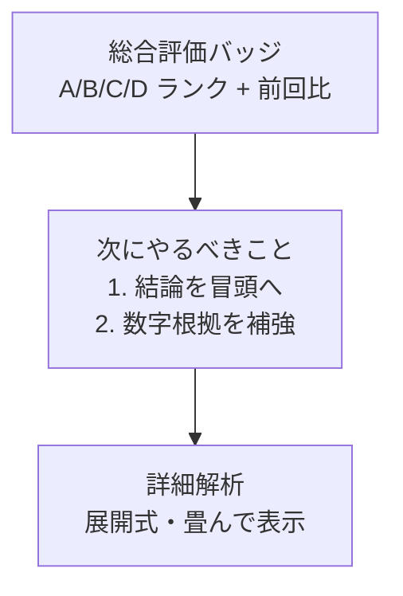
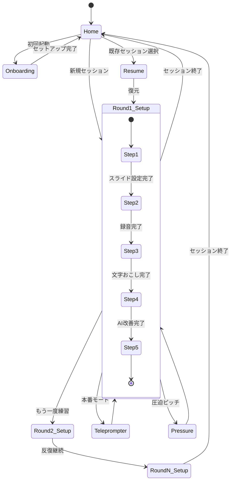
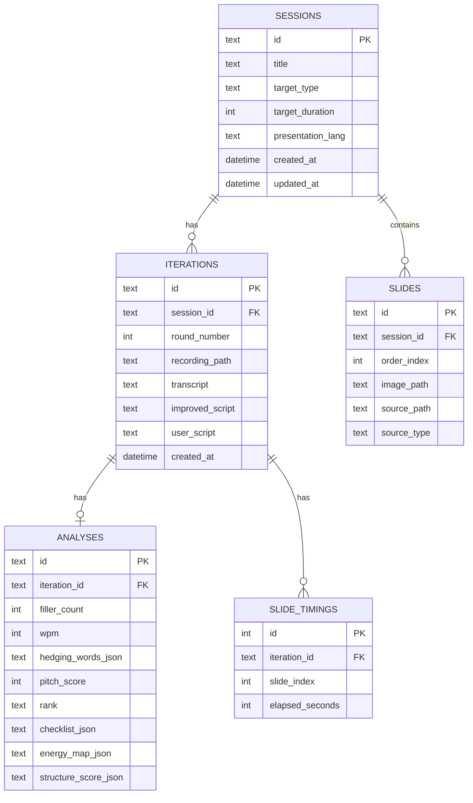
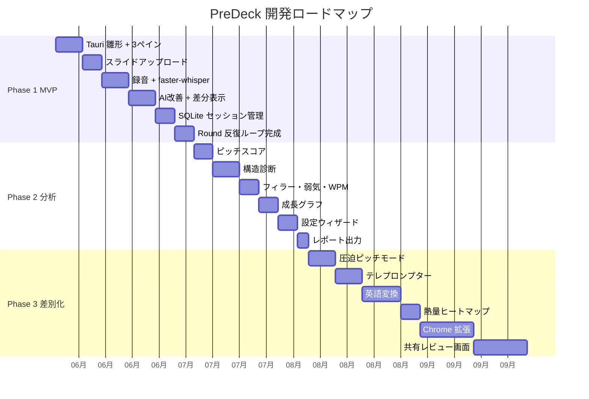

# PreDeck（プレデキ）最終技術選定・UI設計まとめ

> 3者AI（ChatGPT / Gemini / Claude）の議論を統合した最終決定版
> 対象: 要件定義書 Ver 6.0 / 既存設計資料一式
> 最終更新: 2026年5月

---

## 0. ドキュメントの目的

このドキュメントは、PreDeck を新規実装するにあたり、

- 採用すべき技術スタック
- UI/UX の設計方針
- 実装フェーズの優先順位

を、3者AIの議論結果を踏まえて確定させたものです。
以降の開発作業（雛形コード生成・スキーマ設計・モックアップ作成）は、すべてこの内容を前提に進めます。

---

## 1. 結論サマリー



### 1-1. 技術スタック早見表

| カテゴリ | 採用技術 | 主要な根拠 |
|---|---|---|
| デスクトップ基盤 | **Tauri 2.0** | 配布物 約8MB／メモリ 50〜100MB／3者一致 |
| フロントエンド | **React 19 + TypeScript + Vite** | shadcn/ui エコシステム／AI支援開発との親和性 |
| UIライブラリ | **shadcn/ui + Tailwind CSS v4** | コードを自前リポジトリに持つ方式・ロックインなし |
| アイコン | **lucide-react** | shadcn/ui 標準 |
| 状態管理 | **Zustand** | 既存グローバル `state` の置き換えに最適 |
| API状態 | **TanStack Query** | FastAPI 通信のキャッシュ・再取得管理 |
| ステップ管理 | **XState** | 5ステップ間のガード遷移（不正状態を防止） |
| グラフ | **Recharts** | 成長グラフ・WPMチャート |
| 差分表示 | **diff-match-patch** | AI改善前後のテキスト差分 |
| 原稿エディタ | **textarea → TipTap（将来）** | 段階的に高機能化 |
| バックエンド | **Python FastAPI（サイドカー）** | 既存資産を流用 |
| 文字起こし | **faster-whisper** | 約4倍速・メモリ半分（CTranslate2 ベース） |
| PDF処理 | **PyMuPDF** | 既存実装と整合 |
| PPTX処理 | **LibreOffice headless / PowerPoint COM** | OS環境に応じて選択 |
| AI処理 | **Ollama / OpenAI BYOK / Managed AI** | 3層提供（要件定義書 §3-2 準拠） |
| DB | **SQLite + SQLModel** | リレーショナル管理・成長集計に対応 |
| OS連携 | **Tauri SQL / dialog / updater plugins** | Rust 側で型安全に実装 |
| 配布 | **Windows .msi 単体（PyInstaller 同梱）** | 製造業現場 PC への配布最適化 |

### 1-2. UI/UX 早見表

| 項目 | 採用方針 |
|---|---|
| レイアウト | **3ペイン・ワークベンチ**（左:スライド ／ 中央:作業 ／ 右:AIコーチ） |
| ナビゲーション | **Round 表記 + 細い5ステップ進捗ドット**（ハイブリッド） |
| デザインコンセプト | **Calm Decision Cockpit**（落ち着いた意思決定突破コックピット） |
| カラーパレット | Deep Navy（信頼）／ Success Green（成長）／ Amber（注意）／ Red（圧迫） |
| タイポグラフィ | Noto Sans JP（日本語）／ Inter（英数字） |
| テレプロンプター | **独立フルスクリーン**画面に分離 |
| 圧迫ピッチモード | **独立モード**（中央ペインを置き換え） |
| 設定UI | **初回オンボーディング独立**／詳細は隠す |
| アクセシビリティ | 色だけに依存しない／キーボード操作完全対応 |

---

## 2. 技術スタック全体像（構造図）



### 2-1. 各レイヤーの役割

| レイヤー | 主な責務 | 技術 |
|---|---|---|
| UI 層 | 画面描画・ユーザー入力・状態管理 | React + shadcn/ui |
| Tauri Core | OS連携・サイドカー起動・配布物生成 | Rust |
| Python サイドカー | AI処理・音声処理・ファイル変換 | FastAPI + faster-whisper |
| 永続化層 | セッション管理・成長記録 | SQLite + SQLModel |
| 外部 AI | ユーザー選択により切替 | Ollama / OpenAI / Managed |

---

## 3. UI/UX 設計：3ペイン・ワークベンチ

### 3-1. 全体レイアウト



### 3-2. 左ペイン（スライド固定領域）

| 要素 | 内容 |
|---|---|
| スライドプレビュー | 現在ページの画像表示 |
| 前後ナビ | ◀ N / M ▶ |
| PowerPoint 並列起動 | PPTX 時のみ表示 |
| スライド別原稿 | 練習モードで該当スライドの原稿を表示 |

ステップを跨いで常時表示。スライドは「現在地の道標」として固定。

### 3-3. 中央ペイン（主作業領域）

| ステップ | 中央ペインの内容 |
|---|---|
| ① スライド設定 | アップロード UI、目的選択、目標時間入力 |
| ② 録音 | 大きな録音ボタン、タイマー、音量バー |
| ③ 文字おこし | 編集可能なエディタ、英語翻訳セクション |
| ④ 原稿改善 | 自分の原稿 ↔ AI改善案（左右比較）、差分表示 |
| ⑤ 練習モード | 通常練習／テレプロンプター／圧迫ピッチ／振り返り（モード切替） |

### 3-4. 右ペイン（AIコーチ領域）



#### プログレッシブ・ディスクロージャー方針

- **トップ**: ピッチスコア（A/B/C/D）＋前回比
- **ミドル**: 「通すために必要な行動」（チェックリスト形式・3項目以内）
- **ボトム**: 詳細解析（展開可能なアコーディオン）
  - フィラー検出
  - 弱気ワード
  - WPM（話速）
  - 構造診断
  - つまずき検知
  - 比喩提案
  - 熱量ヒートマップ

**初心者には Action までしか見せない**。詳細はクリックで展開する設計にすることで、要件定義書 §1 の「意思決定突破ツール」思想を維持する。

### 3-5. ナビゲーションのハイブリッド方式

```
┌─────────────────────────────────────────────────────────┐
│  Round 2 ／ 第2回練習                                    │
│  ① ────── ② ────── ● ────── ④ ────── ⑤             │
│                  現在地：文字おこし                       │
└─────────────────────────────────────────────────────────┘
```

**意図**:
- 上段の `Round N` で「反復による成長」（要件定義書 §1-3）を可視化
- 下段の細い 5 ステップドットで「今どこにいるか」を維持
- 既存ユーザーの混乱を避けつつ、プロダクト価値を UI に反映

---

## 4. 画面遷移とステートマシン

### 4-1. 全体フロー



### 4-2. ステップ間ガード（XState で実装）

| 遷移 | ガード条件 |
|---|---|
| Step1 → Step2 | スライド設定済 OR 「スライドなしで進む」を選択 |
| Step2 → Step3 | 録音データあり |
| Step3 → Step4 | 文字おこしテキストが空でない |
| Step4 → Step5 | AI改善原稿が生成済み |
| 任意ステップへのジャンプ | 該当ステップに必要なデータが揃っている |

既存実装の「録音なしで文字おこしを開く」のような不整合状態を、ステートマシンで構造的に防止する。

---

## 5. データ設計（SQLite スキーマ）

### 5-1. ER 図



### 5-2. 主要テーブル説明

| テーブル | 役割 |
|---|---|
| `sessions` | セッション本体（タイトル・目的・目標時間） |
| `slides` | スライド画像・元ファイル参照 |
| `iterations` | 1セッション内の練習回数（Round N） |
| `slide_timings` | スライド切替の時刻ログ |
| `analyses` | 各 Round の解析結果（JSON 列で柔軟に保持） |

### 5-3. 成長グラフ用クエリ例

```sql
SELECT
    i.round_number,
    a.pitch_score,
    a.filler_count,
    a.wpm,
    a.rank
FROM iterations i
JOIN analyses a ON a.iteration_id = i.id
WHERE i.session_id = ?
ORDER BY i.round_number;
```

このクエリ 1 本で、要件定義書 §4 の「成長可視化レイヤー」（スコア推移・改善率・自信曲線）が描画可能になる。JSON ファイル管理では実現困難だった集計が、SQLite ならほぼゼロコストで実行できる。

---

## 6. 実装フェーズ

### 6-1. ロードマップ



### 6-2. Phase 1 MVP の詳細

| 週 | 作業内容 | 完了基準 |
|---|---|---|
| 1 | Tauri 2 + React + Vite 雛形 / shadcn/ui 導入 / 3ペインレイアウト | `pnpm tauri dev` でアプリが起動し、3ペインが表示される |
| 2 | ホーム画面 / セッション一覧 / 新規セッション作成 | SQLite にセッションが保存・一覧表示される |
| 3 | ステップ1（スライド設定） / Pythonサイドカー接続 | PDF→PNG 変換が動作 |
| 4 | ステップ2（録音） + faster-whisper 統合 | 録音→ローカル文字おこしが動作 |
| 5 | ステップ3（文字おこし表示・編集） | 文字おこし結果が編集可能 |
| 6 | ステップ4（AI改善 + 差分表示） / Ollama 接続 | ローカル LLM で原稿改善 |
| 7 | ステップ5（練習モード基本機能） / Round 表記実装 | 反復ループが完成 |
| 8 | バグ修正 / Windows .msi ビルド検証 | 配布可能な .msi 完成 |

### 6-3. Phase 1 で「あえて作らない」もの

| 機能 | 理由 |
|---|---|
| Chrome 拡張 | コア体験完成後に集客導線として追加 |
| Stripe 決済 | 有料化はピッチスコア完成後 |
| 共有 URL | バイラルループは Phase 3 |
| カメラ解析 | 独立プロダクト級の複雑さ |
| 発音トレーニング | パートナーシップ検討対象 |
| 本番リアルタイムアシスト | デスクトップ強み機能だが MVP には不要 |

「**録音→改善→再練習**」のコア価値を磨くことに集中する。

---

## 7. 開発環境セットアップ

### 7-1. 前提

- Windows 11 Pro
- VSCode
- PowerShell 7 以降
- WSL2（Ubuntu）：Python サイドカーのビルドに使用

### 7-2. 初期セットアップ（PowerShell）

```powershell
# Node.js 環境
winget install OpenJS.NodeJS.LTS
npm install -g pnpm

# Rust 環境（Tauri 用）
winget install Rustlang.Rustup
rustup default stable

# プロジェクト作成
pnpm create vite predeck-desktop --template react-ts
cd predeck-desktop

# Tauri 追加
pnpm add -D @tauri-apps/cli
pnpm tauri init

# shadcn/ui 初期化
pnpm dlx shadcn@latest init

# 必要なコンポーネント追加
pnpm dlx shadcn@latest add resizable card button dialog tabs
```

### 7-3. Python サイドカー（WSL2 Ubuntu Bash）

```bash
# 仮想環境
python3 -m venv .venv
source .venv/bin/activate

# 依存関係
pip install fastapi uvicorn faster-whisper pymupdf sqlmodel python-multipart

# 既存 main.py を移植
cp /path/to/existing/main.py ./backend/

# PyInstaller でバイナリ化（配布用）
pip install pyinstaller
pyinstaller --onefile backend/main.py --name predeck-backend
```

### 7-4. Tauri へのサイドカー組み込み

```json
// src-tauri/tauri.conf.json
{
  "bundle": {
    "externalBin": ["binaries/predeck-backend"]
  },
  "plugins": {
    "shell": {
      "sidecar": true,
      "scope": [
        { "name": "binaries/predeck-backend", "sidecar": true }
      ]
    }
  }
}
```

---

## 8. 製造業現場特有の考慮事項

### 8-1. 配布戦略

| 観点 | 対応 |
|---|---|
| OS | **Windows 限定で開始**（Mac/Linux は将来） |
| インストール | `.msi` 形式でグループポリシー配布対応 |
| ネットワーク制約 | オフライン完結可能な構成（Whisper + Ollama 同梱） |
| アップデート | Tauri Updater で社内サーバー経由配信も可能 |
| ライセンス管理 | OS Keychain で API キーを安全に保存 |

### 8-2. 法務・ライセンス確認事項

| 対象 | ライセンス | 確認事項 |
|---|---|---|
| Tauri | MIT / Apache-2.0 | 商用利用可 |
| shadcn/ui | MIT | コードコピー方式・ロックインなし |
| faster-whisper | MIT | 商用利用可 |
| Whisper モデル | MIT | 商用利用可 |
| Ollama | MIT | 商用利用可 |
| OpenAI API | 商用利用可 | データ学習されない契約確認必須 |
| PyMuPDF | AGPL-3.0 / 商用ライセンス | **AGPL の場合、SaaS 提供時はソース公開義務あり** |

> **注意**: PyMuPDF は AGPL-3.0 のため、Phase 3 以降で SaaS 化する場合は商用ライセンス取得を検討する必要がある。MVP（デスクトップ単体配布）の段階では問題なし。

### 8-3. PowerShell vs Bash の使い分け

| 作業 | シェル | 理由 |
|---|---|---|
| フロント開発（`pnpm dev` など） | PowerShell | Windows ネイティブで安定 |
| Tauri ビルド | PowerShell | Windows 用 .msi 生成が直接可能 |
| Python サイドカーのビルド | WSL2 Bash | PyInstaller が Linux 系で安定 |
| Git 操作 | どちらでも | 好みで選択 |

---

## 9. 3者AI 議論の収束ポイント

### 9-1. 全員一致した点

| 項目 | 合意内容 |
|---|---|
| デスクトップランタイム | Tauri 2.0（Electron は不採用） |
| バックエンド | Python FastAPI（既存資産流用） |
| ローカル AI | Ollama + ローカル Whisper |
| スタイリング | Tailwind CSS |
| フロントエンド | React + Vite（最終的に Claude も同意） |
| UI ライブラリ | shadcn/ui |
| 状態管理 | Zustand + TanStack Query |

### 9-2. 議論の末に決着した点

| 論点 | 最終決定 | 主張者 |
|---|---|---|
| React vs Svelte | **React** | ChatGPT・Gemini 推奨、Claude も同意 |
| 2ペイン vs 3ペイン | **3ペイン・ワークベンチ** | ChatGPT 発案、3者同意 |
| ステップバー存続 | **ハイブリッド（Round + 進捗ドット）** | Claude 提案、3者同意 |
| Whisper の種類 | **faster-whisper** | ChatGPT 提案 |
| ORM 選択 | **SQLModel** | ChatGPT 提案 |

### 9-3. 3者AIの寄与点

| 項目 | 主な寄与 |
|---|---|
| **ChatGPT** | 3ペイン・ワークベンチ／反復ループ UX／faster-whisper／TipTap 将来採用／実装フェーズ詳細 |
| **Gemini** | Calm Decision Cockpit デザインコンセプト／プログレッシブ・ディスクロージャー／Deep Navy + Success Green |
| **Claude** | XState によるステートマシン化／テレプロンプター独立／設定モーダル簡素化／製造業配布考慮（Windows .msi）／PyMuPDF ライセンス指摘 |

---

## 10. 次のアクション

このドキュメント確定後、以下のいずれかから着手します。

| 選択肢 | アウトプット |
|---|---|
| 3ペインのモックアップ実装 | React + shadcn/ui のサンプルコード |
| SQLite スキーマ詳細設計 | `schema.sql` + マイグレーション戦略 |
| Tauri + Python サイドカー雛形 | 動作する最小構成プロジェクト |
| デザインシステム整備 | Tailwind config + shadcn テーマ |

---

## 付録 A: ファイル構成案

```
predeck/
├── apps/
│   ├── desktop/              # Tauri + React 本体
│   │   ├── src/
│   │   │   ├── components/   # shadcn/ui 拡張
│   │   │   ├── features/     # 機能単位
│   │   │   │   ├── home/
│   │   │   │   ├── workbench/
│   │   │   │   ├── teleprompter/
│   │   │   │   └── pressure/
│   │   │   ├── stores/       # Zustand
│   │   │   ├── machines/     # XState
│   │   │   └── lib/          # 共通ユーティリティ
│   │   └── src-tauri/        # Rust 側
│   │       ├── src/
│   │       └── tauri.conf.json
│   └── extension/            # Chrome 拡張（Phase 3）
│
├── backend/                  # Python サイドカー
│   ├── main.py               # FastAPI エントリ
│   ├── routers/
│   │   ├── sessions.py
│   │   ├── transcribe.py
│   │   ├── improve.py
│   │   └── analyze.py
│   ├── services/
│   │   ├── whisper_service.py
│   │   ├── ai_service.py
│   │   └── pdf_service.py
│   └── db/
│       ├── models.py         # SQLModel
│       └── migrations/
│
├── packages/
│   ├── ui/                   # 共通 UI コンポーネント
│   └── types/                # TypeScript 型定義
│
└── docs/
    ├── PreDeck_要件定義書_Ver6_0.md
    └── PreDeck_最終技術選定_UI設計.md  ← 本ドキュメント
```

---

## 付録 B: 参考リンク

- [Tauri 2.0 公式](https://tauri.app/)
- [shadcn/ui](https://ui.shadcn.com/)
- [Tailwind CSS v4](https://tailwindcss.com/)
- [Zustand](https://zustand-demo.pmnd.rs/)
- [TanStack Query](https://tanstack.com/query/latest)
- [XState](https://xstate.js.org/)
- [faster-whisper](https://github.com/SYSTRAN/faster-whisper)
- [SQLModel](https://sqlmodel.tiangolo.com/)

---

*PreDeck 最終技術選定・UI設計まとめ - 3者AI議論統合版*
