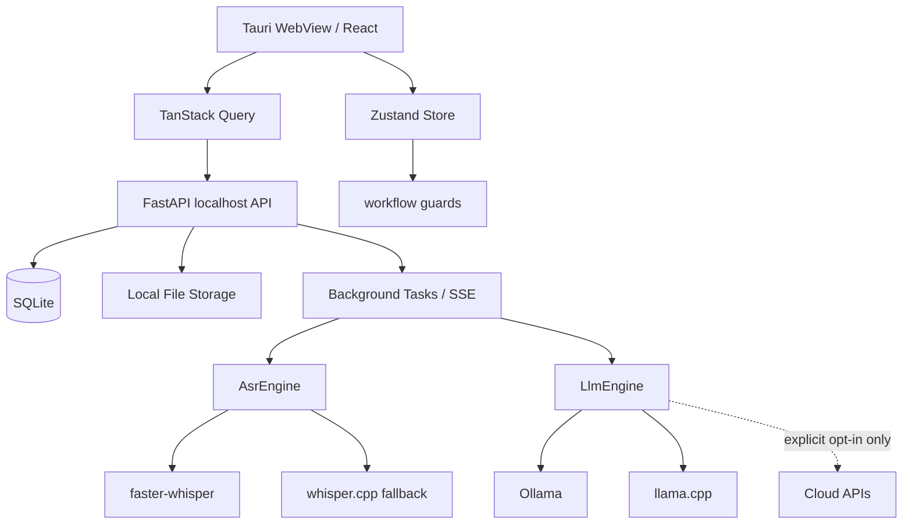

# AI開発指示書_20260508

---

## 0. 目的

本書は、AIエージェントまたは開発支援AIにPreDeckを実装させるための開発指示書である。対象は、Tauri 2 + React + TypeScript + Vite + Python FastAPI sidecar + SQLite + ローカルASR/LLMで構成するPreDeck新規開発版である。

本書にない仕様を確定仕様として創作してはならない。資料にない判断が必要な場合は、必ず分類ラベルを付ける。

| 分類 | 意味 |
|---|---|
| 要確認 | 実装前または採用前に確認が必要 |
| 未決事項 | 現時点で仕様未確定 |
| AIエージェントによる補完可 | 実装案、雛形、テスト、UI草案としてAIが補完してよい |
| AIエージェントによる補完不可、人間確認必須 | 法務、価格、ブランド、個人情報、ライセンス、外部送信、最終採用判断 |

参照元:
- PreDeck 要件定義書 Ver6.0（完全統合版）.md
- ローカルLLM_調査資料_20260507.md
- ローカル音声認識_調査資料_20260507.md
- 技術選定_UIUX設計決定書_Mermaid追加版_20260507.md
- PreDeck_外部事実確認ログ_20260508.md
- PreDeck_技術調査統合_ASR_LLM_20260508.md
- PreDeck_原文保持アーカイブ_20260508.md
- PreDeck_統合設計書_20260508.md

---

## 1. 絶対遵守事項

### 1.1 ハルシネーション禁止

- 添付資料に存在しない仕様を、確定仕様として追加しない。
- 技術仕様を補う場合は、根拠となる資料名または外部URLをコメントやドキュメントに残す。
- 外部事実が変わり得るライブラリ、モデル、ライセンス、API、OS対応、配布方式は、実装時点で再確認する。

### 1.2 Strict Local Modeを既定にする

MVPでは以下を既定設定にする。

```json
{
  "strict_local_mode": true,
  "allow_cloud_asr": false,
  "allow_cloud_llm": false,
  "allow_model_download": false,
  "allowed_hosts": ["127.0.0.1", "localhost"]
}
```

禁止:

- ユーザーの録音、文字起こし、原稿、スライド、分析データを外部APIへ送ること。
- Web Speech APIをローカルASRとして使うこと。
- モデルを本番動作中にHugging Face Hub等から自動取得すること。
- クラウドASR/LLMを既定ONにすること。

クラウド利用は、ユーザーが明示的にONにし、送信先、送信データ、保存方針、課金、解除方法を表示した場合のみ許可する。

### 1.3 ライセンス安全構成を守る

標準同梱から除外するもの:

- PyMuPDF無償版
- GPL有効FFmpeg
- nonfree有効FFmpeg
- LibreOffice同梱
- Microsoft Office / PowerPoint本体
- Web Speech API
- OpenAI API / Google Speech / Azure Speech（Strict Local Mode）
- Llama 4系の標準同梱
- FunASR / SenseVoiceの標準同梱
- ライセンス未確認モデル

必須:

- `THIRD_PARTY_NOTICES.md`
- `licenses/` フォルダ
- アプリ内「オープンソースライセンス」画面
- モデルレジストリ（モデル名、配布元、ライセンス、商用利用可否、再配布可否、同梱可否、確認日）

---

## 2. 実装対象スタック

| 領域 | 指示 |
|---|---|
| Desktop Runtime | Tauri 2 |
| Frontend | React + TypeScript + Vite |
| UI | Tailwind CSS v4 + shadcn/ui + lucide-react |
| State | Zustand |
| Server State | TanStack Query |
| Validation | Zod |
| Forms | React Hook Form |
| Backend | Python FastAPI sidecar |
| DB | SQLite + SQLModel または SQLAlchemy |
| ASR | faster-whisper標準、whisper.cpp代替 |
| LLM Runtime | Ollama / llama.cpp、MacではMLX候補 |
| LLM Models | Qwen3.5-9B、Gemma 4 E4B、Gemma 4 26B-A4B、gpt-oss-20b、Bonsai-8B |
| 初期配布 | Windows `.msi` |
| 将来Web | Next.js。LP、共有、決済、チーム管理用。デスクトップ本体には使わない |
| 将来Chrome拡張 | Phase 2以降。WXT + React候補 |

参照元:
- PreDeck_統合設計書_20260508.md
- 技術選定_UIUX設計決定書_Mermaid追加版_20260507.md
- PreDeck_外部事実確認ログ_20260508.md
- 外部確認: Tauri 2.0 Stable Release: https://v2.tauri.app/blog/tauri-20/
- 外部確認: React 19.2 Release: https://react.dev/blog/2025/10/01/react-19-2
- 外部確認: Tailwind CSS v4.0: https://tailwindcss.com/blog/tailwindcss-v4

---

## 3. 実装アーキテクチャ



### 3.1 ディレクトリ構成案

```text
predeck/
├─ apps/
│  └─ desktop/
│     ├─ src-tauri/
│     ├─ src/
│     │  ├─ app/
│     │  ├─ components/
│     │  ├─ features/
│     │  │  ├─ session/
│     │  │  ├─ slides/
│     │  │  ├─ recording/
│     │  │  ├─ transcript/
│     │  │  ├─ improve/
│     │  │  ├─ practice/
│     │  │  └─ settings/
│     │  ├─ stores/
│     │  ├─ api/
│     │  └─ lib/
├─ sidecar/
│  ├─ app/
│  │  ├─ main.py
│  │  ├─ api/
│  │  │  ├─ asr.py
│  │  │  ├─ llm.py
│  │  │  ├─ settings.py
│  │  │  └─ sessions.py
│  │  ├─ core/
│  │  ├─ db/
│  │  ├─ engines/
│  │  │  ├─ asr/
│  │  │  └─ llm/
│  │  ├─ jobs/
│  │  └─ schemas/
├─ docs/
│  ├─ THIRD_PARTY_NOTICES.md
│  └─ licenses/
└─ scripts/
```

`AIエージェントによる補完可`: 実際のディレクトリ名、ファイル分割、命名規則は上記を基準に調整してよい。ただし、Strict Local Mode、ASR/LLM抽象化、SQLite、ローカル保存は変更不可。

---

## 4. 画面実装指示

### 4.1 ワークベンチ構成

2.5ペイン構成を実装する。

| ペイン | 必須要素 |
|---|---|
| 左 | スライド一覧、現在スライド、スライド別原稿、ページ移動 |
| 中央 | 5ステップの作業領域、録音、文字起こし確認、原稿改善、練習 |
| 右 | AIコーチ、改善提案、構造診断、ピッチチェック、次アクション。折りたたみ可能 |

### 4.2 5ステップUI

主ナビゲーションは必ず次の5ステップにする。

```text
1. スライド設定
2. 録音
3. 文字おこし確認
4. 原稿改善
5. 練習
```

Round表示は補助情報にする。

```text
Round 2  前回より改善: フィラー減少 / 構成改善 / 時間調整
```

### 4.3 ステップガード実装

```ts
export type WorkflowStep =
  | 'slideSetting'
  | 'recording'
  | 'transcriptReview'
  | 'improve'
  | 'practice';

export interface WorkflowState {
  sessionId?: string;
  recordingId?: string;
  transcriptId?: string;
  transcriptText?: string;
  userScript?: string;
  aiImprovedScript?: string;
}

export function canEnter(step: WorkflowStep, state: WorkflowState): boolean {
  switch (step) {
    case 'slideSetting':
      return true;
    case 'recording':
      return Boolean(state.sessionId);
    case 'transcriptReview':
      return Boolean(state.recordingId || state.transcriptId);
    case 'improve':
      return Boolean(state.transcriptText?.trim());
    case 'practice':
      return Boolean(state.userScript?.trim() || state.aiImprovedScript?.trim());
  }
}
```

`AIエージェントによる補完可`: 型名・store名は変更可。入場条件は変更不可。

### 4.4 右AIコーチ表示制御

| 状態 | 実装 |
|---|---|
| 初回セットアップ | 非表示 |
| スライド設定 | 折りたたみ |
| 録音中 | 非表示 |
| 文字おこし確認 | 軽く表示 |
| 原稿改善 | 展開 |
| 通常練習 | 非表示 |
| 振り返り | 展開 |

---

## 5. API実装指示

### 5.1 ASR API

```text
GET  /api/asr/engines
GET  /api/asr/models
POST /api/asr/models/import
POST /api/asr/transcribe
GET  /api/asr/jobs/{job_id}
GET  /api/asr/jobs/{job_id}/events
POST /api/asr/jobs/{job_id}/cancel
```

#### 5.1.1 文字起こし開始リクエスト

```json
{
  "session_id": "s_001",
  "iteration_id": "it_001",
  "audio_path": "PreDeckData/recordings/s_001/it_001.webm",
  "engine": "faster_whisper",
  "model_id": "fw_small_ja",
  "language": "ja",
  "vad": true,
  "word_timestamps": true
}
```

#### 5.1.2 完了レスポンス

```json
{
  "job_id": "job_001",
  "status": "completed",
  "transcript_id": "tr_001",
  "text": "本日は新規事業の提案について説明します。",
  "segments": [
    {
      "start_sec": 0.0,
      "end_sec": 3.2,
      "text": "本日は新規事業の提案について説明します。",
      "slide_index": 1
    }
  ]
}
```

### 5.2 LLM API

```text
GET  /api/llm/engines
GET  /api/llm/models
POST /api/llm/models/import
POST /api/llm/improve-script
POST /api/llm/diagnose-structure
POST /api/llm/generate-questions
GET  /api/llm/jobs/{job_id}
GET  /api/llm/jobs/{job_id}/events
POST /api/llm/jobs/{job_id}/cancel
```

### 5.3 設定API

```text
GET  /api/settings
PATCH /api/settings
POST /api/settings/test-microphone
POST /api/settings/test-asr
POST /api/settings/test-llm
POST /api/settings/switch-local-mode
```

### 5.4 エラー形式

`AIエージェントによる補完可`: 以下の形式で実装する。

```json
{
  "error": {
    "code": "ASR_MODEL_NOT_FOUND",
    "message": "指定されたASRモデルが見つかりません。",
    "recoverable": true,
    "next_action": "モデル管理画面からモデルをインポートしてください。"
  }
}
```

---

## 6. ASR実装指示

### 6.1 AsrEngine抽象化

```python
from abc import ABC, abstractmethod
from dataclasses import dataclass
from typing import Iterable, Optional

@dataclass
class TranscriptSegment:
    start_sec: float
    end_sec: float
    text: str
    slide_index: Optional[int] = None
    avg_logprob: Optional[float] = None
    no_speech_prob: Optional[float] = None
    compression_ratio: Optional[float] = None

@dataclass
class TranscriptionResult:
    text: str
    segments: list[TranscriptSegment]

class AsrEngine(ABC):
    @abstractmethod
    def transcribe(self, audio_path: str, language: str = 'ja') -> TranscriptionResult:
        raise NotImplementedError
```

### 6.2 faster-whisper実装ルール

- MVP正式ASRとして実装する。
- `WhisperModel("small")` のようなモデル名指定は禁止。
- 必ずローカルパスを渡す。
- CPU標準は `compute_type="int8"` を初期候補にする。
- GPUは任意設定とし、CUDA環境差で失敗してもCPUへフォールバックできるようにする。

```python
from faster_whisper import WhisperModel

model = WhisperModel(
    "PreDeckData/models/faster-whisper-small",
    device="cpu",
    compute_type="int8",
)

segments, info = model.transcribe(
    audio_path,
    language="ja",
    beam_size=5,
    vad_filter=True,
    vad_parameters={"min_silence_duration_ms": 500},
    word_timestamps=True,
)
```

### 6.3 whisper.cpp実装ルール

- 代替候補として抽象化の別実装にする。
- Python依存を減らしたい場合、Windows配布安定性を優先する場合に使う。
- CLIラッパーまたはネイティブバインディングの採用は `要確認`。

### 6.4 Web Speech API禁止

Web Speech APIはWindows/TauriのローカルASRとして扱わない。Edge実装ではAzure Cognitive Servicesを使い、音声データが端末外に出ることが公式文書で確認されているためである。

参照元:
- ローカル音声認識_調査資料_20260507.md
- PreDeck_技術調査統合_ASR_LLM_20260508.md
- 外部確認: faster-whisper GitHub: https://github.com/SYSTRAN/faster-whisper
- 外部確認: Microsoft Edge SpeechRecognitionEnabled policy: https://learn.microsoft.com/en-us/deployedge/microsoft-edge-browser-policies/speechrecognitionenabled

---

## 7. LLM実装指示

### 7.1 LlmEngine抽象化

```python
from abc import ABC, abstractmethod
from dataclasses import dataclass
from typing import Any

@dataclass
class LlmRequest:
    task: str
    payload: dict[str, Any]
    model_id: str

@dataclass
class LlmResult:
    raw_text: str
    parsed_json: dict[str, Any] | None
    validation_errors: list[str]

class LlmEngine(ABC):
    @abstractmethod
    def run(self, request: LlmRequest) -> LlmResult:
        raise NotImplementedError
```

### 7.2 モデル選択

| PC条件 | 既定モデル |
|---|---|
| RAM 8GB未満 | ローカルLLM OFF。BYOK/API推奨。ただしStrict Local ModeではクラウドOFF |
| RAM 8〜16GB、GPUなし | Gemma 4 E4B または Bonsai-8B |
| RAM 16GB以上、またはVRAM 8GB以上 | Qwen3.5-9B Q4 |
| RAM 32GB以上、またはVRAM 16GB以上 | Gemma 4 26B-A4B / gpt-oss-20b選択可 |
| RAM 64GB以上、またはVRAM 24GB以上 | Qwen3.6-35B-A3B / Gemma 4 31B選択可 |

### 7.3 JSON Schema強制

自由文だけで返させない。以下のような構造化出力を求める。

```json
{
  "improved_script": "...",
  "changes": [
    {"type": "delete_filler", "before": "えー", "after": ""},
    {"type": "strengthen_claim", "before": "だと思います", "after": "です"}
  ],
  "structure_diagnosis": {
    "problem_clarity": 4,
    "why_strength": 3,
    "evidence_density": 2,
    "cta_clarity": 3
  },
  "priority_actions": [
    "市場規模の根拠を1つ追加",
    "冒頭で結論を先に述べる"
  ]
}
```

必須処理:

- JSON parse
- Zod相当またはPydanticによるschema validation
- 失敗時の再試行
- 再試行しても失敗した場合はユーザーに復旧可能エラーを出す

### 7.4 プロンプト入力制限

長文コンテキストをそのまま全量投入しない。

```text
現在スライド原稿: 詳細入力
前後スライド: 要約入力
全体構成: JSON要約
過去イテレーション: 弱点・スコア履歴のみ
録音文字起こし: 現在セッション部分のみ
```

---

## 8. DB実装指示

### 8.1 必須テーブル

| テーブル | 用途 |
|---|---|
| sessions | セッション基本情報 |
| iterations | 練習回数ごとの履歴 |
| slides | スライド画像・ファイル参照 |
| slide_timings | スライド切替タイミング |
| recordings | 録音ファイル情報 |
| transcripts | 文字おこし本文 |
| transcript_segments | セグメント、タイムスタンプ、信頼度、スライド対応 |
| scripts | ユーザー原稿・AI改善原稿 |
| analyses | フィラー、WPM、構造診断、スコア等 |
| asr_models | ASRモデル管理 |
| asr_jobs | ASRジョブ管理 |
| llm_models | LLMモデル管理 |
| llm_jobs | 原稿改善・診断ジョブ管理 |
| settings | Strict Local Mode、ASR、LLM、UI設定 |
| exports | レポート出力履歴 |

### 8.2 ASR関連DDL案

```sql
CREATE TABLE asr_models (
  id TEXT PRIMARY KEY,
  engine TEXT NOT NULL,
  model_name TEXT NOT NULL,
  local_path TEXT NOT NULL,
  language TEXT,
  size_bytes INTEGER,
  installed_at TEXT,
  is_default INTEGER NOT NULL DEFAULT 0
);

CREATE TABLE asr_jobs (
  id TEXT PRIMARY KEY,
  session_id TEXT NOT NULL,
  iteration_id TEXT NOT NULL,
  engine TEXT NOT NULL,
  model_id TEXT NOT NULL,
  status TEXT NOT NULL,
  progress REAL DEFAULT 0,
  error_message TEXT,
  started_at TEXT,
  finished_at TEXT
);

CREATE TABLE transcript_segments (
  id TEXT PRIMARY KEY,
  transcript_id TEXT NOT NULL,
  start_sec REAL NOT NULL,
  end_sec REAL NOT NULL,
  text TEXT NOT NULL,
  avg_logprob REAL,
  no_speech_prob REAL,
  compression_ratio REAL,
  slide_index INTEGER
);
```

`AIエージェントによる補完可`: `sessions`等のDDL詳細は、要件定義書の概念モデルに基づいて設計してよい。ただし、raw transcriptとnormalized transcript、ユーザー原稿とAI改善原稿を混ぜないこと。

### 8.3 ローカルファイル保存

```text
PreDeckData/
├─ recordings/
│  └─ {session_id}/{iteration_id}.webm
├─ slides/
│  └─ {session_id}/slide_001.png
├─ originals/
│  └─ {session_id}/source.pptx
├─ exports/
│  └─ reports/
├─ models/
└─ logs/
```

---

## 9. 品質・テスト指示

### 9.1 ASR単体検証

評価音声:

- 3分プレゼン
- 5分プレゼン
- 10分プレゼン
- 日本語プレゼン
- 無音多め
- 早口
- フィラー多め
- 固有名詞多め

評価項目:

| 評価項目 | 内容 |
|---|---|
| 認識精度 | 文字誤り率、固有名詞、言い間違い |
| 処理時間 | 録音時間に対する倍率 |
| メモリ使用量 | RAM使用量 |
| GPU使用量 | VRAM使用量 |
| 無音耐性 | 長い沈黙で幻覚が出ないか |
| フィラー | 「えー」「あの」「まあ」を拾えるか |
| 句読点 | そのまま読める品質か |

### 9.2 LLM独自ベンチマーク

| 評価セット | 内容 | 評価指標 |
|---|---|---|
| 日本語VCピッチ10本 | 起業家向け3〜5分原稿 | 論理、説得力、短縮品質、弱気表現除去 |
| 学会発表10本 | 研究背景、方法、結果、考察 | 正確性、専門性、簡潔性 |
| 英語変換10本 | 日本語原稿→VC English / Academic English | 文化適応、話しやすさ、自然さ |
| 圧迫質問生成20本 | 市場規模、競合、技術優位性 | 質問の鋭さ、重複の少なさ |
| JSON安定性100件 | 決めたSchemaで返せるか | パース成功率、再試行率 |

### 9.3 Strict Local Modeテスト

- 外部ホストへの通信が発生しないこと。
- モデル自動ダウンロードが発生しないこと。
- クラウドASR/LLMがOFFであること。
- 設定変更時に明示的なユーザー操作が必要であること。
- 送信データ、送信先、保存方針、課金、解除方法が表示されること。

### 9.4 UX品質テスト

- 初回ユーザーが迷わず録音まで進める。
- 録音中に右AIコーチが出ない。
- 原稿改善画面で変更理由が分かる。
- 再練習導線が目立つ。
- スコアより改善アクションが前に出る。
- キーボード操作、スクリーンリーダー、高コントラスト、色以外の表現に対応する。

---

## 10. 実装優先順位

### 10.1 Phase 0: 技術検証

1. Tauri + React + FastAPI sidecarの疎通
2. FastAPI起動・終了制御
3. SQLite接続
4. ローカルファイル保存
5. Windows MSIビルド見込み確認

### 10.2 Phase 1: MVP

1. セッション作成
2. スライドアップロード
3. 録音
4. 録音ファイル保存
5. faster-whisper文字起こし
6. 文字おこし確認
7. Ollama / ローカルLLM接続
8. 原稿改善
9. 差分表示
10. 練習
11. 保存
12. 再録音とiteration追加

### 10.3 Phase 2: α版改善

- ピッチチェックリスト
- 構造診断
- WPM
- 弱気ワード
- フィラー
- 成長グラフ
- 設定ウィザード
- Ollama/OpenAI切替（ただしクラウドは明示許可）
- レポート
- QR転送

### 10.4 Phase 3以降

- 圧迫ピッチ
- 英語変換
- Speakable English
- テレプロンプター声追従
- Chrome拡張
- 共有レビュー
- Stripe
- Next.js管理画面
- チーム管理
- Enterprise向け勝ちパターン学習
- PowerPoint/Keynote連携強化

---

## 11. 禁止実装リスト

| 禁止実装 | 理由 |
|---|---|
| 録音直後に外部APIへ自動送信 | Strict Local Mode違反 |
| Web Speech APIをローカルASRとして採用 | Edgeで外部送信されるため |
| Hugging Face Hubから本番中に自動DL | Strict Local Mode違反、再現性低下 |
| PyMuPDF無償版を標準同梱 | AGPL/商用ライセンス問題 |
| GPL/nonfree FFmpeg同梱 | クローズドソース配布と衝突し得る |
| Microsoft Office本体同梱 | 再配布不可 |
| Llama 4系の標準同梱 | ライセンス管理リスク |
| 勝率を初期からパーセントで断定表示 | 信頼性不足 |
| 相手の表情解析 | 同意・規約・法規制リスク |

---

## 12. AIエージェントの補完範囲

### 12.1 補完可

- コンポーネント分割
- TypeScript型定義
- Pydanticモデル
- SQLModel/SQLAlchemyモデル
- APIエラー形式
- UI草案
- テストケース
- モックデータ
- Mermaid図
- README
- 開発用スクリプト
- OSSライセンス一覧生成スクリプト
- Strict Local Modeの通信テスト補助

### 12.2 補完不可、人間確認必須

- 課金プラン・価格の最終決定
- ライセンスの法的判断
- 商用配布・モデル同梱の最終判断
- 個人情報・録音データの保存方針
- クラウドAPI利用規約・DPA確認
- ブランドコピーの最終決定
- Enterprise契約条件
- Microsoft Office / Google Slides / Zoom / Teams等の規約判断

---

## 13. 開発着手時の最初のタスク

1. `predeck` リポジトリ初期化
2. Tauri 2 + React + TypeScript + Vite テンプレート作成
3. Tailwind CSS v4 + shadcn/ui + lucide-react導入
4. Zustand store と TanStack Query client導入
5. Python FastAPI sidecar最小実装
6. `/api/health` 実装
7. SQLite接続とmigration方式の選定
8. `settings` テーブルにStrict Local Mode初期値を保存
9. `PreDeckData/` ディレクトリ作成
10. 5ステップUIの静的ワークベンチ実装
11. 録音UIとローカル保存
12. ASRジョブ投入APIの雛形

---

## 14. 外部確認ソース

- Tauri 2.0 Stable Release: https://v2.tauri.app/blog/tauri-20/
- Tauri Windows Installer: https://v2.tauri.app/distribute/windows-installer/
- React 19.2 Release: https://react.dev/blog/2025/10/01/react-19-2
- Tailwind CSS v4.0: https://tailwindcss.com/blog/tailwindcss-v4
- faster-whisper GitHub: https://github.com/SYSTRAN/faster-whisper
- OpenAI Whisper GitHub: https://github.com/openai/whisper
- whisper.cpp GitHub: https://github.com/ggml-org/whisper.cpp
- Microsoft Edge SpeechRecognitionEnabled policy: https://learn.microsoft.com/en-us/deployedge/microsoft-edge-browser-policies/speechrecognitionenabled
- MDN Web Speech API: https://developer.mozilla.org/en-US/docs/Web/API/Web_Speech_API
- sherpa-onnx GitHub: https://github.com/k2-fsa/sherpa-onnx
- FunASR GitHub: https://github.com/modelscope/FunASR
- Vosk API GitHub: https://github.com/alphacep/vosk-api
- Ollama Docs: https://docs.ollama.com/
- Qwen3.5-9B Hugging Face: https://huggingface.co/Qwen/Qwen3.5-9B
- Qwen3.6-35B-A3B Hugging Face: https://huggingface.co/Qwen/Qwen3.6-35B-A3B
- Gemma 4 Model Card: https://ai.google.dev/gemma/docs/core/model_card_4
- Gemma 4 26B-A4B Hugging Face: https://huggingface.co/google/gemma-4-26B-A4B
- OpenAI gpt-oss open models: https://openai.com/open-models/
- openai/gpt-oss-20b Hugging Face: https://huggingface.co/openai/gpt-oss-20b
- Bonsai-8B Hugging Face: https://huggingface.co/prism-ml/Bonsai-8B-mlx-1bit
- PyMuPDF License and Copyright: https://pymupdf.readthedocs.io/en/latest/about.html
- FFmpeg Legal: https://ffmpeg.org/legal.html
- LibreOffice Licenses: https://www.libreoffice.org/about-us/licenses/
