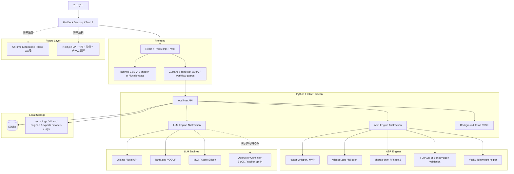
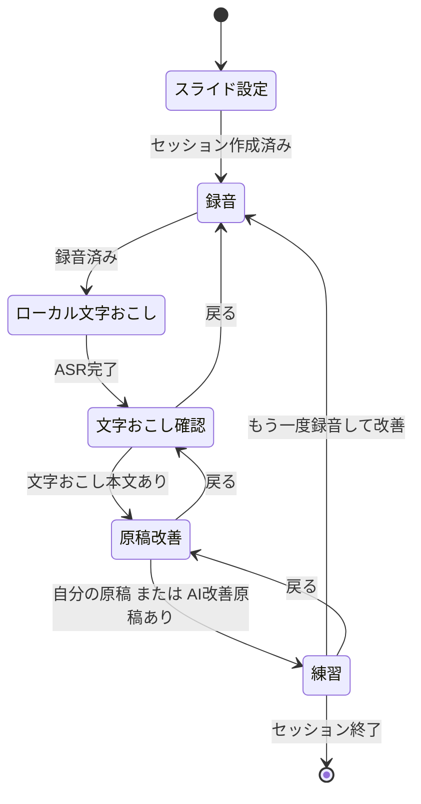

# PreDeck 統合設計書

作成日: 2026-05-08  
対象: PreDeck（プレデキ）新規開発版  
統合対象: 添付3ファイル  
位置付け: 技術選定、UI/UX設計、ローカルASR調査、ローカルLLM調査を整合させた統合版

---

## 0. 統合方針

本書は、以下3ファイルの内容を統合し、矛盾する箇所を「ローカル完結」を優先して整理した設計書である。

| 元ファイル | 主な内容 | 統合上の扱い | SHA-256 |
|---|---|---|---|
| `PreDeck_最終技術選定_UIUX設計決定書_Mermaid追加版(1).md` | アプリ全体設計、UI/UX、技術スタック、開発フェーズ | 全体設計の基礎 | `6e67b98cdd8a52239600ef7b5948cf826e0b9cfeef5215d283670b5a460f6494` |
| `ローカル音声認識‗調査20260508(2).md` | ローカルASR選定、Strict Local Mode、ASR API/DB | 音声認識とローカル完結方針を上書き統合 | `7f3d6ee8df1b5df5af020bdd580e0565951e1f4f416fd28fa8ab2e767934f5f7` |
| `ローカルLLM‗調査20260507.md` | ローカルLLM選定、PCスペック分類、モデル選択UI | 改善AIとモデル管理方針を上書き統合 | `dee9264c25ac7241dda003ca3a141e92a75991946ca299863781c5f20a076a0b` |

### 0.1 欠損防止方針

- 本書は読みやすさを優先した統合設計書である。
- 添付ファイルに含まれていた全情報は、別ファイル `PreDeck_原文保持アーカイブ_20260508.md` に原文のまま収録する。
- 本書で要約・再配置した内容は、原文保持アーカイブにより照合可能にする。
- 外部確認できた事実と、添付原文由来の判断・推奨を分けて記載する。

### 0.2 ハルシネーション防止方針

- 外部の技術・モデル・APIに関する記述は、2026-05-08時点で公式情報または公開リポジトリを確認した。
- 検証済みでない性能値・適性評価は「PreDeck判断」「要検証」「概算」として扱う。
- モデルの実行メモリ、速度、日本語品質、商用配布可否は、最終採用前に実機・ライセンス再確認を必須とする。

---

## 1. 最終結論

PreDeck は、単なるスピーチ練習アプリではなく、ユーザーがプレゼンを「通す」ための **意思決定突破エンジン** として設計する。

中核UXは、ユーザーにとって理解しやすい **5ステップの明確な流れ** とする。

```text
1. スライド設定 → 2. 録音 → 3. 文字おこし確認 → 4. 原稿改善 → 5. 練習
```

反復ループは、この5ステップを1回実行して終わるのではなく、必要に応じて **5ステップを1ラウンドとして繰り返す** 体験として設計する。

```text
5ステップを完了 → 改善点を確認 → 次のラウンドでもう一度5ステップを回す
```

初期MVPでは、**ローカルファーストのWindowsデスクトップアプリ**として、以下を正式採用する。

| 領域 | 統合後の最終決定 |
|---|---|
| アプリ形態 | ローカルファーストのデスクトップアプリ |
| 初期配布 | Windows `.msi` |
| ランタイム | Tauri 2 |
| フロントエンド | React + TypeScript + Vite |
| UI / デザイン | Tailwind CSS v4 + shadcn/ui + lucide-react |
| 状態管理 | Zustand + TanStack Query + workflow guards |
| バックエンド | Python FastAPI sidecar |
| データ保存 | SQLite + ローカルファイル保存 |
| 画面構成 | 2.5ペイン・ワークベンチ |
| ASR既定 | faster-whisper |
| ASR代替 | whisper.cpp |
| ASR将来拡張 | sherpa-onnx / FunASR / SenseVoice / Vosk |
| Web Speech API | ローカル完結版では不採用。クラウド許可モードでも慎重扱い |
| OpenAI API / Google / Azure ASR | ローカル完結版では不採用。ユーザー明示許可時のみ |
| LLM既定 | ローカルLLM / Ollama 等 |
| LLM標準モデル | Qwen3.5-9B |
| LLM軽量モデル | Gemma 4 E4B または Bonsai-8B |
| LLM高品質モデル | Gemma 4 26B-A4B |
| LLM推論診断 | gpt-oss-20b |
| クラウドAI / BYOK | 明示許可モードのみ |
| Chrome拡張 | 初期MVPでは作らない。Phase 2以降 |
| Next.js | デスクトップ本体には使わない。将来のLP、共有、決済、チーム管理用 |

---

## 2. 統合により変更した重要点

### 2.1 音声認識の扱い

元の全体設計では、音声認識候補として `faster-whisper / Web Speech API / OpenAI API` が並列に記載されていた。

統合後は、ローカル完結要件を優先し、次の扱いに変更する。

| 方式 | 統合後の扱い | 理由 |
|---|---|---|
| faster-whisper | MVP正式採用 | Python FastAPI sidecar と相性が良く、録音後バッチ文字起こしに適する |
| whisper.cpp | 代替候補 | Python依存を減らし、軽量配布・CPU実行の保険になる |
| sherpa-onnx | Phase 2以降 | ストリーミング、声追従、VAD、リアルタイム字幕に向く |
| FunASR / SenseVoice | 比較検証候補 | 日本語精度、句読点、固有名詞で追加検証する |
| Vosk | 補助用途 | マイクテスト、音声コマンド、軽量リアルタイム用途 |
| Web Speech API | ローカルASRとして不採用 | 実装依存があり、Edge系では音声データが端末外に出る |
| OpenAI API / Google / Azure ASR | ローカル版では不採用 | 音声データを外部APIへ送信するため |

### 2.2 AI処理の扱い

元の全体設計では、AI処理候補として `OpenAI API / Ollama / BYOK` が並列に記載されていた。

統合後は、次の二層構成にする。

| モード | 既定 | 外部送信 | 用途 |
|---|---|---:|---|
| Strict Local Mode | Ollama / ローカルLLM | なし | 標準。録音、文字起こし、原稿改善、分析をPC内で完結 |
| Cloud Allowed Mode | OpenAI API / Gemini API / BYOK | あり | ユーザーが明示的に許可した場合のみ |

---

## 3. Strict Local Mode

PreDeck は、少なくともMVPでは **Strict Local Mode を既定**にする。

```json
{
  "strict_local_mode": true,
  "allow_cloud_asr": false,
  "allow_cloud_llm": false,
  "allow_model_download": false,
  "allowed_hosts": [
    "127.0.0.1",
    "localhost"
  ]
}
```

### 3.1 禁止するもの

- Web Speech API をローカルASRとして扱うこと
- OpenAI API 音声認識
- Google Speech
- Azure Speech
- Gemini API
- Hugging Face Hub からの本番動作中の自動モデル取得
- 外部URLからの本番動作中モデル取得
- 外部LLMへの原稿改善依頼
- ユーザーが明示許可していない外部通信

### 3.2 許可するもの

- ローカルファイル読み書き
- SQLite
- `127.0.0.1`
- `localhost`
- Ollama などのローカルLLM
- ローカルASRモデル
- ユーザーがインポート済みのモデルファイル

### 3.3 クラウド許可モード

クラウド利用は、次の条件を満たす場合のみ許可する。

```text
初期状態: クラウド利用 OFF
切替操作: ユーザーが明示的に ON
説明: 何が外部送信されるかを表示
保存: 設定履歴に記録
解除: いつでも Strict Local Mode に戻せる
```

---

## 4. 最終アーキテクチャ



---

## 5. UI/UX設計

### 5.1 デザインコンセプト

正式コンセプト:

> **Calm Decision Cockpit**  
> 落ち着いて、通すための判断と改善に集中できるコックピット

補助コンセプト:

> **Professional Clarity & Growth**  
> プロらしい明快さと、成長の手応え

### 5.2 画面構成

**2.5ペイン・ワークベンチ構成**を採用する。

```text
┌──────────────┬──────────────────────────┬────────────────────┐
│ 左：スライド   │ 中央：作業                 │ 右：AIコーチ          │
│ 固定           │ 録音 / 編集 / 練習          │ 折りたたみ可能         │
└──────────────┴──────────────────────────┴────────────────────┘
```

| ペイン | 役割 |
|---|---|
| 左ペイン | スライド表示、ページ移動、スライド別原稿、PowerPoint連携 |
| 中央ペイン | 録音、文字おこし、原稿編集、AI改善、練習、テレプロンプター |
| 右ペイン | AIコーチ、改善提案、構造診断、ピッチチェック、次アクション |

### 5.3 5ステップ主導UIと反復ループの扱い

PreDeckの画面上の主導線は、ユーザーが直感的に理解しやすい **5ステップUI** とする。

```text
1. スライド設定
2. 録音
3. 文字おこし確認
4. 原稿改善
5. 練習
```

反復ループは、5ステップを置き換える概念ではなく、**5ステップ完了後に次のラウンドへ進むための改善サイクル**として扱う。

```text
Round 1: 5ステップを一通り実行
Round 2: 前回の改善点を反映して、もう一度5ステップを実行
Round 3: 本番前確認として、必要なステップだけ再実行
```

UI上は、5ステップの進捗を常に主表示し、Round表示は補助情報として扱う。

```text
[1 スライド設定] ─ [2 録音] ─ [3 文字おこし確認] ─ [4 原稿改善] ─ [5 練習]
Round 2　前回より改善: フィラー減少 / 構成改善 / 時間調整
```

この変更により、初回ユーザーには「次に何をすればよいか」が明確になり、継続ユーザーには「同じ5ステップを改善しながら回す」体験として理解しやすくなる。

#### 採用決定: 5ステップを主役にする

ユーザー理解のしやすさを優先し、PreDeckのナビゲーション、画面遷移、オンボーディング、チュートリアルでは **5ステップ表現を正式採用**する。

| 項目 | 採用方針 |
|---|---|
| 主ナビゲーション | 5ステップを表示する |
| 初回説明 | 「スライド設定 → 録音 → 文字おこし確認 → 原稿改善 → 練習」と説明する |
| Round表示 | 補助情報として表示する |
| 反復ループ | 5ステップ完了後の改善サイクルとして扱う |
| 戻る・やり直す | 各ステップから前段へ戻れるようにする |
| 本番直前 | 必要なステップだけ再実行できるようにする |

したがって、今後のUI文言では「話す → 直す → もう一度話す」を主コピーにはせず、必要に応じて説明文やコーチング文脈で使う。

### 5.4 右AIコーチの表示制御

| 状態 | 右AIコーチ |
|---|---|
| 初回セットアップ | 非表示 |
| スライド設定 | 折りたたみ |
| 録音中 | 非表示 |
| 文字おこし確認 | 軽く表示 |
| 原稿改善 | 展開 |
| 通常練習 | 非表示 |
| 振り返り | 展開 |

---

## 6. ワークフローとステップガード



| ステップ | 入場条件 |
|---|---|
| スライド設定 | 常に可 |
| 録音 | セッション作成済み |
| 文字おこし確認 | 録音済み、または復元済み文字おこしあり |
| 原稿改善 | 文字おこし本文あり |
| 練習 | 自分の原稿、またはAI改善原稿あり |

---

## 7. データ設計

### 7.1 SQLiteテーブル

| テーブル | 内容 |
|---|---|
| sessions | セッション基本情報 |
| iterations | 練習回数ごとの記録 |
| slides | スライド画像・ファイル参照 |
| slide_timings | スライド切替タイミング |
| recordings | 録音ファイル情報 |
| transcripts | 文字おこし本文 |
| transcript_segments | セグメント、タイムスタンプ、信頼度、スライド対応 |
| scripts | ユーザー原稿・AI改善原稿 |
| analyses | フィラー、WPM、構造診断、スコア等 |
| asr_models | ASRモデル管理 |
| asr_jobs | ASRジョブ管理 |
| llm_models | LLMモデル管理 |
| llm_jobs | 原稿改善・診断ジョブ管理 |
| settings | 文字起こし・AI・UI・Strict Local Mode 設定 |
| exports | レポート出力履歴 |

### 7.2 文字おこしと原稿の分離

```text
transcripts.raw_text
  音声認識そのままのテキスト

transcripts.normalized_text
  句読点・改行・表記ゆれを軽く整えたテキスト

scripts.user_script
  ユーザーが編集した発表原稿

scripts.ai_improved_script
  AIが改善した原稿
```

この分離により、フィラー検出、話速分析、原稿改善、ユーザー編集履歴を混在させずに扱う。

### 7.3 ローカルファイル構成

```text
PreDeckData/
├─ recordings/
│  └─ {session_id}/{iteration_id}.webm
├─ slides/
│  └─ {session_id}/slide_001.png
├─ originals/
│  └─ {session_id}/source.pptx
├─ exports/
│  └─ reports/
├─ models/
│  ├─ faster-whisper-small/
│  ├─ faster-whisper-medium/
│  ├─ faster-whisper-turbo/
│  ├─ whisper.cpp/
│  ├─ sherpa-onnx/
│  ├─ qwen3.5-9b/
│  ├─ gemma-4-e4b/
│  ├─ gemma-4-26b-a4b/
│  ├─ gpt-oss-20b/
│  └─ bonsai-8b/
└─ logs/
```

---

## 8. API設計

### 8.1 ASR API

```text
GET  /api/asr/engines
GET  /api/asr/models
POST /api/asr/models/import
POST /api/asr/transcribe
GET  /api/asr/jobs/{job_id}
GET  /api/asr/jobs/{job_id}/events
POST /api/asr/jobs/{job_id}/cancel
```

### 8.2 LLM API

```text
GET  /api/llm/engines
GET  /api/llm/models
POST /api/llm/models/import
POST /api/llm/improve-script
POST /api/llm/diagnose-structure
POST /api/llm/generate-questions
GET  /api/llm/jobs/{job_id}
GET  /api/llm/jobs/{job_id}/events
POST /api/llm/jobs/{job_id}/cancel
```

### 8.3 設定 API

```text
GET  /api/settings
PATCH /api/settings
POST /api/settings/test-microphone
POST /api/settings/test-asr
POST /api/settings/test-llm
POST /api/settings/switch-local-mode
```

---

## 9. LLMモデル選択

### 9.1 MVP構成

| モード | モデル | 推奨PCクラス | 主な用途 |
|---|---|---|---|
| 標準 | Qwen3.5-9B Q4 | S2 | 原稿改善、構造診断、弱気表現検出、英語変換 |
| 軽量 | Gemma 4 E4B Q4 | S1〜S2 | 1スライド改善、短文リライト、無料体験 |
| 超軽量 | Bonsai-8B 1bit | S1 | 最低限のローカルAI体験 |
| 高品質 | Gemma 4 26B-A4B Q4 | S3 | 構造診断、英語文化適応、長文レビュー |

### 9.2 Phase 2以降

| モード | モデル | 推奨PCクラス | 用途 |
|---|---|---|---|
| 推論診断 | gpt-oss-20b | S3、短文ならS2 | 圧迫質問、論理チェック、チェックリスト評価 |
| 上位診断 | Qwen3.6-35B-A3B | S4 | 高度なスライド全体診断、長文レビュー |
| 研究者向け補助 | Phi-4 / Phi-4-mini-reasoning | S1〜S3 | 数式、研究方法、論理展開の補助 |

### 9.3 PCクラス自動選択

| 検出条件 | 自動選択 | UI表示例 |
|---|---|---|
| RAM 8GB未満 | ローカルLLM OFF | このPCではローカルAIは非推奨です。API利用を推奨します。 |
| RAM 8〜16GB、GPUなし | Gemma 4 E4B または Bonsai-8B | 軽量モード |
| RAM 16GB以上、またはVRAM 8GB以上 | Qwen3.5-9B Q4 | 標準モード |
| RAM 32GB以上、またはVRAM 16GB以上 | Gemma 4 26B-A4B / gpt-oss-20b選択可 | 高品質モード |
| RAM 64GB以上、またはVRAM 24GB以上 | Qwen3.6-35B-A3B / Gemma 4 31B選択可 | 上級モード |
| サーバー級 / 複数GPU | 70B超 / Llama 4系検証可 | Enterprise / 研究室モード |

---

## 10. 出力形式

LLM出力は自由文ではなく、JSON Schema に寄せる。

```json
{
  "improved_script": "...",
  "changes": [
    {"type": "delete_filler", "before": "えー", "after": ""},
    {"type": "strengthen_claim", "before": "だと思います", "after": "です"}
  ],
  "structure_diagnosis": {
    "problem_clarity": 4,
    "why_strength": 3,
    "evidence_density": 2,
    "cta_clarity": 3
  },
  "priority_actions": [
    "市場規模の根拠を1つ追加",
    "冒頭で結論を先に述べる"
  ]
}
```

---

## 11. 開発フェーズ

| Phase | 目的 | 主な実装 |
|---|---|---|
| Phase 0 | 技術検証 | Tauri + React + FastAPI sidecar、SQLite、ローカルファイル、Windows MSI見込み |
| Phase 1 | MVP | セッション作成、スライドアップロード、録音、faster-whisper、原稿改善、差分、練習、保存、再録音 |
| Phase 2 | α版改善 | ピッチチェックリスト、構造診断、WPM、弱気ワード、フィラー、成長グラフ、設定ウィザード、Ollama/OpenAI切替、レポート、QR転送 |
| Phase 3 | 差別化機能 | 圧迫ピッチ、英語変換、Speakable English、テレプロンプター声追従、Chrome拡張、共有レビュー |
| Phase 4 | 事業化・Enterprise | Stripe、Next.js管理画面、チーム管理、メンター/上司レビュー、Enterprise向け勝ちパターン学習、PowerPoint/Keynote連携強化 |

### 11.1 初期実装順序

1. Tauri + React + FastAPI の雛形
2. SQLite とデータモデル
3. ホーム画面
4. 2.5ペイン作業画面
5. 5ステップ進捗バー + 補助的なRound表示
6. セッション作成
7. 録音ボタン、タイマー、音量メーター
8. 録音ファイル保存
9. faster-whisper 接続
10. 文字おこし確認画面
11. Ollama / ローカルLLM 接続
12. AI改善原稿、差分表示、改善理由
13. 5ステップの再実行導線、再録音、iteration追加

---

## 12. 品質基準

### 12.1 UX品質

- 初回ユーザーが迷わず録音まで到達できる
- 録音中に余計な情報が出ない
- 原稿改善画面で「何がどう良くなったか」が分かる
- 再練習への導線が明確
- スコアより改善アクションが前に出る
- 分析結果はプリセット別に絞って表示する
- テレプロンプターは通常練習画面へ詰め込まず、独立モードまたはフルスクリーンにする

### 12.2 技術品質

- FastAPI sidecar が安定起動する
- 録音ファイルがローカル保存される
- セッション復元ができる
- イテレーション履歴がSQLiteで追える
- APIキーはOS keychain等で安全に保存される
- Strict Local Mode では外部送信しない
- モデル自動ダウンロードを本番動作中に行わない
- ASR / LLM エンジンを抽象化し、差し替え可能にする

### 12.3 配布品質

- Windowsでインストールできる
- 一般ユーザーが開発環境なしで起動できる
- Whisper / Ollama / ローカルモデル未設定時に分かりやすく案内できる
- モデルサイズが大きいものは本体同梱ではなくモデル別配布・インポート方式を検討する

---

## 13. リスクと対策

| リスク | 内容 | 対策 |
|---|---|---|
| ASRモデルサイズ | medium以上やlarge-v3/turboは配布サイズが大きい | small同梱版とモデル別配布に分ける |
| CPU負荷 | 長尺音声で処理に時間がかかる | Background Task + SSE進捗 |
| GPU環境差 | CUDA環境差で動かない | CPU int8を標準、GPUは任意 |
| 自動ダウンロード | 外部通信が発生する | ローカルパス指定を強制 |
| ASRライセンス | モデル同梱可否が不明 | モデル別に商用可否を確認 |
| Web Speech API | 外部送信の可能性 | ローカル版では使用禁止 |
| LLMモデル更新 | 世代交代が速い | モデルレジストリ方式にする |
| ベンチマーク乖離 | MMLU等が高くても原稿改善品質が高いとは限らない | PreDeck独自評価セットを作る |
| JSON崩れ | LLM出力がSchemaから外れる | structured output、低temperature、バリデーション、再試行 |
| 長文コンテキスト過信 | KVキャッシュでメモリ消費が大きくなる | 8K〜32K中心、スライド単位 + 全体要約 |
| クラウド混入 | 設定ミスで外部送信する | Strict Local Modeを既定、監査ログ、明示許可UI |

---

## 14. 外部事実確認サマリー

2026-05-08時点で外部確認した範囲では、次の統合判断は妥当である。

| 確認項目 | 結果 |
|---|---|
| Tauri 2 | 公式に安定版が公開済み |
| Windows MSI | Tauri公式ドキュメントにWindows installer/MSIビルド手順あり |
| React 19 | React 19系が利用可能 |
| Tailwind CSS v4 | Tailwind CSS v4が公式リリース済み |
| faster-whisper | CTranslate2ベースのWhisper実装として継続公開 |
| whisper.cpp | C/C++ Whisper実装、量子化、Windows等に対応 |
| Web Speech API | API自体は存在するが、Edge実装ではAzure Cognitive Servicesを使うため音声データが端末外に出る。ローカル完結版では不採用が妥当 |
| sherpa-onnx | オフラインASR/ストリーミング用途の候補として妥当 |
| FunASR | ASR、VAD、句読点復元等の候補として妥当。ただしモデルごとのライセンス確認が必要 |
| Vosk | オフライン軽量ASRとして補助用途候補 |
| Ollama | ローカルLLM実行・API連携候補として妥当 |
| Qwen3.5-9B | Hugging Face上で確認。標準候補として継続検証対象 |
| Gemma 4 | Google DeepMind公式モデルカードで確認。E4B/26B-A4B等の構成を確認 |
| gpt-oss-20b | OpenAI公式およびHugging Faceで確認。推論診断候補 |
| Bonsai-8B | Hugging Faceで確認。超軽量フォールバック候補 |

### 14.1 外部確認ソース

- Tauri 2.0 Stable Release: https://v2.tauri.app/blog/tauri-20/ — Tauri 2 が正式リリース済みであること。
- Tauri Windows Installer: https://v2.tauri.app/distribute/windows-installer/ — Windows 向け MSI ビルド要件と配布方式。
- React 19.2 Release: https://react.dev/blog/2025/10/01/react-19-2 — React 19 系が利用可能であること。
- Tailwind CSS v4.0: https://tailwindcss.com/blog/tailwindcss-v4 — Tailwind CSS v4 系が正式リリース済みであること。
- faster-whisper GitHub: https://github.com/SYSTRAN/faster-whisper — faster-whisper が CTranslate2 ベースの Whisper 実装であること。
- OpenAI Whisper GitHub: https://github.com/openai/whisper — Whisper / large-v3 / turbo の存在。
- whisper.cpp GitHub: https://github.com/ggml-org/whisper.cpp — Whisper の C/C++ 実装、量子化、Windows 対応。
- Microsoft Edge SpeechRecognitionEnabled policy: https://learn.microsoft.com/en-us/deployedge/microsoft-edge-browser-policies/speechrecognitionenabled — Edge の Web Speech API 実装では Azure Cognitive Services が使われ、音声データが端末外に出ること。
- Web Speech API MDN: https://developer.mozilla.org/en-US/docs/Web/API/Web_Speech_API — Web Speech API の概要。ブラウザ実装依存であること。
- sherpa-onnx GitHub: https://github.com/k2-fsa/sherpa-onnx — ONNX ベースの音声処理、オフライン ASR/ストリーミング用途。
- FunASR GitHub: https://github.com/modelscope/FunASR — ASR、VAD、句読点復元、話者関連機能を含む音声処理ツールキット。
- Vosk API GitHub: https://github.com/alphacep/vosk-api — オフライン音声認識、軽量モデル、ストリーミング対応。
- Ollama Docs: https://docs.ollama.com/ — ローカル LLM 実行・API 連携の実装候補。
- Ollama New App: https://ollama.com/blog/new-app — Windows/macOS 向け GUI アプリの提供。
- Qwen3.5-9B Hugging Face: https://huggingface.co/Qwen/Qwen3.5-9B — Qwen3.5-9B の存在、Apache 2.0、Transformers/vLLM/SGLang 互換。
- Qwen3.6-35B-A3B Hugging Face: https://huggingface.co/Qwen/Qwen3.6-35B-A3B — Qwen3.6-35B-A3B の存在。
- Gemma 4 Model Card: https://ai.google.dev/gemma/docs/core/model_card_4 — Gemma 4 E2B/E4B/26B-A4B/31B、Apache 2.0、コンテキスト、モダリティ。
- Gemma 4 26B-A4B Hugging Face: https://huggingface.co/google/gemma-4-26B-A4B — Gemma 4 26B-A4B のモデルカード。
- OpenAI Introducing gpt-oss: https://openai.com/index/introducing-gpt-oss/ — gpt-oss 系が Apache 2.0 で公開され、ローカル実行向けであること。
- openai/gpt-oss-20b Hugging Face: https://huggingface.co/openai/gpt-oss-20b — gpt-oss-20b のモデルカード、Apache 2.0。
- PrismML Bonsai-8B Hugging Face: https://huggingface.co/prism-ml/Bonsai-8B-mlx-1bit — Bonsai-8B 1bit、Apache 2.0、Apple Silicon/MLX、サイズ情報。

---

## 15. 統合後の最終方針

PreDeckの新規開発は、次の方針で進める。

```text
Desktop Runtime: Tauri 2
Frontend: React + TypeScript + Vite
UI: Tailwind CSS v4 + shadcn/ui + lucide-react
State: Zustand + TanStack Query + workflow guards
Backend: Python FastAPI sidecar
ASR: faster-whisper first, whisper.cpp fallback
LLM: local LLM first, Qwen3.5-9B standard
Database: SQLite + local file storage
Security: Strict Local Mode by default
Layout: 2.5-pane workbench
UX: Talk → Improve → Practice loop
Chrome Extension: Phase 2 or later
Web/Payment/Team: Next.js later
Initial Distribution: Windows .msi
```

PreDeck は、分析ダッシュボードではなく、ユーザーが「通るプレゼン」に近づくための反復コーチングアプリとして作る。
---

## 16. サブスク配布におけるライセンス評価

作成日: 2026-05-08  
対象: PreDeck を有料サブスクリプション型デスクトップアプリとして配布する場合の技術要件ライセンス確認  
前提: 本節は技術選定上のライセンスリスク整理であり、最終的な法的判断は弁護士・知財担当による確認を行う。

### 16.1 結論

PreDeck は、現在の技術方針で **サブスク配布は概ね可能**である。  
ただし、以下の5点はそのまま同梱・商用配布するとリスクがあるため、正式リリース前に対応を必須とする。

| 区分 | 判断 | 理由 | 対応方針 |
|---|---|---|---|
| PyMuPDF | **要注意 / 原則避けるか商用ライセンス** | PyMuPDF / MuPDF は AGPL または商用ライセンス。クローズドソースのサブスクアプリに組み込む場合、AGPL条件を満たせない可能性が高い。 | PDF処理は別ライブラリへ変更、または Artifex 商用ライセンスを取得する。 |
| FFmpeg | **条件付き可** | FFmpeg は原則 LGPL だが、GPL / nonfree オプションを有効化したビルドは配布条件が大きく変わる。 | LGPLビルドのみ使用。`--enable-gpl`、`--enable-nonfree`、GPL系コーデック同梱を避ける。ライセンス表示と差し替え可能性を確保する。 |
| LibreOffice headless | **条件付き可** | LibreOffice は MPL v2 / LGPL v3+ 系。商用利用自体は可能だが、同梱・改変・再配布時の通知義務とライセンス文書同梱が必要。 | 可能ならユーザー環境のLibreOfficeを利用。アプリに同梱する場合はライセンス文書、NOTICE、改変有無管理を行う。 |
| FunASR / SenseVoice | **標準同梱は保留** | ツール本体と各モデルでライセンスが分かれる。モデルごとに商用利用・再配布・同梱可否を確認する必要がある。 | 比較検証候補に留め、標準同梱前にモデル単位でライセンス台帳を作る。 |
| Llama 4系 | **標準同梱非推奨** | Llama 4 Community License は Apache/MIT ではなく、追加条件・利用制限・地域制限等がある。 | Enterprise / 研究室サーバーなど個別契約・個別確認枠に限定する。 |

したがって、PreDeck のサブスク配布における安全な初期構成は次の通りとする。

```text
安全な初期配布構成:
  Desktop: Tauri 2 + React + TypeScript + Vite
  UI: Tailwind CSS v4 + shadcn/ui + lucide-react
  State: Zustand + TanStack Query
  Backend: Python FastAPI sidecar
  DB: SQLite + SQLModel / SQLAlchemy
  ASR: faster-whisper + OpenAI Whisper系モデル、または whisper.cpp
  LLM Runtime: Ollama / llama.cpp
  LLM Models: Qwen3.5-9B, Gemma 4 E4B, Gemma 4 26B-A4B, gpt-oss-20b, Bonsai-8B のうち Apache 2.0 / MIT 確認済みモデル
  PDF/PPTX: PyMuPDFは避ける。LibreOffice同梱は条件付き。PowerPointはユーザー所有インストールを利用。
```

### 16.2 フロントエンド / デスクトップ基盤

| 技術 | 確認ライセンス | サブスク配布判断 | 必要対応 |
|---|---|---|---|
| Tauri 2 | MIT / Apache 2.0系 | **可** | ライセンス文書・NOTICEを同梱。 |
| React | MIT | **可** | 著作権表示・ライセンス文書を同梱。 |
| TypeScript | Apache 2.0 | **可** | ライセンス文書を同梱。 |
| Vite | MIT | **可** | ライセンス文書を同梱。 |
| Tailwind CSS v4 | MIT | **可** | ライセンス文書を同梱。Tailwind Plus / Tailwind UI を使う場合は別途有償ライセンスを確認。 |
| shadcn/ui | MIT | **可** | コピーしたコンポーネントもライセンス表示対象として管理。 |
| lucide-react | ISC | **可** | 著作権表示・ライセンス文書を同梱。 |
| Zustand | MIT | **可** | ライセンス文書を同梱。 |
| TanStack Query | MIT | **可** | ライセンス文書を同梱。 |
| React Hook Form | MIT | **可** | ライセンス文書を同梱。 |
| Zod | MIT | **可** | ライセンス文書を同梱。 |
| Recharts | MIT | **可** | ライセンス文書を同梱。 |
| diff-match-patch | Apache 2.0 | **可** | ライセンス文書・NOTICEがあれば保持。 |
| jsdiff | BSD 3-Clause | **可** | 著作権表示、ライセンス、名称利用制限を遵守。 |
| TipTap OSS | MIT | **可** | OSS部分のみ利用。Tiptap Cloud / Pro / AI系の有償機能は別契約。 |
| sonner | MIT | **可** | ライセンス文書を同梱。 |
| hotkeys-js | MIT | **可** | ライセンス文書を同梱。 |

### 16.3 バックエンド / DB / 配布ツール

| 技術 | 確認ライセンス | サブスク配布判断 | 必要対応 |
|---|---|---|---|
| FastAPI | MIT | **可** | ライセンス文書を同梱。 |
| SQLModel | MIT | **可** | ライセンス文書を同梱。 |
| SQLAlchemy | MIT | **可** | ライセンス文書を同梱。 |
| SQLite | Public Domain | **可** | ライセンス不要だが、企業法務上はSQLiteのpublic domain説明または保証文書購入要否を確認。 |
| PyInstaller | GPL 2.0 + 商用利用を許す例外 / 一部Apache 2.0 | **可** | PyInstallerで商用製品をビルドできる例外がある。ただし同梱される依存物のライセンスは別途管理。 |
| Nuitka | AGPLv3 + runtime exception / 商用ライセンスあり | **要確認** | 初期は PyInstaller 優先。Nuitka採用時は runtime exception と商用ライセンス要否を確認する。 |
| FFmpeg | LGPL 2.1+中心、GPL部品あり、nonfreeあり | **条件付き可** | LGPLビルドのみ採用。GPL/nonfree有効ビルド、x264/x265等のGPL系同梱、特許コーデック利用を避ける。 |
| LibreOffice headless | MPL v2 / LGPL v3+ | **条件付き可** | 同梱する場合はライセンス文書・NOTICE・改変管理。可能ならユーザー環境の既存インストールを使う。 |
| PowerPoint連携 | Microsoft Officeのユーザーライセンスに依存 | **条件付き可** | PowerPoint本体・Office素材・フォント等をPreDeckに同梱しない。ユーザーが正規ライセンスでインストール済みのOfficeを自動操作する設計にする。 |
| PyMuPDF | AGPL / 商用ライセンス | **原則非推奨** | クローズドソースのサブスクアプリに組み込むなら Artifex 商用ライセンスを取得。代替PDF処理を優先検討。 |

### 16.4 ASR / 音声認識

| 技術 / モデル | 確認ライセンス | サブスク配布判断 | 必要対応 |
|---|---|---|---|
| faster-whisper | MIT | **可** | ライセンス文書を同梱。依存する CTranslate2 もMIT。 |
| CTranslate2 | MIT | **可** | ライセンス文書を同梱。 |
| OpenAI Whisper OSS / Whisper weights | MIT | **可** | ライセンス文書を同梱。モデルをローカル同梱する場合はモデル配布元を固定する。 |
| whisper.cpp | MIT | **可** | ライセンス文書を同梱。GGUF等の変換済みモデルは変換元ライセンスも確認。 |
| sherpa-onnx | Apache 2.0 | **可** | ライセンス文書・NOTICEを同梱。使用するONNXモデルごとのライセンスを確認。 |
| Vosk API | Apache 2.0 | **可** | API本体は可。使用するVoskモデルごとのライセンス・再配布可否を確認。 |
| FunASR | Apache 2.0系として確認対象 | **条件付き可** | 本体だけでなく、SenseVoice等を含む各モデルのライセンス・再配布可否をモデル単位で確認する。 |
| Web Speech API | ブラウザAPI。実装依存 | **ローカル完結版では不採用** | ライセンス問題よりも外部送信リスクが問題。MDNでは一部ブラウザでサーバーベース認識、EdgeではAzure Cognitive Services利用が明記されている。 |
| OpenAI API / Google Speech / Azure Speech | 各社API規約 | **クラウド許可モードのみ可** | 音声・原稿の外部送信についてユーザーの明示同意、利用規約、データ処理契約、ログを整備する。 |

### 16.5 ローカルLLM / 推論ランタイム / モデル

| 技術 / モデル | 確認ライセンス | サブスク配布判断 | 必要対応 |
|---|---|---|---|
| Ollama | MIT | **可** | Ollama本体とモデルを分けて管理。Ollamaで取得する各モデルのライセンスをモデル単位で確認。 |
| llama.cpp | MIT | **可** | ライセンス文書を同梱。GGUFモデルは元モデルのライセンスを継承するため個別確認。 |
| Qwen3.5-9B | Apache 2.0 | **可** | 標準LLM候補として可。量子化版・ミラー配布版は配布元と変換元のライセンスを確認。 |
| Qwen3.6-35B-A3B | Apache 2.0 | **可** | 上級LLM候補として可。高スペックPC向け。 |
| Gemma 4 E4B / 26B-A4B / 31B | Apache 2.0 | **可** | 軽量・高品質候補として可。モデルカードの利用制限・安全注意をUIと規約に反映。 |
| gpt-oss-20b | Apache 2.0 | **可** | 推論診断候補として可。OpenAI公式モデルカードとHugging Face配布物を参照する。 |
| Bonsai-8B 1bit | Apache 2.0 | **可** | 超軽量候補として可。PrismMLのMLX/llama.cpp fork等、実行に必要な派生ランタイムのライセンスも確認。 |
| Phi-4 / Phi-4-mini-reasoning | MIT | **可** | 研究・論理補助候補として可。ただし日本語改善品質は実機評価が必要。 |
| Mistral Small 3.2 24B | Apache 2.0 | **可** | 英語・関数呼び出し候補として可。サイズが重いため標準同梱は避ける。 |
| DeepSeek-R1-Distill-Qwen-14B | MIT | **可** | 推論・想定質問候補として可。ただし出力冗長性と日本語混在は実機評価が必要。 |
| Llama 4 Scout / Maverick | Llama 4 Community License | **標準同梱非推奨** | Apache/MITではない。追加商用条件、利用制限、地域制限等を確認し、Enterprise個別枠に限定する。 |

### 16.6 サブスク配布時の必須運用

1. **OSSライセンス台帳を作る**  
   `package.json`、`pyproject.toml`、`requirements.txt`、Rust crate、sidecar同梱物、モデルファイルを対象に、名称・バージョン・ライセンス・配布元URL・同梱有無を管理する。

2. **アプリ内にライセンス表示画面を用意する**  
   設定画面に「オープンソースライセンス」を設け、MIT / Apache / BSD / ISC / LGPL / MPL 等のライセンス全文と著作権表示を表示できるようにする。

3. **インストーラーに `THIRD_PARTY_NOTICES.md` を同梱する**  
   Windows `.msi` に、第三者OSS、モデル、フォント、アイコン、同梱バイナリのライセンス文書を入れる。

4. **モデルレジストリ方式にする**  
   モデルID、配布元、ライセンス、商用利用可否、再配布可否、同梱可否、最終確認日をSQLiteまたはJSONで管理する。

5. **クラウドAPIは既定OFFにする**  
   OpenAI API、Gemini API、Azure Speech、Google Speech等は、サブスクプランに含める場合でも、Strict Local Modeでは使わない。ユーザーが明示的に有効化した場合のみ、送信対象データ・送信先・課金・保存方針を表示する。

6. **PyMuPDFは初期採用から外す**  
   PDF処理が必要な場合は、まずライセンス上扱いやすい代替を検討する。PyMuPDFが必要な場合は、商用ライセンス取得を前提にする。

7. **FFmpegは配布ビルドを固定する**  
   自社で使用するFFmpegバイナリの `ffmpeg -version` 出力を保存し、`License: LGPL` であること、`--enable-gpl` / `--enable-nonfree` がないことをリリースごとに確認する。

8. **Office / PowerPointを同梱しない**  
   PowerPoint連携は、ユーザーが正規にインストール済みのOfficeを操作する方式に限定する。Office本体、テンプレート、フォント、アイコン、素材の再配布は行わない。

### 16.7 最終判断

PreDeck は、**MIT / Apache 2.0 / BSD / ISC / Public Domain 中心の構成に寄せれば、サブスク型デスクトップアプリとして配布可能**である。  
初期MVPでは、以下をライセンス上の正式方針とする。

```text
正式方針:
  - PyMuPDFは使わない、または商用ライセンス取得まで同梱しない
  - FFmpegはLGPLビルドのみ許可
  - LibreOfficeは同梱せず、ユーザー環境利用を優先
  - ASRは faster-whisper / whisper.cpp / sherpa-onnx / Vosk を中心にする
  - LLMは Apache 2.0 / MIT 確認済みモデルだけを標準モデルにする
  - Llama 4系は標準同梱しない
  - Web Speech APIとクラウドASR/LLMはStrict Local Modeでは使わない
  - アプリ内ライセンス表示とTHIRD_PARTY_NOTICESを必ず実装する
```


### 16.8 採用決定: ライセンス安全版の配布予定構成

本設計では、PreDeck のサブスク型デスクトップアプリ配布において、ライセンス違反リスクを避けるため、以下の **ライセンス安全版構成** を正式な配布予定構成として採用する。

この採用決定は、以下の前提に基づく。

- クローズドソースの商用サブスクアプリとして配布する。
- ユーザーのローカルPCで動作するデスクトップアプリを主対象にする。
- Strict Local Mode では、音声・原稿・スライド・分析データを外部APIへ送信しない。
- 同梱するOSS、モデル、バイナリ、フォント、アイコンについて、ライセンス表記と第三者通知を行う。
- GPL / AGPL / nonfree 条件により、クローズドソース配布と衝突し得るものは標準同梱しない。

#### 16.8.1 正式採用する配布予定構成

```text
Desktop Runtime:
  - Tauri 2

Frontend:
  - React + TypeScript + Vite
  - Tailwind CSS
  - shadcn/ui
  - lucide-react

State / Data Fetching / Form:
  - Zustand
  - TanStack Query
  - React Hook Form
  - Zod

Backend Sidecar:
  - Python FastAPI
  - SQLite
  - SQLModel または SQLAlchemy

Packaging:
  - Windows .msi 先行
  - Python sidecar は PyInstaller または Nuitka で検証

ASR:
  - faster-whisper を標準
  - whisper.cpp を代替候補
  - sherpa-onnx は将来リアルタイム用途
  - Vosk は軽量補助用途

LLM Runtime:
  - Ollama
  - llama.cpp
  - Mac では MLX も候補

Local LLM Models:
  - Qwen3.5-9B
  - Gemma 4 E4B
  - Gemma 4 26B-A4B
  - gpt-oss-20b
  - Bonsai-8B

PDF / PPTX / Media:
  - PDFの基本処理は pypdf 中心
  - FFmpeg は LGPL ビルドのみ許可
  - LibreOffice は原則同梱せず、ユーザー環境の既存インストールを検出
  - PowerPoint 本体は同梱せず、ユーザーの正規インストール済み環境と連携

Compliance:
  - THIRD_PARTY_NOTICES.md を同梱
  - licenses/ フォルダを同梱
  - アプリ内に「オープンソースライセンス」画面を設置
  - モデルレジストリにライセンス・取得元・同梱可否・確認日を記録
```

#### 16.8.2 標準配布から除外するもの

以下は、ライセンス違反または利用条件違反のリスクを避けるため、PreDeck の標準配布構成には含めない。

| 対象 | 標準配布判断 | 理由 | 代替方針 |
|---|---|---|---|
| PyMuPDF 無償版 | 除外 | AGPLまたは商用ライセンス前提。クローズドソース配布と衝突し得る | pypdfを優先。必要ならPyMuPDF商用ライセンスを取得 |
| GPL有効FFmpeg | 除外 | GPL条件がアプリ配布方針と衝突し得る | LGPLビルドのみ使用 |
| nonfree有効FFmpeg | 除外 | 再配布に不向き | nonfreeなしのLGPLビルドに固定 |
| LibreOffice同梱 | 原則除外 | 同梱配布時の通知・ライセンス・更新管理が重い | ユーザー環境のLibreOfficeを検出して利用 |
| Microsoft Office / PowerPoint本体 | 除外 | Microsoft製品の再配布不可 | ユーザーの正規インストール済みOfficeと連携 |
| Web Speech API | 除外 | ブラウザ実装により外部送信を排除できず、Strict Local Modeに合わない | faster-whisper / whisper.cppを使用 |
| OpenAI API / Google Speech / Azure Speech | Strict Local Modeでは除外 | ユーザーデータを外部送信するため | ユーザーが明示許可したクラウド許可モードのみ |
| Llama 4系 | 標準同梱しない | Community Licenseの追加条件があり、Apache 2.0系より管理リスクが高い | Qwen / Gemma / gpt-oss / Bonsaiを優先 |
| FunASR / SenseVoice | 標準同梱保留 | モデル単位のライセンス・再配布可否確認が必要 | 比較検証候補に留める |
| ライセンス未確認モデル | 除外 | モデル配布・商用利用・再配布条件が未確定 | モデルレジストリで確認後に追加 |

#### 16.8.3 条件付き採用するもの

| 対象 | 採用条件 |
|---|---|
| FFmpeg | `--enable-gpl` と `--enable-nonfree` を含まない LGPL ビルドに限定する。リリースごとに `ffmpeg -version` を保存する。 |
| LibreOffice headless | 原則として同梱しない。ユーザー環境にインストール済みの場合のみ検出して利用する。将来同梱する場合は、MPL / LGPL に基づく通知・ライセンス文・更新方針を整理する。 |
| PyMuPDF | 標準では使わない。必要になった場合は商用ライセンス取得後に採用する。 |
| クラウドAI / クラウドASR | Strict Local Modeでは無効。ユーザーが明示的にONにした場合のみ、送信データ、送信先、保存方針、課金、API利用規約を表示して利用する。 |
| Llama系モデル | Llama 4系は標準同梱しない。Enterprise個別案件で、利用条件・ユーザー数・売上条件・再配布条件を確認した場合のみ検討する。 |

#### 16.8.4 採用しない代わりの実装案

| 機能領域 | 危険または重い候補 | 採用する代替案 |
|---|---|---|
| PDFテキスト抽出 | PyMuPDF | pypdf |
| PDF画像化 | PyMuPDF | PDFium系、Poppler系、または外部ツール分離を検討 |
| 音声変換 | GPL/nonfree FFmpeg | LGPL FFmpegビルド |
| PPTX変換 | LibreOffice同梱 | ユーザー環境のLibreOffice検出、PowerPoint連携、または画像/PDF入力優先 |
| 標準ASR | Web Speech API / OpenAI API | faster-whisper |
| 軽量ASR | Web Speech API | whisper.cpp / Vosk |
| リアルタイムASR | Web Speech API | sherpa-onnx |
| 標準LLM | Llama 4系 | Qwen3.5-9B |
| 軽量LLM | ライセンス未確認モデル | Gemma 4 E4B / Bonsai-8B |
| 高品質LLM | Llama 70B / Llama 4 | Gemma 4 26B-A4B / gpt-oss-20b |

#### 16.8.5 リリース前必須チェックリスト

PreDeck をサブスク配布する前に、以下をリリースゲートにする。

- [ ] `THIRD_PARTY_NOTICES.md` を作成し、インストーラーに同梱する。
- [ ] `licenses/` フォルダに、OSSとモデルのライセンス全文を同梱する。
- [ ] npm依存のライセンス一覧を生成し、GPL / AGPL / commercial / unknown を検出する。
- [ ] Python依存のライセンス一覧を生成し、GPL / AGPL / commercial / unknown を検出する。
- [ ] 同梱バイナリ一覧を作成する。
- [ ] FFmpegを同梱する場合は、LGPLビルドであることを `ffmpeg -version` で確認する。
- [ ] PyMuPDFが依存関係に入っていないことを確認する。入る場合は商用ライセンス取得状況を記録する。
- [ ] モデルレジストリに、モデル名、配布元、ライセンス、商用利用可否、再配布可否、同梱可否、確認日を記録する。
- [ ] Llama 4系、FunASR / SenseVoice、その他未確認モデルが標準同梱に入っていないことを確認する。
- [ ] Strict Local Modeで外部通信が発生しないことをテストする。
- [ ] クラウドAI / クラウドASRは、ユーザー明示許可時のみ有効化されることを確認する。
- [ ] アプリ内の「オープンソースライセンス」画面から第三者ライセンスを確認できるようにする。

#### 16.8.6 最終採用文

PreDeck のサブスク配布では、上記の **ライセンス安全版構成** を正式採用する。  
この構成では、標準同梱物を MIT / Apache 2.0 / BSD / ISC / Public Domain および条件整理済みの LGPL / MPL 系に限定し、GPL / AGPL / nonfree / ライセンス未確認モデルを標準配布から除外する。

したがって、初期MVPの配布予定構成は以下とする。

```text
PreDeck MVP 配布予定構成:
  - ローカルファーストのTauriデスクトップアプリ
  - React + TypeScript + Vite フロントエンド
  - Python FastAPI sidecar
  - SQLite + ローカルファイル保存
  - ASRは faster-whisper 標準、whisper.cpp 代替
  - LLMは Ollama / llama.cpp 経由で Qwen / Gemma / gpt-oss / Bonsai を利用
  - PDFは pypdf 中心
  - FFmpegはLGPLビルドのみ
  - PyMuPDF、GPL/nonfree FFmpeg、Llama 4系、ライセンス未確認モデルは標準同梱しない
  - クラウドAPIはStrict Local ModeではOFF、ユーザー明示許可時のみON
  - THIRD_PARTY_NOTICES.md、licenses/、アプリ内ライセンス画面を必須実装
```

この方針を、PreDeck の初期MVPおよびサブスク配布時のライセンス前提として固定する。

### 追加確認ソース: ライセンス

- Tauri GitHub License: https://github.com/tauri-apps/tauri
- React GitHub License: https://github.com/facebook/react/blob/main/LICENSE
- TypeScript GitHub License: https://github.com/microsoft/TypeScript/blob/main/LICENSE.txt
- Vite GitHub License: https://github.com/vitejs/vite/blob/main/LICENSE
- Tailwind CSS GitHub License: https://github.com/tailwindlabs/tailwindcss/blob/main/LICENSE
- shadcn/ui GitHub License: https://github.com/shadcn-ui/ui/blob/main/LICENSE.md
- Lucide License: https://lucide.dev/license
- Zustand GitHub License: https://github.com/pmndrs/zustand/blob/main/LICENSE
- TanStack Query GitHub License: https://github.com/TanStack/query/blob/main/LICENSE
- FastAPI GitHub License: https://github.com/fastapi/fastapi/blob/master/LICENSE
- SQLModel GitHub License: https://github.com/fastapi/sqlmodel/blob/main/LICENSE
- SQLAlchemy GitHub License: https://github.com/sqlalchemy/sqlalchemy/blob/main/LICENSE
- SQLite Copyright: https://sqlite.org/copyright.html
- PyInstaller License: https://pyinstaller.org/en/stable/license.html
- Nuitka GitHub License note: https://github.com/Nuitka/Nuitka
- FFmpeg Legal: https://ffmpeg.org/legal.html
- PyMuPDF License and Copyright: https://pymupdf.readthedocs.io/en/latest/about.html
- LibreOffice Licenses: https://www.libreoffice.org/about-us/licenses/
- faster-whisper GitHub License: https://github.com/SYSTRAN/faster-whisper/blob/master/LICENSE
- CTranslate2 GitHub License: https://github.com/OpenNMT/CTranslate2/blob/master/LICENSE
- OpenAI Whisper GitHub License: https://github.com/openai/whisper/blob/main/LICENSE
- whisper.cpp GitHub License: https://github.com/ggml-org/whisper.cpp/blob/master/LICENSE
- sherpa-onnx GitHub License: https://github.com/k2-fsa/sherpa-onnx/blob/master/LICENSE
- Vosk API GitHub License: https://github.com/alphacep/vosk-api/blob/master/COPYING
- Web Speech API SpeechRecognition MDN: https://developer.mozilla.org/en-US/docs/Web/API/SpeechRecognition
- Microsoft Edge SpeechRecognitionEnabled Policy: https://learn.microsoft.com/en-us/deployedge/microsoft-edge-browser-policies/speechrecognitionenabled
- Ollama GitHub License: https://github.com/ollama/ollama/blob/main/LICENSE
- llama.cpp GitHub License: https://github.com/ggml-org/llama.cpp/blob/master/LICENSE
- Qwen3.5-9B Hugging Face License: https://huggingface.co/Qwen/Qwen3.5-9B/blob/main/LICENSE
- Qwen3.6-35B-A3B Hugging Face: https://huggingface.co/Qwen/Qwen3.6-35B-A3B
- Gemma 4 Model Card: https://ai.google.dev/gemma/docs/core/model_card_4
- OpenAI gpt-oss announcement: https://openai.com/index/introducing-gpt-oss/
- openai/gpt-oss-20b Hugging Face: https://huggingface.co/openai/gpt-oss-20b
- Bonsai-8B Hugging Face: https://huggingface.co/prism-ml/Bonsai-8B-mlx-1bit
- Microsoft Phi-4 Hugging Face: https://huggingface.co/microsoft/phi-4
- Mistral Small 3.2 Hugging Face: https://huggingface.co/mistralai/Mistral-Small-3.2-24B-Instruct-2506
- DeepSeek-R1-Distill-Qwen-14B Hugging Face: https://huggingface.co/deepseek-ai/DeepSeek-R1-Distill-Qwen-14B
- Llama 4 Community License: https://github.com/meta-llama/llama-models/blob/main/models/llama4/LICENSE
- Llama 4 Model Card: https://github.com/meta-llama/llama-models/blob/main/models/llama4/MODEL_CARD.md

