# PreDeck 最終技術選定・UI/UX設計決定書

作成日: 2026-05-07  
対象: PreDeck（プレデキ）新規開発版  
位置付け: 各AI提案統合後の最終決定版

---

## 0. 最終結論

PreDeck は、単なるスピーチ練習アプリではなく、ユーザーがプレゼンを「通す」ための **意思決定突破エンジン** として設計する。

そのため、新規開発では次の構成を正式採用する。

| 領域 | 最終決定 |
|---|---|
| アプリ形態 | ローカルファーストのデスクトップアプリ |
| デスクトップランタイム | **Tauri 2** |
| フロントエンド | **React + TypeScript + Vite** |
| UI / デザイン | **Tailwind CSS v4 + shadcn/ui + lucide-react** |
| 状態管理 | **Zustand + TanStack Query + workflow guards** |
| バックエンド | **Python FastAPI sidecar** |
| 音声認識 | **faster-whisper / Web Speech API / OpenAI API** |
| AI処理 | **OpenAI API / Ollama / BYOK** |
| データベース | **SQLite + ローカルファイル保存** |
| 画面構成 | **2.5ペイン・ワークベンチ** |
| Chrome拡張 | **初期MVPでは作らない。Phase 2以降に追加** |
| Web / 共有 / 決済 | **Next.js を将来用に分離** |
| 初期配布対象 | **Windows .msi から開始** |

最も重要な方針は、以下である。

> PreDeck は「5ステップを順番に処理するアプリ」ではなく、  
> **話す → 直す → もう一度話す** 反復ループを支えるコーチングアプリとして設計する。


### 図0-1: 最終決定アーキテクチャ全体像

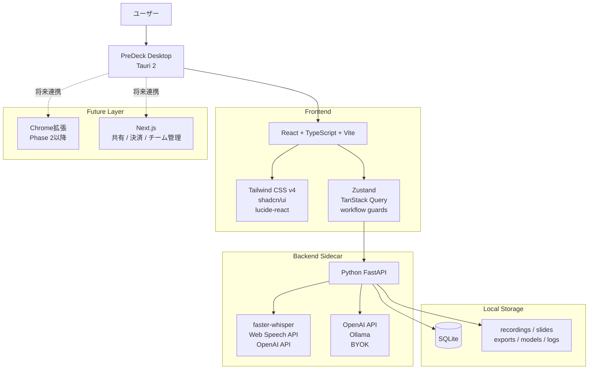

---

## 1. 各AI意見の統合結果

### 1.1 ChatGPT案から採用するもの

ChatGPT案は、技術構成とプロダクト全体設計が最も安定していたため、最終決定の土台とする。

採用する点:

- Tauri 2 + React + TypeScript + Vite
- Tailwind CSS v4 + shadcn/ui
- Zustand + TanStack Query
- Python FastAPI sidecar
- SQLite + ローカルファイル保存
- Chrome拡張は初期MVPでは作らない
- Next.jsは共有・決済・チーム管理など将来Web用に分離
- スコアは初期段階では勝率パーセントではなくチェックリスト形式
- 反復改善ループをUXの中心に置く

修正して採用する点:

- 完全な3ペイン固定ではなく、右AIコーチを折りたたみ可能にする
- 5ステップは完全廃止せず、進捗補助として残す

---

### 1.2 Gemini案から採用するもの

Gemini案は、UX思想、集中モード、段階的開示の考え方が優れている。

採用する点:

- 録音中・練習中は余計な情報を減らす
- 分析結果は最初から全部見せず、必要に応じて展開する
- デザインは「Professional Clarity & Growth」を重視する
- ユーザーに自信を与えるフィードバックを優先する
- AI差分には「なぜ直したか」を添える
- QRコード連携をスマホ用プロンプター/確認導線として活かす

そのまま採用しない点:

- 単純な2ペイン固定
- 技術スタックの詳細不足

---

### 1.3 Claude案から採用するもの

Claude案は、既存実装の限界と実装改善の指摘が最も鋭い。

採用する点:

- ステップ遷移に `canEnter` ガードを設ける
- グローバルな巨大 `state` を整理する
- 設定モーダルをオンボーディングウィザードへ分離する
- 分析パネルをプリセット別に絞る
- テレプロンプターは独立モード/フルスクリーン化する
- SQLiteへ移行する
- 既存FastAPI資産は捨てずに活かす
- Windows .msi 配布を初期対象にする
- faster-whisper を優先検討する

そのまま採用しない点:

- SvelteKit第一推奨
- Drizzle ORM前提
- 2ペイン前提


### 図1-1: 各AI案の統合方針

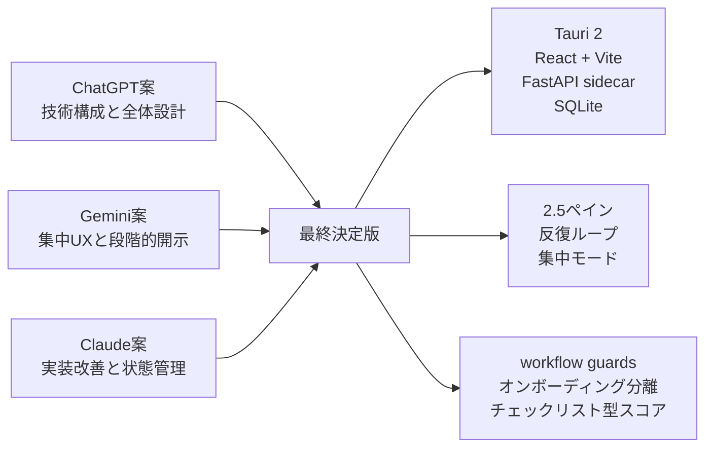

---

## 2. 主要論点の最終決定

---

## 2.1 React vs SvelteKit

### 最終決定

**React + TypeScript + Vite を採用する。**

### 理由

SvelteKit はコード量が少なく、リアクティブUIを短く書ける点で魅力がある。特に録音タイマー、音量メーター、テレプロンプターのようなUIでは有利である。

しかし、PreDeck は将来的に以下を扱う。

- 複雑な分析ダッシュボード
- 差分比較エディタ
- テレプロンプター
- 圧迫ピッチチャット
- 成長グラフ
- Chrome拡張
- 共有レビューWeb
- 決済
- チーム管理
- Enterprise機能

この拡張性を考えると、Reactエコシステムのほうが安全である。

| 観点 | React + Vite | SvelteKit |
|---|---:|---:|
| UIライブラリの豊富さ | ◎ | ○ |
| shadcnとの相性 | ◎ | ○ |
| グラフ/分析系 | ◎ | ○ |
| エディタ系 | ◎ | ○ |
| Chrome拡張との共有 | ◎ | ○ |
| Next.js連携 | ◎ | △ |
| 採用・外注・相談のしやすさ | ◎ | △〜○ |
| コードの短さ | ○ | ◎ |

### 判断

短期の書きやすさより、長期の保守性・採用性・周辺ライブラリの強さを優先し、Reactを正式採用する。


### 図2-1: React採用判断の構造

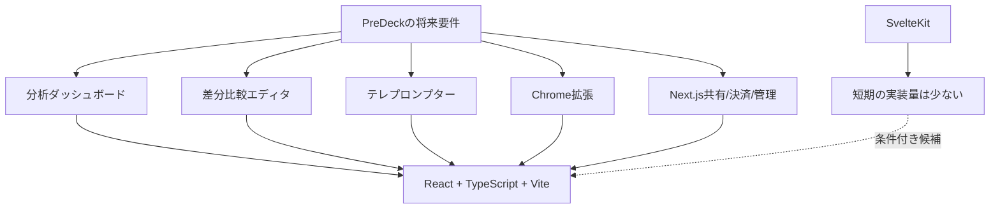

---

## 2.2 2ペイン vs 3ペイン

### 最終決定

**2.5ペイン・ワークベンチ構成を採用する。**

```text
┌──────────────┬──────────────────────────┬────────────────────┐
│ 左：スライド   │ 中央：作業                 │ 右：AIコーチ          │
│ 固定           │ 録音 / 編集 / 練習          │ 折りたたみ可能         │
└──────────────┴──────────────────────────┴────────────────────┘
```

### 各ペインの役割

| ペイン | 役割 |
|---|---|
| 左ペイン | スライド表示、ページ移動、スライド別原稿、PowerPoint連携 |
| 中央ペイン | 録音、文字おこし、原稿編集、AI改善、練習、テレプロンプター |
| 右ペイン | AIコーチ、改善提案、構造診断、ピッチチェック、次アクション |

### 完全3ペインにしない理由

初回ユーザーにとって、PreDeckは設定・録音・分析・改善・練習が多機能である。最初から3ペインを常時表示すると、情報過多になりやすい。

### 単純2ペインにしない理由

原稿改善画面では、以下が同時に関係する。

- 自分の原稿
- AI改善原稿
- 差分
- 改善理由
- ピッチスコア
- 構造診断
- 次の改善アクション

これらを2ペインに詰め込むと、編集と評価が混ざり、使いにくくなる。

### 表示ルール

| 状態 | 右AIコーチ |
|---|---|
| 初回セットアップ | 非表示 |
| スライド設定 | 折りたたみ |
| 録音中 | 非表示 |
| 文字おこし確認 | 軽く表示 |
| 原稿改善 | 展開 |
| 通常練習 | 非表示 |
| 振り返り | 展開 |


### 図2-2: 2.5ペイン表示制御

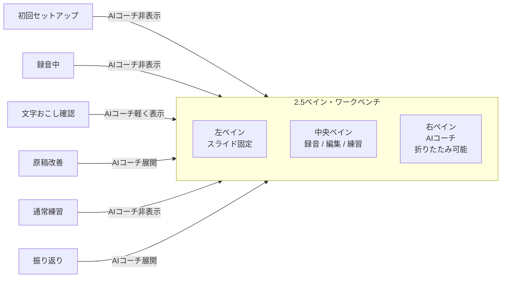

---

## 2.3 5ステップUI vs 反復ループUI

### 最終決定

**反復ループを主役にし、5ステップは補助ナビゲーションとして残す。**

### 表現方針

従来の見せ方:

```text
① スライド → ② 録音 → ③ 文字おこし → ④ 原稿改善 → ⑤ 練習
```

新しい見せ方:

```text
Round 1: 話す → 直す → もう一度話す
Round 2: さらに磨く
Round 3: 本番前確認
```

UI上は、中央ペイン上部に現在の `Round N` を大きく表示し、その下に細い5ステップ進捗ドットを表示する。

```text
Round 2　前回より +12pt 改善
[スライド] ─ [録音] ─ [文字おこし] ─ [原稿改善] ─ [練習]
```


### 図2-3: 反復ループと5ステップの関係

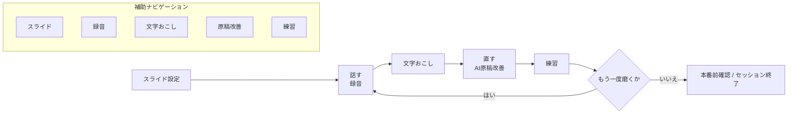

### 理由

PreDeckの本質は、1回で原稿を完成させることではなく、反復によって「通る状態」に近づけることである。したがって、線形ステップよりも反復ループを体験の中心に置く。

---

## 2.4 Chrome拡張の扱い

### 最終決定

**初期MVPでは作らない。Phase 2以降に作る。**

### 理由

Chrome拡張は、Google Slides連携や無料導線として重要である。しかし、Manifest V3の制約により、録音・AI処理・全体最適化を担わせるべきではない。

初期に最優先すべきは、デスクトップ本体の反復ループである。

### 開発順序

1. デスクトップ本体の反復ループを完成
2. セッション保存・再練習・差分改善を安定化
3. α版ユーザーでUX検証
4. Chrome拡張を無料導線として追加

### 将来構成

| 領域 | 技術 |
|---|---|
| Chrome拡張 | WXT + React |
| 役割 | Google Slides取り込み、簡易プレビュー、1スライドAI修正、ローカルアプリ起動誘導 |
| 本格処理 | デスクトップアプリ側で実行 |


### 図2-4: Chrome拡張の位置付け

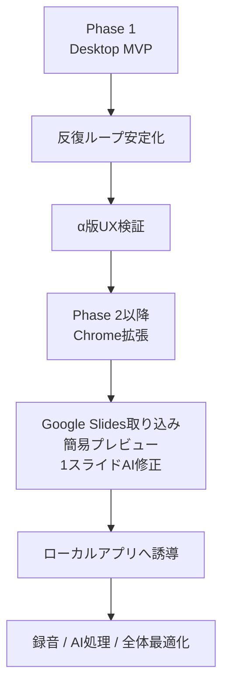

---

## 2.5 Next.jsの扱い

### 最終決定

**デスクトップ本体には使わない。将来のWeb機能用に分離する。**

### Next.jsを使う領域

- 公式LP
- 共有レビュー画面
- Stripe決済
- ライセンス管理
- チーム管理
- Enterprise管理画面
- メンター/上司による非同期フィードバック

### 本体に使わない理由

PreDeck本体はローカルファーストであり、録音・ファイル処理・Whisper・Ollama・ローカル保存が中心である。SSRやWebアプリ基盤の恩恵は小さい。

---

## 3. 最終技術スタック

---

## 3.1 デスクトップ

| 用途 | 技術 |
|---|---|
| ランタイム | Tauri 2 |
| OS連携 | Tauri commands / Rust |
| ファイル選択 | Tauri dialog plugin |
| 通知 | Tauri notification plugin |
| 自動更新 | Tauri updater |
| 秘密情報 | OS keychain / Tauri plugin |
| 初期配布 | Windows .msi |
| 将来対応 | macOS / Linux |

---

## 3.2 フロントエンド

| 用途 | 技術 |
|---|---|
| UI | React 19 |
| 言語 | TypeScript |
| ビルド | Vite |
| スタイル | Tailwind CSS v4 |
| UIコンポーネント | shadcn/ui |
| アイコン | lucide-react |
| 状態管理 | Zustand |
| API状態 | TanStack Query |
| フォーム | React Hook Form + Zod |
| グラフ | Recharts |
| 差分表示 | diff-match-patch または jsdiff |
| 原稿エディタ | 初期は textarea / contenteditable、将来 TipTap |
| 通知 | sonner |
| キーボード操作 | 独自hook または hotkeys-js |

---

## 3.3 バックエンド

| 用途 | 技術 |
|---|---|
| API | Python FastAPI |
| 起動形態 | Tauri sidecar |
| 非同期処理 | asyncio / BackgroundTasks |
| ストリーミング | Server-Sent Events |
| DB | SQLite |
| ORM | SQLModel または SQLAlchemy |
| 音声変換 | ffmpeg |
| 文字起こし | faster-whisper 優先 / openai-whisper / OpenAI API |
| PDF処理 | PyMuPDF |
| PPTX処理 | LibreOffice headless / PowerPoint連携 |
| AI処理 | OpenAI API / Gemini API / Ollama |
| 配布 | PyInstaller または Nuitka |


### 図3-1: Tauri と FastAPI sidecar の責務分離

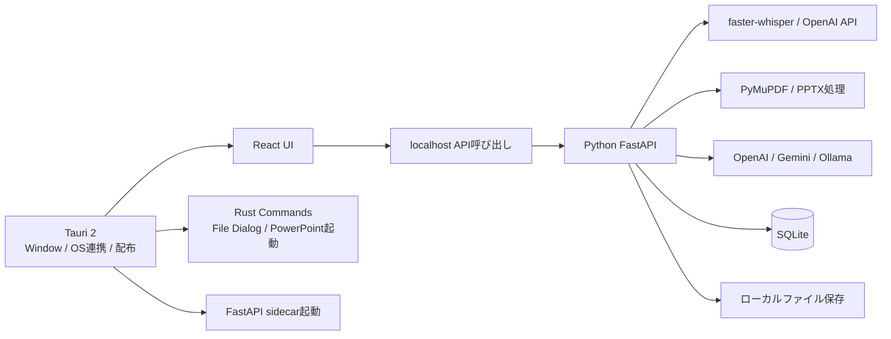

---

## 3.4 ローカルデータ保存

### SQLiteテーブル案

| テーブル | 内容 |
|---|---|
| sessions | セッション基本情報 |
| iterations | 練習回数ごとの記録 |
| slides | スライド画像・ファイル参照 |
| slide_timings | スライド切替タイミング |
| transcripts | 文字おこし本文 |
| scripts | ユーザー原稿・AI改善原稿 |
| analyses | フィラー、WPM、構造診断、スコア等 |
| settings | 文字起こし・AI・UI設定 |
| exports | レポート出力履歴 |

### ローカルファイル保存案

```text
PreDeckData/
├─ recordings/
│  └─ {session_id}/{iteration_id}.webm
├─ slides/
│  └─ {session_id}/slide_001.png
├─ originals/
│  └─ {session_id}/source.pptx
├─ exports/
│  └─ reports/
├─ models/
│  └─ whisper/
└─ logs/
```


### 図3-2: SQLite とローカルファイルの関係

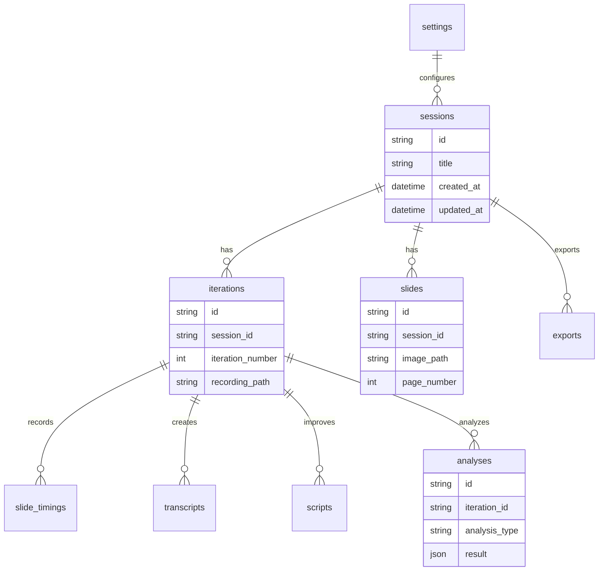

---

## 4. UI/UX最終方針

---

## 4.1 デザインコンセプト

正式コンセプト:

> **Calm Decision Cockpit**  
> 落ち着いて、通すための判断と改善に集中できるコックピット

補助コンセプト:

> **Professional Clarity & Growth**  
> プロらしい明快さと、成長の手応え

---

## 4.2 デザイントーン

| 項目 | 方針 |
|---|---|
| ベース | 白〜薄いグレー |
| メインカラー | Deep Navy / Indigo / Blue |
| AIインサイト | Violet / Purple |
| 成功・改善 | Green / Emerald |
| 注意 | Amber |
| 圧迫・警告 | Red / Rose |
| 角丸 | 12〜16px |
| 影 | 弱め |
| 日本語フォント | Noto Sans JP |
| 英数字 | Inter |
| アイコン | lucide-react |

### 避ける表現

- 派手なゲーム風演出
- スコアだけを大きく見せるダッシュボード
- 色だけで意味を伝えるUI
- 初回から詳細設定を大量表示するUI
- 「勝率72%」のような根拠が弱い確率表示

---

## 4.3 画面構成

### ホーム画面

目的:

- 新規セッション開始
- 過去セッション再開
- 目的別テンプレート選択

推奨構成:

```text
上部: PreDeckロゴ + ブランドコピー
中央: 大きな「新しい練習を始める」ボタン
下部: 目的別テンプレート
右側: 最近のセッション
```

目的別テンプレート:

- VCピッチ
- 社内稟議
- 学会発表
- 面接対策
- LT
- スライドなしで練習

---

### 作業画面

基本構成:

```text
┌────────────────────────────────────────────┐
│ Header: Round N / 進捗 / 設定 / ホーム       │
├──────────────┬────────────────┬────────────┤
│ Slide Pane   │ Main Work Pane  │ AI Coach   │
│              │                 │ collapsible│
└──────────────┴────────────────┴────────────┘
```


### 図4-1: 作業画面の主要コンポーネント構成

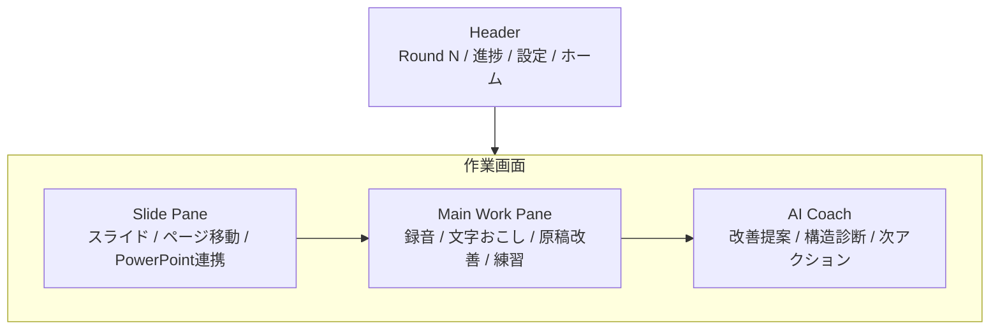

---

### ステップ1: スライド設定

優先表示:

1. 何のためのプレゼンか
2. スライドを入れるか、スライドなしで進むか
3. 目標時間
4. 言語

方針:

- 目的選択を先に出す
- 詳細設定は隠す
- 初回はおすすめ設定で進める

---

### ステップ2: 録音

方針:

- 集中モード
- 大きな録音ボタン
- タイマーを大きく表示
- スライドと現在原稿だけを表示
- 分析・スコア・詳細設定は隠す

表示するもの:

- スライド
- 録音ボタン
- 経過時間
- スライド切替ログ
- 音量メーター
- キーボードショートカット

表示しないもの:

- ピッチスコア
- 詳細分析
- 構造診断
- 設定項目
- AI改善提案

---

### ステップ3: 文字おこし確認

方針:

- 文字おこし編集を中央に置く
- 右AIコーチに検出された問題だけを要約表示
- 分析ボタンを全表示しない

右AIコーチ例:

```text
検出された改善候補
- フィラーが12件あります
- 3枚目が早口です
- 「〜だと思います」が多いです
- 結論が最後まで出ていません
```

---

### ステップ4: 原稿改善

PreDeckの価値が最も出る画面である。

推奨レイアウト:

```text
中央:
┌ 自分の原稿 ┐ ┌ AI改善案 ┐
│ 編集可能   │ │ 提案表示   │
└──────────┘ └──────────┘

右AIコーチ:
┌ 改善理由 ┐
│ 1. 結論を前に移動
│ 2. 弱気表現を言い切りに変更
│ 3. 5分以内に圧縮
└────────┘
```

必須要素:

- 自分の原稿
- AI改善案
- 差分表示
- 改善理由
- AI→自分の原稿へ反映
- コピー
- 保存
- QR転送

---

### ステップ5: 練習モード

ステップ5は機能が多いため、タブではなくモードで分ける。

```text
[通常練習] [テレプロンプター] [圧迫ピッチ] [振り返り]
```

| モード | 内容 |
|---|---|
| 通常練習 | スライド + 原稿 + 録音 |
| テレプロンプター | 大文字原稿 + 自動スクロール + 声追従 |
| 圧迫ピッチ | 質問チャット + 回答 + 評価 |
| 振り返り | 成長グラフ + 改善点 + 次回練習 |

### テレプロンプター

通常練習画面に埋め込まず、独立モードまたはフルスクリーン表示にする。

### 圧迫ピッチ

初期MVPでは任意。VCピッチ用途で優先実装する。

---

## 5. スコア・分析方針

---

## 5.1 初期は勝率パーセントを出さない

禁止例:

```text
資金調達成功率: 72%
```

初期採用例:

```text
総合評価: B

通すために足りないもの
1. 冒頭で結論が弱い
2. 競合比較が不足
3. 市場規模の根拠が薄い
4. 最後の依頼が曖昧
```

理由:

- 初期段階では予測モデルの根拠が不足する
- 確率表示は信頼を損ねる可能性がある
- ユーザーには「何を直せばよいか」が重要

---

## 5.2 プリセット別に分析を絞る

| プリセット | 最初に見せる分析 |
|---|---|
| VCピッチ | 構造診断、勝率チェック、圧迫質問、市場規模、競合比較 |
| 社内稟議 | 結論、根拠、リスク、費用対効果、承認依頼 |
| 学会発表 | 論理構造、方法論、専門用語、話速 |
| 面接 | 弱気ワード、自信スコア、想定質問 |
| LT | 時間、つかみ、締め、テンポ |
| 英語初心者 | Speakable English、短文化、強調語、発音難易度 |
| 本番直前 | プロンプターのみ |


### 図5-1: プリセット別の分析出し分け

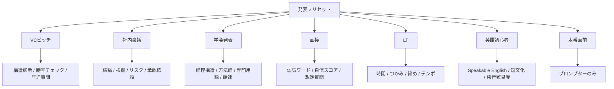

---

## 6. ステップ遷移ガード

既存設計では任意ステップへ移動できるが、新規実装では入場条件を設ける。

| ステップ | 入場条件 |
|---|---|
| スライド設定 | 常に可 |
| 録音 | セッション作成済み |
| 文字おこし | 録音済み、または復元済み文字おこしあり |
| 原稿改善 | 文字おこし本文あり |
| 練習 | 自分の原稿、またはAI改善原稿あり |

ガード方針:

- 戻る操作は原則許可
- 進む操作は条件付き
- 条件を満たさない場合は、理由と次アクションを表示

例:

```text
まだ文字おこしがありません。
先に録音を完了するか、原稿を直接入力してください。
```


### 図6-1: ステップ遷移ガード

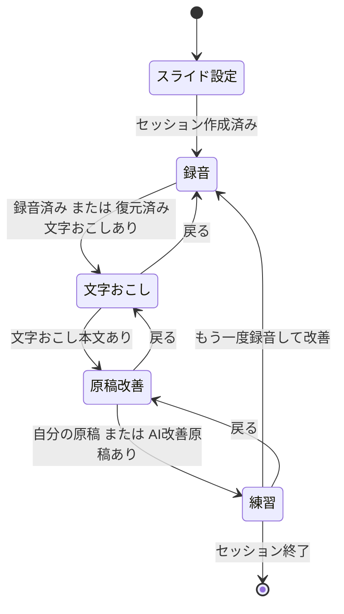

---

## 7. オンボーディングと設定

---

## 7.1 初回オンボーディング

初回起動時は設定モーダルではなく、ウィザード形式にする。

推奨フロー:

1. 利用目的を選ぶ
2. 文字おこし方法を選ぶ
3. AI方法を選ぶ
4. マイクテスト
5. AIテスト
6. 最初の練習へ


### 図7-1: 初回オンボーディングフロー

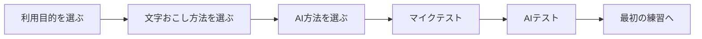

---

## 7.2 設定画面の分離

| 用途 | 画面 |
|---|---|
| 初回セットアップ | オンボーディングウィザード |
| 通常利用中の変更 | 軽量設定 |
| トラブル対応 | 詳細セットアップ |
| 開発者向け | Advanced設定 |

---

## 8. 開発フェーズ

---

## Phase 0: 技術検証

目的:

- Tauri + React + FastAPI sidecar の最小構成を確認

実装:

- Tauri起動
- React画面表示
- FastAPI sidecar起動
- `/api/status` 疎通
- ローカルファイル選択
- SQLite接続

完了条件:

- Windows上で `.msi` 相当の配布見込みが立つ
- FastAPIがTauriから安定起動する

---

## Phase 1: MVP

目的:

- コア価値である反復ループを完成させる

実装:

1. セッション作成
2. スライドアップロード
3. 録音
4. 文字おこし
5. AI原稿改善
6. 差分表示
7. 練習モード
8. セッション保存
9. 再録音によるイテレーション

後回し:

- Chrome拡張
- 決済
- 共有URL
- チーム管理
- カメラ解析
- 発音トレーニング
- 本番リアルタイムアシスト

---

## Phase 2: α版改善

目的:

- 継続利用と有料化前の価値を強める

実装:

- ピッチチェックリスト
- 構造診断
- WPM分析
- 弱気ワード検出
- フィラー検出
- 成長グラフ
- 設定ウィザード
- Ollama / OpenAI 切替
- レポート出力
- QR転送強化

---

## Phase 3: 差別化機能

実装:

- 圧迫ピッチモード
- 英語変換
- Speakable English
- テレプロンプター声追従
- Chrome拡張
- 共有レビュー

---

## Phase 4: 事業化・Enterprise

実装:

- Stripe決済
- Next.js管理画面
- チーム管理
- メンター/上司の非同期フィードバック
- Enterprise向け勝ちパターン学習
- PowerPoint / Keynote連携強化


### 図8-1: 開発フェーズロードマップ

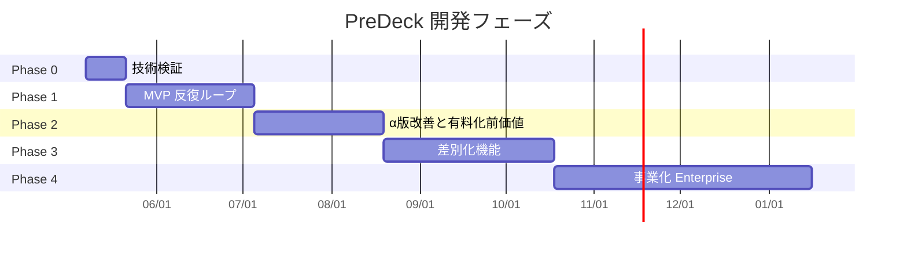

---

## 9. 採用・条件付き採用・不採用

---

## 9.1 採用

- Tauri 2
- React + TypeScript + Vite
- Tailwind CSS v4
- shadcn/ui
- lucide-react
- Zustand
- TanStack Query
- Python FastAPI sidecar
- SQLite
- faster-whisper
- OpenAI API / Ollama / BYOK
- 2.5ペインUI
- 折りたたみAIコーチ
- オンボーディングウィザード
- ステップガード
- チェックリスト型スコア
- Windows .msi 先行配布

---

## 9.2 条件付き採用

### SvelteKit

個人開発で「最短・最少コード」を最優先する場合は候補になる。  
ただし、PreDeckでは長期保守・拡張・外注・Reactエコシステム活用を優先し、正式採用しない。

### Next.js

デスクトップ本体には使わない。  
共有レビュー、決済、LP、チーム管理画面で使う。

### Electron

TauriでOS連携や配布に詰まった場合の保険。  
最初の本命ではない。

### XState

workflow guards が複雑化した場合に導入する。  
初期は Zustand 内の明示的なガード関数で十分。

### TipTap

原稿編集が高度化した段階で導入する。  
初期は textarea / contenteditable で十分。

---

## 9.3 不採用

- 初期からChrome拡張中心で作る
- 初期からNext.js Webアプリ中心で作る
- Electronを第一候補にする
- SvelteKitを正式スタックにする
- 設定項目を初回画面に大量表示する
- 分析ダッシュボードを主役にする
- 勝率パーセントを初期表示する
- テレプロンプターを通常練習画面に詰め込む
- JSONファイルだけでセッション履歴を管理する

---

## 10. 初期実装の推奨順序

### Step 1: 最小Tauri構成

- Tauri 2
- React + Vite
- TypeScript
- Tailwind
- shadcn/ui 最小導入
- FastAPI sidecar起動

### Step 2: データモデル

- SQLite作成
- sessions
- iterations
- transcripts
- scripts
- analyses

### Step 3: コア画面

- ホーム
- 作業画面
- 2.5ペインレイアウト
- Round表示
- ステップ進捗ドット

### Step 4: 録音

- MediaRecorder
- タイマー
- 音量メーター
- スライド切替ログ
- 録音ファイル保存

### Step 5: 文字おこし

- faster-whisper接続
- Web Speech API fallback
- 文字おこし編集
- セッション保存

### Step 6: AI改善

- OpenAI API / Ollama切替
- AI改善原稿
- 差分表示
- 改善理由
- AI→自分原稿反映

### Step 7: 練習ループ

- 練習モード
- 再録音
- iteration追加
- 前回比表示


### 図10-1: 初期実装の依存関係

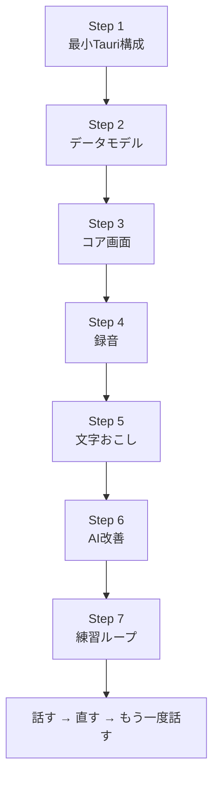

---

## 11. 品質基準

### UX品質

- 初回ユーザーが迷わず録音まで到達できる
- 録音中に余計な情報が出ない
- 原稿改善画面で「何がどう良くなったか」が分かる
- 再練習への導線が明確
- スコアより改善アクションが前に出る

### 技術品質

- FastAPI sidecar が安定起動する
- 録音ファイルがローカルに保存される
- セッション復元ができる
- イテレーション履歴がSQLiteで追える
- APIキーは安全に保存される
- オフライン構成を将来実現できる

### 配布品質

- Windowsでインストールできる
- 一般ユーザーが開発環境なしで起動できる
- Whisper / Ollama 未設定時に分かりやすく案内できる

---

## 12. 最終決定サマリー

PreDeckの新規開発では、以下を正式決定とする。

```text
Desktop Runtime: Tauri 2
Frontend: React + TypeScript + Vite
UI: Tailwind CSS v4 + shadcn/ui + lucide-react
State: Zustand + TanStack Query + workflow guards
Backend: Python FastAPI sidecar
Speech: faster-whisper / Web Speech API / OpenAI API
AI: OpenAI API / Ollama / BYOK
Database: SQLite + local file storage
Layout: 2.5-pane workbench
UX: Talk → Improve → Practice loop
Chrome Extension: Phase 2 or later
Web/Payment/Team: Next.js later
Initial Distribution: Windows .msi
```


### 図12-1: 最終決定スタックの階層

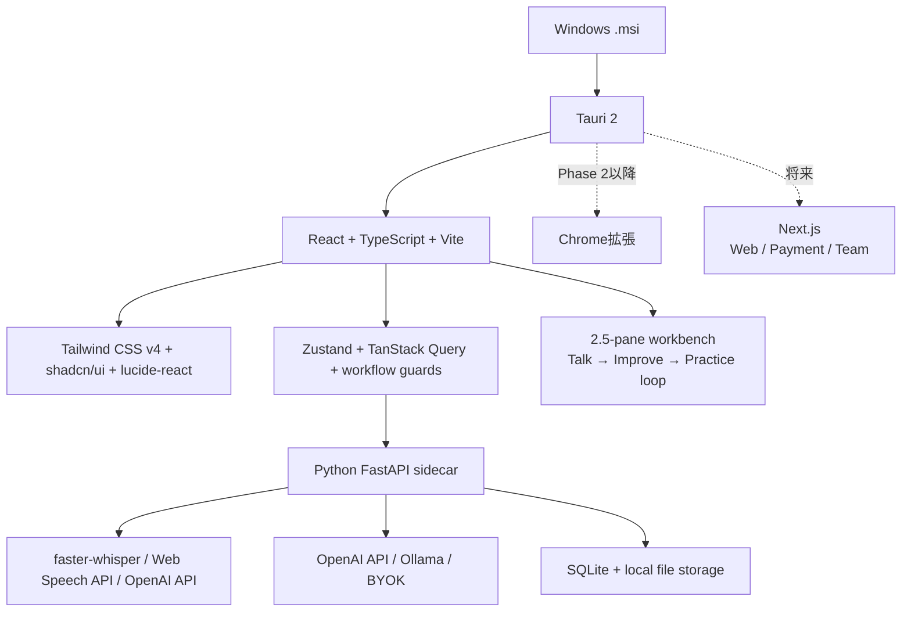

最終方針:

> **React案を正式採用し、Claude案の実装改善、Gemini案の集中UXを統合する。**  
> PreDeckは、分析ダッシュボードではなく、ユーザーが「通るプレゼン」に近づくための反復コーチングアプリとして作る。

---

## 13. 次に作るべきもの

次に作るべきは、機能一覧ではなく **画面と状態の骨格** である。

最初の実装対象:

1. Tauri + React + FastAPI の雛形
2. ホーム画面
3. 2.5ペイン作業画面
4. Round表示 + ステップ進捗
5. セッション作成
6. 録音ボタン
7. 録音ファイル保存
8. 文字おこしAPI接続

この段階で、PreDeckの核である「話す→直す→もう一度話す」の入口が成立する。
