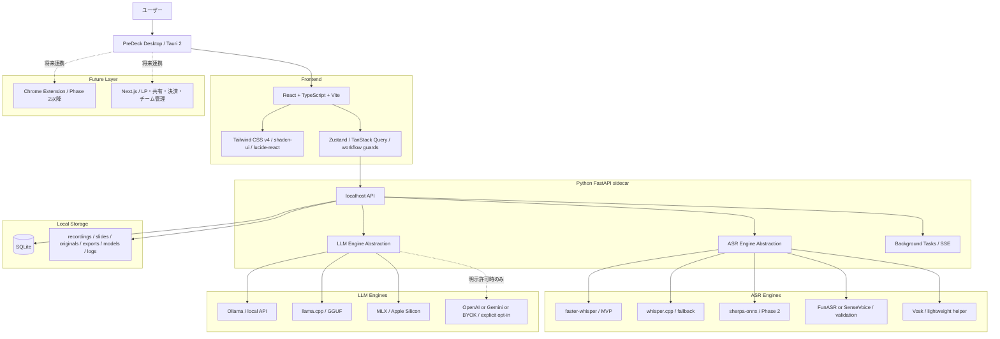

# PreDeck（プレデキ）要件定義書 Ver7.0（完全統合版）

---

## 0. ドキュメント情報

| 項目 | 内容 |
|---|---|
| プロダクト正式名称 | **PreDeck**（プレデック） |
| 日本愛称 | **プレデキ**（プレゼンできてく） |
| バージョン | **7.0（Ver6.0 + 2026-05-07/2026-05-08 技術調査・統合設計・外部確認反映版）** |
| 作成日 | 2026-05-08 |
| 位置付け | 要件定義、技術選定、UI/UX、ローカルASR、ローカルLLM、ライセンス方針を統合した実装前提版 |
| 基本方針 | Ver6.0のプロダクト要件を保持し、新資料で明示的に更新された技術・UI・配布・ライセンス判断のみ上書きする |

### 0.1 統合優先順位

矛盾がある場合は、次の順に優先する。

1. `PreDeck_統合設計書_20260508.md`
2. `PreDeck_技術調査統合_ASR_LLM_20260508.md`
3. `PreDeck_外部事実確認ログ_20260508.md`
4. `PreDeck_原文保持アーカイブ_20260508.md`
5. `技術選定_UIUX設計決定書_Mermaid追加版_20260507.md`
6. `ローカルLLM_調査資料_20260507.md`
7. `ローカル音声認識_調査資料_20260507.md`
8. `PreDeck 要件定義書 Ver6.0（完全統合版）.md`

ただし、Ver6.0にしか存在しない背景、GTM、価格、KPI、アクセシビリティ、ローカライゼーション、長期ビジョン、競合分析、機能要求は削除せず保持する。

### 0.2 ハルシネーション防止ルール

- 添付資料に存在しない仕様は、確定仕様として書かない。
- 実装上必要だが資料に明記がないものは、`要確認`、`未決事項`、`AIエージェントによる補完可`、`AIエージェントによる補完不可、人間確認必須` のいずれかに分類する。
- 外部技術情報は公式ドキュメント、GitHub公式リポジトリ、PyPI/npm/Hugging Face等の一次情報を優先する。
- モデル性能、速度、メモリ目安、日本語品質、商用配布可否は、公開情報だけで最終確定せず、実機検証・ライセンス台帳確認を必須とする。

参照元:
- PreDeck 要件定義書 Ver6.0（完全統合版）.md
- ローカルLLM_調査資料_20260507.md
- ローカル音声認識_調査資料_20260507.md
- 技術選定_UIUX設計決定書_Mermaid追加版_20260507.md
- PreDeck_外部事実確認ログ_20260508.md
- PreDeck_技術調査統合_ASR_LLM_20260508.md
- PreDeck_原文保持アーカイブ_20260508.md
- PreDeck_統合設計書_20260508.md

---

## 1. ブランド・プロダクトビジョン

### 1.1 ブランドメッセージ

| 市場 | キャッチコピー |
|---|---|
| 日本 | 「話すだけで、プレゼンできてく。—— PreDeck（プレデキ）」 |
| グローバル | "Just talk. Your Pitch Deck is ready. —— PreDeck" |
| グローバル代替 | "Talk your ideas. We build your Deck. —— PreDeck" |

### 1.2 名称に込めた意味

- **Pre**sentation + **Deck**
- **Pre**pare your deck
- **Pre**fect your deck
- **Pre**（事前）に整える

### 1.3 本質

PreDeckは単なるスピーチ練習アプリではなく、ユーザーが意思決定者に対してプレゼンを「通す」ための **意思決定突破ツール（Decision Breakthrough Engine）** である。

ユーザーが目指すのは「上手に話すこと」ではなく、資金調達、稟議、採択、採用、合意形成などの意思決定を **通すこと** である。

### 1.4 戦略的差別化

既存のスピーチコーチ、発音アプリ、翻訳アプリとは異なり、PreDeckは次の4要素を統合する。

| 差別化軸 | 内容 |
|---|---|
| 意思決定突破 | 原稿、構造、根拠、CTA、質疑応答まで含めて「通る」状態へ近づける |
| 英語適応 | 単なる翻訳ではなく、英語圏の主張構造・文化文脈に合わせる |
| 即応耐性 | 圧迫質問、割り込み、想定質問に耐える訓練を行う |
| 成長可視化 | 練習回数、スコア、フィラー、弱気ワード、構造改善を履歴化する |

### 1.5 ユーザージャーニー

```text
Stage 1: 話せるようになる（A層・入口）
  - フィラー除去
  - ペース可視化
  - 構造診断

Stage 2: 通せるようになる（A層・深化）
  - チェックリスト型ピッチ評価
  - 圧迫モード
  - 想定質問生成

Stage 3: 英語で戦えるようになる（B層）
  - 日本語→英語変換
  - Speakable English
  - 発音トレーニング
  - 文化適応解析
```

---

## 2. ターゲット戦略

### 2.1 対応領域（最終到達点）

PreDeckは以下のプレゼンシーンに対応する。

- VCピッチ
- 大企業社内稟議
- 学会発表・研究助成金申請
- 採用面接
- IR説明会
- 起業家コミュニティ内発表

### 2.2 GTM戦略（最初の勝ちパターン）

初期GTMは **VCピッチ × 起業家コミュニティ** を第1ターゲットにする。

| 選定理由 | 詳細 |
|---|---|
| 強い課題感 | 資金調達がかかっており、改善への金銭的インセンティブが強い |
| 短時間勝負 | 5〜10分で評価が決まるため、練習アプリとの相性がよい |
| 圧迫質問の存在 | 投資家からの鋭い質問に備える需要が自然に発生する |
| SNS拡散性 | 起業家層は発信力が高く、バイラルループを作りやすい |

---

## 3. Ver7.0での最終プロダクト方針

### 3.1 中核UX

新資料の統合判断により、Ver7.0では **5ステップ主導UI** を正式採用する。

```text
1. スライド設定 → 2. 録音 → 3. 文字おこし確認 → 4. 原稿改善 → 5. 練習
```

反復ループは5ステップを置き換えるのではなく、5ステップを1ラウンドとして繰り返す改善サイクルとして扱う。

```text
Round 1: 5ステップを一通り実行
Round 2: 前回の改善点を反映して再実行
Round 3: 本番前確認として必要なステップだけ再実行
```

### 3.2 最終技術方針

| 領域 | Ver7.0での決定 |
|---|---|
| アプリ形態 | ローカルファーストのデスクトップアプリ |
| 初期配布 | Windows `.msi` |
| ランタイム | Tauri 2 |
| フロントエンド | React + TypeScript + Vite |
| UI | Tailwind CSS v4 + shadcn/ui + lucide-react |
| 状態管理 | Zustand + TanStack Query + workflow guards |
| バックエンド | Python FastAPI sidecar |
| データ保存 | SQLite + ローカルファイル保存 |
| 画面構成 | 2.5ペイン・ワークベンチ |
| ASR既定 | faster-whisper |
| ASR代替 | whisper.cpp |
| ASR将来拡張 | sherpa-onnx / FunASR / SenseVoice / Vosk |
| Web Speech API | ローカル完結版では不採用 |
| OpenAI API / Google / Azure ASR | ローカル完結版では不採用。ユーザー明示許可時のみ |
| LLM既定 | ローカルLLM / Ollama等 |
| LLM標準モデル | Qwen3.5-9B |
| LLM軽量モデル | Gemma 4 E4B または Bonsai-8B |
| LLM高品質モデル | Gemma 4 26B-A4B |
| LLM推論診断 | gpt-oss-20b |
| クラウドAI / BYOK | 明示許可モードのみ |
| Chrome拡張 | 初期MVPでは作らない。Phase 2以降 |
| Next.js | デスクトップ本体には使わず、将来のLP、共有、決済、チーム管理用 |

参照元:
- PreDeck_統合設計書_20260508.md
- PreDeck_技術調査統合_ASR_LLM_20260508.md
- 技術選定_UIUX設計決定書_Mermaid追加版_20260507.md
- 外部確認: Tauri 2.0 Stable Release: https://v2.tauri.app/blog/tauri-20/
- 外部確認: Tauri Windows Installer: https://v2.tauri.app/distribute/windows-installer/

---

## 4. アーキテクチャ要件

### 4.1 全体構成



### 4.2 Strict Local Mode

MVPではStrict Local Modeを既定にする。

```json
{
  "strict_local_mode": true,
  "allow_cloud_asr": false,
  "allow_cloud_llm": false,
  "allow_model_download": false,
  "allowed_hosts": ["127.0.0.1", "localhost"]
}
```

#### 禁止事項

- Web Speech APIをローカルASRとして扱うこと
- OpenAI API音声認識
- Google Speech
- Azure Speech
- Gemini API
- Hugging Face Hubからの本番動作中の自動モデル取得
- 外部URLからの本番動作中モデル取得
- 外部LLMへの原稿改善依頼
- ユーザーが明示許可していない外部通信

#### 許可事項

- ローカルファイル読み書き
- SQLite
- `127.0.0.1`
- `localhost`
- Ollama等のローカルLLM
- ローカルASRモデル
- ユーザーがインポート済みのモデルファイル

参照元:
- PreDeck_統合設計書_20260508.md
- PreDeck_技術調査統合_ASR_LLM_20260508.md
- 外部確認: Microsoft Edge SpeechRecognitionEnabled policy: https://learn.microsoft.com/en-us/deployedge/microsoft-edge-browser-policies/speechrecognitionenabled

---

## 5. UI/UX要件

### 5.1 デザインコンセプト

| 区分 | 内容 |
|---|---|
| 正式コンセプト | **Calm Decision Cockpit** |
| 意味 | 落ち着いて、通すための判断と改善に集中できるコックピット |
| 補助コンセプト | **Professional Clarity & Growth** |
| 意味 | プロらしい明快さと、成長の手応え |

### 5.2 画面構成

2.5ペイン・ワークベンチを採用する。

```text
┌──────────────┬──────────────────────────┬────────────────────┐
│ 左：スライド   │ 中央：作業                 │ 右：AIコーチ          │
│ 固定           │ 録音 / 編集 / 練習          │ 折りたたみ可能         │
└──────────────┴──────────────────────────┴────────────────────┘
```

| ペイン | 役割 |
|---|---|
| 左ペイン | スライド表示、ページ移動、スライド別原稿、PowerPoint連携 |
| 中央ペイン | 録音、文字おこし、原稿編集、AI改善、練習、テレプロンプター |
| 右ペイン | AIコーチ、改善提案、構造診断、ピッチチェック、次アクション |

### 5.3 右AIコーチ表示制御

| 状態 | 右AIコーチ |
|---|---|
| 初回セットアップ | 非表示 |
| スライド設定 | 折りたたみ |
| 録音中 | 非表示 |
| 文字おこし確認 | 軽く表示 |
| 原稿改善 | 展開 |
| 通常練習 | 非表示 |
| 振り返り | 展開 |

### 5.4 ステップガード

| ステップ | 入場条件 |
|---|---|
| スライド設定 | 常に可 |
| 録音 | セッション作成済み |
| 文字おこし確認 | 録音済み、または復元済み文字おこしあり |
| 原稿改善 | 文字おこし本文あり |
| 練習 | 自分の原稿、またはAI改善原稿あり |

---

## 6. コア機能要件

### 6.1 Aレイヤー: プレゼン突破エンジン（日本語ベース）

#### 6.1.1 原稿彫刻エンジン

反復練習の核となる「録音 → 文字起こし → AI改善 → 再練習」ループを提供する。

| 機能 | 説明 |
|---|---|
| フィラー除去 | 「えー」「あのー」「まあ」等を検知し、自然な言い替えを提案 |
| 全体時間最適化 | 指定時間に収まるよう文字数・構成を自動調整 |
| 差分ハイライト表示 | AIの修正箇所を追加/削除でハイライト |
| 業界特化トーン変換 | VC、稟議、アカデミア、面接向けに調整 |
| 反復改善 | 全イテレーションを保存・比較し、練習するたびに原稿を磨く |

#### 6.1.2 構造診断エンジン

| チェック項目 | 内容 |
|---|---|
| ストーリーアーク | 導入 → 問題提起 → 解決策 → 根拠 → CTA の流れ |
| WHYの強度 | 「なぜこれが必要なのか」が明確か |
| 問題提起の明確さ | 聴衆が課題を自分ごと化できるか |
| 根拠データの密度 | 数字・事例・権威性の裏付けがあるか |
| 競合比較の網羅性 | 差別化ポイントが伝わるか |
| 将来ビジョン | 聴衆が未来を想像できるか |

出力は、ピラミッド構造の可視化図と改善優先順位リストとする。

#### 6.1.3 ピッチ評価エンジン

初期フェーズでは「63%の確率で通過」のような勝率パーセントを出さず、透明性の高いチェックリスト型評価にする。

| Phase | 方針 |
|---|---|
| Phase 1 | ルールベース。チェックリスト方式でランク・不足項目を示す |
| Phase 2 | ユーザーが「通った/落ちた」フィードバックを入力し成功パターンを蓄積 |
| Phase 3 | 蓄積データでML校正し、予測モデル化を検討 |

対象は、VC/エンジェル投資家、大企業役員、学会審査員、採用面接官を想定する。

#### 6.1.4 話し方・パフォーマンス解析

| 機能 | 説明 |
|---|---|
| 弱気ワード検出 | 「〜だと思います」「たぶん」「〜かもしれない」を検知し、言い切りを提案 |
| WPMペースグラフ | 1分あたり文字数をスライドごとにグラフ化し、早口/遅すぎを指摘 |
| 熱量ヒートマップ | 声の抑揚・大きさを原稿上に色付けし、棒読み箇所を可視化 |
| つまずき検知 | 言い直し・詰まりが多いスライドを自動検知 |
| メタファー自動提案 | つまずき箇所に比喩表現を提案 |

#### 6.1.5 圧迫ピッチモード

プレゼン途中にAI音声でランダムに割り込み質問を挿入し、即応力を訓練する。

| 採点項目 | 内容 |
|---|---|
| 反応速度 | 割り込みへの即応力 |
| 論理維持力 | 回答の論理的整合性 |
| 再開スムーズ度 | 回答後、元のプレゼンに戻れるか |
| 感情コントロール | 動揺せず堂々と対応できたか |

#### 6.1.6 カメラ解析（オプション）

| 機能 | 説明 |
|---|---|
| カメラ目線保持率 | 原稿ばかり見ていないか判定 |
| 原稿依存率 | 画面を見すぎていないか判定 |
| 表情感情分類 | 緊張・自信・無表情を検知 |
| ジェスチャー解析 | 手振りが効果的に使えているか評価 |

カメラ使用は明示的なオプトインとし、デフォルトOFFにする。

### 6.2 Bレイヤー: 英語プレゼン突破エンジン

BレイヤーはPhase 3以降に段階的に追加する。Phase 1〜2では「日本語→英語変換（テキストのみ）」に限定する。

#### 6.2.1 用途別英語変換

| 変換モード | 特徴 |
|---|---|
| VC English | 投資家向け。数字と成長ストーリー重視 |
| Academic English | 学術的。根拠と方法論を明確化 |
| Corporate English | ビジネスフォーマル。意思決定者向け |
| Startup Casual | テックコミュニティ向けのカジュアル表現 |
| TED風 | ストーリーテリング重視。感情に訴える |

#### 6.2.2 Speakable English

- 文の短文化
- 呼吸ポイント表示
- 強調語ハイライト
- 発音難易度表示

#### 6.2.3 発音トレーニング（Phase 4以降）

- 単語レベル
- 文レベル
- 通し練習
- American / British切替
- シャドーイングモード
- スピード可変再生

#### 6.2.4 単語帳システム

- ワンクリック単語登録
- 自動例文生成
- 音声再生
- 発音録音・採点
- 忘却曲線ベースの復習リマインド

#### 6.2.5 崩し言い換えモード

- Very formal
- Business natural
- Startup casual
- Conversational

#### 6.2.6 英語即応力トレーニング

英語での圧迫質問へ即座に切り返す訓練を行う。

例:

- "Wait, I don't understand your market size."
- "How is this different from [competitor]?"

#### 6.2.7 英語文化適応解析

| 検出項目 | 説明 |
|---|---|
| 主張の弱さ | 結論が曖昧ではないか |
| 具体性不足 | 抽象的すぎる表現がないか |
| 自己主張不足 | 成果のアピールが足りないか |
| 回りくどさ | 日本語的な婉曲表現が残っていないか |

### 6.3 共通サポート機能

#### 6.3.1 スマート・プロンプター

完成原稿を表示し、ユーザーの声に合わせて自動ハイライト・スクロールする。

- 読み飛ばしへの対応
- アドリブ挿入時の文脈同期
- 練習モードと本番モードの切替

#### 6.3.2 成長可視化レイヤー

| 可視化項目 | 内容 |
|---|---|
| スコア推移グラフ | 練習回数ごとのスコア変化 |
| 改善率表示 | 前回比での改善ポイント |
| 日本語→英語移行率 | B層への進捗 |
| 自信曲線 | 弱気ワード使用率の推移 |
| 本番直前比較 | 最初の練習と最新練習の差分 |

#### 6.3.3 プリセットモード

| プリセット | 有効モジュール |
|---|---|
| VCピッチ | 全体時間最適化 + 構造診断 + ピッチ評価 + 圧迫モード |
| 稟議プレゼン | 構造診断 + 弱気ワード + 稟議トーン変換 |
| 学会発表 | 構造診断 + ペース解析 + アカデミアトーン変換 |
| 面接対策 | 圧迫モード + 弱気ワード + 自信スコア |
| 英語初心者 | 英語変換 + Speakable English + 発音 |
| 本番直前 | プロンプターのみ |

---

## 7. ASR要件

### 7.1 採用判断

| 用途 | 推奨エンジン | 採用判断 |
|---|---|---|
| MVPの正式文字起こし | faster-whisper | 第一候補 |
| 低スペックPC・配布安定性 | whisper.cpp | 代替候補 |
| リアルタイム字幕・声追従 | sherpa-onnx | Phase 2以降 |
| 日本語精度の追加検証 | FunASR / SenseVoice | 比較検証候補 |
| 軽量リアルタイム補助 | Vosk | 補助用途 |
| ローカル完結要件では不適 | Web Speech API | 不採用 |
| ローカル完結要件では不適 | OpenAI API / Google / Azure等クラウドASR | 不採用 |

### 7.2 実装要件

- `AsrEngine` 抽象化を設ける。
- Tauri UIから直接ASRを呼ばず、FastAPI sidecarにジョブとして投入する。
- Background Task + SSEで進捗通知する。
- 文字起こし結果はSQLiteに保存する。
- faster-whisperはローカルパス指定を強制し、モデル名指定による自動ダウンロードは禁止する。

```text
GET  /api/asr/engines
GET  /api/asr/models
POST /api/asr/models/import
POST /api/asr/transcribe
GET  /api/asr/jobs/{job_id}
GET  /api/asr/jobs/{job_id}/events
POST /api/asr/jobs/{job_id}/cancel
```

### 7.3 文字起こしデータ分離

```text
transcripts.raw_text
  音声認識そのままのテキスト

transcripts.normalized_text
  句読点・改行・表記ゆれを軽く整えたテキスト

scripts.user_script
  ユーザーが編集した発表原稿

scripts.ai_improved_script
  AIが改善した原稿
```

参照元:
- ローカル音声認識_調査資料_20260507.md
- PreDeck_技術調査統合_ASR_LLM_20260508.md
- PreDeck_統合設計書_20260508.md
- 外部確認: faster-whisper GitHub: https://github.com/SYSTRAN/faster-whisper
- 外部確認: whisper.cpp GitHub: https://github.com/ggml-org/whisper.cpp
- 外部確認: Microsoft Edge SpeechRecognitionEnabled policy: https://learn.microsoft.com/en-us/deployedge/microsoft-edge-browser-policies/speechrecognitionenabled

---

## 8. LLM要件

### 8.1 採用判断

PreDeckのローカルLLMは、単一モデルを全ユーザーに配布せず、PC性能に応じた段階構成にする。

| 採用区分 | 推奨モデル | 位置づけ |
|---|---|---|
| 標準モデル | Qwen3.5-9B | 研究者・起業家の一般的ノートPC向け標準 |
| 軽量フォールバック | Gemma 4 E4B または Bonsai-8B | 低スペックPC、無料体験、短文改善 |
| 高品質オプション | Gemma 4 26B-A4B | 上位ユーザー、32GB RAM以上、GPU搭載PC向け |
| 推論・論理補助 | gpt-oss-20b | 圧迫質問、論理診断、チェックリスト補助 |
| 上級オプション | Qwen3.6-35B-A3B / Gemma 4 31B | S4以上の高性能PC向け |
| 非推奨: 標準搭載 | Llama 4 Scout / Maverick、Llama 3.3 70B | 一般ノートPC配布には重い、またはライセンス管理が重い |

### 8.2 PCクラス自動選択

| 検出条件 | 自動選択 | UI表示例 |
|---|---|---|
| RAM 8GB未満 | ローカルLLM OFF | このPCではローカルAIは非推奨です。API利用を推奨します。 |
| RAM 8〜16GB、GPUなし | Gemma 4 E4B または Bonsai-8B | 軽量モード |
| RAM 16GB以上、またはVRAM 8GB以上 | Qwen3.5-9B Q4 | 標準モード |
| RAM 32GB以上、またはVRAM 16GB以上 | Gemma 4 26B-A4B / gpt-oss-20b選択可 | 高品質モード |
| RAM 64GB以上、またはVRAM 24GB以上 | Qwen3.6-35B-A3B / Gemma 4 31B選択可 | 上級モード |
| サーバー級 / 複数GPU | 70B超 / Llama 4系検証可 | Enterprise / 研究室モード |

### 8.3 コンテキスト設計

長文コンテキスト対応モデルでも、全量投入は避ける。

```text
現在スライド原稿: 詳細入力
前後スライド: 要約入力
全体構成: JSON要約
過去イテレーション: 弱点・スコア履歴のみ
録音文字起こし: 現在セッション部分のみ
```

理由:

- 262Kや1MコンテキストはKVキャッシュでメモリを消費する。
- 一般ユーザーPCでは8K〜32Kに抑えた方が安定する。
- PreDeckでは全量投入より「スライド単位 + 全体要約」の方がUXが良い。

### 8.4 LLM出力形式

LLM出力は自由文ではなくJSON Schemaに寄せる。

```json
{
  "improved_script": "...",
  "changes": [
    {"type": "delete_filler", "before": "えー", "after": ""},
    {"type": "strengthen_claim", "before": "だと思います", "after": "です"}
  ],
  "structure_diagnosis": {
    "problem_clarity": 4,
    "why_strength": 3,
    "evidence_density": 2,
    "cta_clarity": 3
  },
  "priority_actions": [
    "市場規模の根拠を1つ追加",
    "冒頭で結論を先に述べる"
  ]
}
```

参照元:
- ローカルLLM_調査資料_20260507.md
- PreDeck_技術調査統合_ASR_LLM_20260508.md
- PreDeck_統合設計書_20260508.md
- 外部確認: Qwen3.5-9B Hugging Face: https://huggingface.co/Qwen/Qwen3.5-9B
- 外部確認: Gemma 4 Model Card: https://ai.google.dev/gemma/docs/core/model_card_4
- 外部確認: OpenAI gpt-oss open models: https://openai.com/open-models/
- 外部確認: Bonsai-8B Hugging Face: https://huggingface.co/prism-ml/Bonsai-8B-mlx-1bit

---

## 9. データ要件

### 9.1 SQLiteテーブル

| テーブル | 内容 |
|---|---|
| sessions | セッション基本情報 |
| iterations | 練習回数ごとの記録 |
| slides | スライド画像・ファイル参照 |
| slide_timings | スライド切替タイミング |
| recordings | 録音ファイル情報 |
| transcripts | 文字おこし本文 |
| transcript_segments | セグメント、タイムスタンプ、信頼度、スライド対応 |
| scripts | ユーザー原稿・AI改善原稿 |
| analyses | フィラー、WPM、構造診断、スコア等 |
| asr_models | ASRモデル管理 |
| asr_jobs | ASRジョブ管理 |
| llm_models | LLMモデル管理 |
| llm_jobs | 原稿改善・診断ジョブ管理 |
| settings | 文字起こし・AI・UI・Strict Local Mode設定 |
| exports | レポート出力履歴 |

### 9.2 ローカルファイル構成

```text
PreDeckData/
├─ recordings/
│  └─ {session_id}/{iteration_id}.webm
├─ slides/
│  └─ {session_id}/slide_001.png
├─ originals/
│  └─ {session_id}/source.pptx
├─ exports/
│  └─ reports/
├─ models/
│  ├─ faster-whisper-small/
│  ├─ faster-whisper-medium/
│  ├─ faster-whisper-turbo/
│  ├─ whisper.cpp/
│  ├─ sherpa-onnx/
│  ├─ qwen3.5-9b/
│  ├─ gemma-4-e4b/
│  ├─ gemma-4-26b-a4b/
│  ├─ gpt-oss-20b/
│  └─ bonsai-8b/
└─ logs/
```

### 9.3 Ver6.0の概念データモデルの保持

Ver6.0の `Session`、`iterations[]`、`growth_log` 構造は概念モデルとして保持し、Ver7.0ではSQLiteテーブルへ正規化する。

```text
Session
├── id
├── title
├── created_at / updated_at
├── slides
├── target_type
├── target_duration
├── iterations[]
│   ├── iteration_number
│   ├── recording
│   ├── transcript
│   ├── slide_timings[]
│   ├── improved_script
│   ├── analysis
│   │   ├── filler_count
│   │   ├── wpm
│   │   ├── hedging_words[]
│   │   ├── energy_map
│   │   ├── structure_score
│   │   └── pitch_score
│   └── timestamp
└── growth_log
    ├── score_history[]
    └── improvement_rate
```

---

## 10. 拡張・ビジネススケール要件

### 10.1 共有と非同期フィードバック

練習の録画・録音データとAI分析結果を専用URLで共有し、メンターや上司がブラウザ上でタイムラインコメントできるようにする。

- 共有範囲: 公開 / 限定公開 / パスワード付き
- 目的: バイラルループ強化、メンター・上司レビュー、BtoB導入支援
- 実装時期: Phase 3以降

### 10.2 Enterprise向け勝ちパターン学習

社内の「過去に通した優秀なプレゼン」をアップロードし、企業固有の勝ちパターンを学習する。

- 社長・役員が好む構成判定
- 新人・若手のプレゼン力底上げ
- 企業研修パッケージ化

### 10.3 本番リアルタイムアシスト

ZoomやTeamsでの本番プレゼン中に、自分のパフォーマンスのみに限定して画面端へ透明ウィジェットを表示する。

| アシスト | 内容 |
|---|---|
| ペースアラート | 少し早口になっています |
| 時間リマインダー | 残り2分です |
| 台本リマインダー | 原稿を半透明で表示 |
| キーメッセージ表示 | 現スライドで伝えるべき要点 |

相手の表情解析は実装しない。理由は、同意なき相手カメラ解析が法規制・サービス規約上のリスクを持つためである。

### 10.4 インテグレーション戦略

| 連携先 | 方式 | 優先度 |
|---|---|---|
| Google Slides | Chrome拡張 | Phase 2以降 |
| PowerPoint | Office Add-in / ファイル読み込み | Phase 2以降 |
| Keynote | ファイル読み込み（PDF変換経由） | Phase 2以降 |
| Figma Slides | プラグイン / URL連携 | Phase 4 |
| Canva | URL連携 / PDF書き出し | Phase 4 |

---

## 11. 価格・KPI・アクセシビリティ・ローカライゼーション

### 11.1 価格設計（4+1層）

| プラン | 月額 | 内容 |
|---|---:|---|
| Free | 0円 | Chrome拡張で体験。1スライドAI修正、簡易ペース測定 |
| Lite | 500〜800円 | ローカルアプリ。3スライドまで、月5セッション、AI改善3回/月 |
| DIY | 1,200〜1,800円 | BYOK / ローカルLLM。無制限練習、基本モジュール全開放 |
| Smart | 2,500〜3,000円 | Managed AI。構造診断、圧迫モード、英語変換等 |
| Enterprise | 要相談 | チーム管理、勝ちパターン学習、企業研修、SLA付き |

#### 転換率を高める仕組み

- Free → Lite: 14日間の無料トライアル
- Lite → DIY: BYOK設定すれば安いという誘導
- DIY → Smart: 構造診断で弱点が見つかった後の自動改善訴求
- Smart → Enterprise: チーム利用への案内

### 11.2 KPI

| 指標 | 6ヶ月後 | 12ヶ月後 |
|---|---:|---:|
| MAU | 500 | 3,000 |
| Chrome拡張インストール数 | 2,000 | 10,000 |
| 有料転換率 | 5% | 8% |
| 月次チャーンレート | < 8% | < 5% |
| NPS | 30+ | 50+ |

| エンゲージメント指標 | 目標 |
|---|---:|
| 平均練習回数/セッション | 3回以上 |
| 週間アクティブ率 | 40%+ |
| 録音完了率 | 70%+ |
| AI改善利用率 | 80%+ |
| 2回目以降のイテレーション率 | 50%+ |

### 11.3 アクセシビリティ要件

| 要件 | 対応 |
|---|---|
| 視覚障害 | スクリーンリーダー対応、高コントラストモード |
| 聴覚障害 | 全音声フィードバックに視覚的代替を用意 |
| 色覚多様性 | 色だけに依存しないUI。パターン・アイコン併用 |
| 多言語 | UI言語切替。日本語/英語、将来は中国語/韓国語 |
| キーボード操作 | マウスなしで全機能操作可能 |

### 11.4 ローカライゼーション戦略

| Phase | 対応言語 | 対象市場 |
|---|---|---|
| Phase 1〜2 | 日本語 | 日本 |
| Phase 3 | 英語（UI + コンテンツ） | グローバル |
| Phase 4+ | 中国語（簡体/繁体） | 中華圏 |
| Phase 4+ | 韓国語 | 韓国 |

---

## 12. 開発ロードマップ

### 12.1 Ver7.0統合ロードマップ

| Phase | 目的 | 主な実装 |
|---|---|---|
| Phase 0 | 技術検証 | Tauri + React + FastAPI sidecar、SQLite、ローカルファイル、Windows MSI見込み |
| Phase 1 | MVP | セッション作成、スライドアップロード、録音、faster-whisper、原稿改善、差分、練習、保存、再録音 |
| Phase 2 | α版改善 | ピッチチェックリスト、構造診断、WPM、弱気ワード、フィラー、成長グラフ、設定ウィザード、Ollama/OpenAI切替、レポート、QR転送 |
| Phase 3 | 差別化機能 | 圧迫ピッチ、英語変換、Speakable English、テレプロンプター声追従、Chrome拡張、共有レビュー |
| Phase 4 | 事業化・Enterprise | Stripe、Next.js管理画面、チーム管理、メンター/上司レビュー、Enterprise向け勝ちパターン学習、PowerPoint/Keynote連携強化 |

### 12.2 初期実装順序

1. Tauri + React + FastAPI の雛形
2. SQLite とデータモデル
3. ホーム画面
4. 2.5ペイン作業画面
5. 5ステップ進捗バー + 補助的なRound表示
6. セッション作成
7. 録音ボタン、タイマー、音量メーター
8. 録音ファイル保存
9. faster-whisper 接続
10. 文字おこし確認画面
11. Ollama / ローカルLLM 接続
12. AI改善原稿、差分表示、改善理由
13. 5ステップの再実行導線、再録音、iteration追加

---

## 13. 品質基準

### 13.1 UX品質

- 初回ユーザーが迷わず録音まで到達できる。
- 録音中に余計な情報を出さない。
- 原稿改善画面で「何がどう良くなったか」が分かる。
- 再練習への導線が明確である。
- スコアより改善アクションを前に出す。
- 分析結果はプリセット別に絞って表示する。
- テレプロンプターは通常練習画面へ詰め込まず、独立モードまたはフルスクリーンにする。

### 13.2 技術品質

- FastAPI sidecarが安定起動する。
- 録音ファイルがローカル保存される。
- セッション復元ができる。
- イテレーション履歴がSQLiteで追える。
- APIキーはOS keychain等で安全に保存する。
- Strict Local Modeでは外部送信しない。
- モデル自動ダウンロードを本番動作中に行わない。
- ASR / LLM エンジンを抽象化し、差し替え可能にする。

### 13.3 配布品質

- Windowsでインストールできる。
- 一般ユーザーが開発環境なしで起動できる。
- Whisper / Ollama / ローカルモデル未設定時に分かりやすく案内できる。
- 大きなモデルは本体同梱ではなく、モデル別配布・インポート方式を検討する。

---

## 14. ライセンス・配布要件

### 14.1 ライセンス安全版構成

PreDeckのサブスク配布では、標準同梱物をMIT / Apache 2.0 / BSD / ISC / Public Domain、および条件整理済みのLGPL / MPL系に限定する。

```text
PreDeck MVP 配布予定構成:
  - ローカルファーストのTauriデスクトップアプリ
  - React + TypeScript + Vite フロントエンド
  - Python FastAPI sidecar
  - SQLite + ローカルファイル保存
  - ASRは faster-whisper 標準、whisper.cpp 代替
  - LLMは Ollama / llama.cpp 経由で Qwen / Gemma / gpt-oss / Bonsai を利用
  - PDFは pypdf 中心
  - FFmpegはLGPLビルドのみ
  - PyMuPDF、GPL/nonfree FFmpeg、Llama 4系、ライセンス未確認モデルは標準同梱しない
  - クラウドAPIはStrict Local ModeではOFF、ユーザー明示許可時のみON
  - THIRD_PARTY_NOTICES.md、licenses/、アプリ内ライセンス画面を必須実装
```

### 14.2 標準配布から除外するもの

| 対象 | 標準配布判断 | 理由 | 代替方針 |
|---|---|---|---|
| PyMuPDF無償版 | 除外 | AGPLまたは商用ライセンス前提 | pypdfを優先。必要なら商用ライセンス取得 |
| GPL有効FFmpeg | 除外 | GPL条件がアプリ配布方針と衝突し得る | LGPLビルドのみ使用 |
| nonfree有効FFmpeg | 除外 | 再配布に不向き | nonfreeなしのLGPLビルドに固定 |
| LibreOffice同梱 | 原則除外 | 同梱配布時の通知・更新管理が重い | ユーザー環境のLibreOfficeを検出して利用 |
| Microsoft Office / PowerPoint本体 | 除外 | Microsoft製品は再配布しない | ユーザーの正規インストール済みOfficeと連携 |
| Web Speech API | 除外 | 外部送信を排除できずStrict Local Modeに合わない | faster-whisper / whisper.cppを使用 |
| OpenAI API / Google Speech / Azure Speech | Strict Local Modeでは除外 | ユーザーデータを外部送信するため | クラウド許可モードのみ |
| Llama 4系 | 標準同梱しない | Community Licenseの追加条件管理が必要 | Qwen / Gemma / gpt-oss / Bonsaiを優先 |
| FunASR / SenseVoice | 標準同梱保留 | モデル単位のライセンス・再配布可否確認が必要 | 比較検証候補に留める |
| ライセンス未確認モデル | 除外 | 条件未確定 | モデルレジストリ確認後に追加 |

### 14.3 必須運用

- OSSライセンス台帳を作成する。
- アプリ内に「オープンソースライセンス」画面を設ける。
- Windows `.msi` に `THIRD_PARTY_NOTICES.md` と `licenses/` を同梱する。
- モデルレジストリにモデルID、配布元、ライセンス、商用利用可否、再配布可否、同梱可否、最終確認日を記録する。
- Strict Local Modeで外部通信が発生しないことをテストする。

参照元:
- PreDeck_外部事実確認ログ_20260508.md
- PreDeck_統合設計書_20260508.md
- 外部確認: PyMuPDF License and Copyright: https://pymupdf.readthedocs.io/en/latest/about.html
- 外部確認: FFmpeg Legal: https://ffmpeg.org/legal.html
- 外部確認: LibreOffice Licenses: https://www.libreoffice.org/about-us/licenses/

---

## 15. リスクと対策

| リスク | 内容 | 対策 |
|---|---|---|
| ASRモデルサイズ | medium以上やlarge-v3/turboは配布サイズが大きい | small同梱版とモデル別配布に分ける |
| CPU負荷 | 長尺音声で処理に時間がかかる | Background Task + SSE進捗 |
| GPU環境差 | CUDA環境差で動かない | CPU int8を標準、GPUは任意 |
| 自動ダウンロード | 外部通信が発生する | ローカルパス指定を強制 |
| ASRライセンス | モデル同梱可否が不明 | モデル別に商用可否を確認 |
| Web Speech API | 外部送信の可能性 | ローカル版では使用禁止 |
| LLMモデル更新 | 世代交代が速い | モデルレジストリ方式にする |
| ベンチマーク乖離 | MMLU等が高くても原稿改善品質が高いとは限らない | PreDeck独自評価セットを作る |
| JSON崩れ | LLM出力がSchemaから外れる | structured output、低temperature、バリデーション、再試行 |
| 長文コンテキスト過信 | KVキャッシュでメモリ消費が大きくなる | 8K〜32K中心、スライド単位 + 全体要約 |
| クラウド混入 | 設定ミスで外部送信する | Strict Local Modeを既定、監査ログ、明示許可UI |
| Whisperの精度不足 | 日本語・固有名詞・フィラー認識が不十分 | 複数ASR選択、独自評価音声、再認識導線 |
| OpenAI API料金改定 | 運営コスト増 | BYOK + ローカルLLMで依存低減 |
| Chrome拡張審査不通過 | 無料導線が遅れる | 初期MVPではデスクトップ本体を優先 |
| ユーザー定着率の低さ | 継続利用が伸びない | 成長可視化、プリセット、改善ループの簡素化 |
| プライバシー問題 | 信頼低下・法務リスク | ローカル優先、同意制、ログ制御、法務レビュー |

---

## 16. 未決事項・確認事項

| 区分 | 項目 | 内容 | 扱い |
|---|---|---|---|
| 要確認 | モデル同梱可否 | 各LLM/ASRモデルの商用利用・再配布・同梱可否 | AIエージェントによる補完不可、人間確認必須 |
| 要確認 | 法務レビュー | AGPL/LGPL/MPL、クラウドAPI、データ処理契約 | AIエージェントによる補完不可、人間確認必須 |
| 要確認 | 実機ベンチ | faster-whisper、whisper.cpp、Qwen/Gemma/gpt-oss/Bonsaiの速度・メモリ・品質 | AIエージェントによる補完可。ただし最終判断は人間確認必須 |
| 未決事項 | PDF/PPTX変換方式 | pypdf、PDFium、Poppler、LibreOffice検出、PowerPoint連携の優先順位 | AIエージェントによる補完可 |
| 未決事項 | Chrome拡張仕様 | Google Slides取り込み、簡易プレビュー、1スライドAI修正、ローカルアプリ誘導の詳細 | AIエージェントによる補完可 |
| 未決事項 | 価格プラン実装範囲 | Ver6.0の価格設計をどの時点で課金実装へ移すか | AIエージェントによる補完不可、人間確認必須 |
| 要確認 | 個人情報・録音データ管理 | 保存期間、削除、エクスポート、監査ログ、同意UI | AIエージェントによる補完不可、人間確認必須 |
| 未決事項 | UIコピー最終化 | 「話すだけで、プレゼンできてく」と5ステップ主導UIの整合 | AIエージェントによる補完可 |

---

## 17. 長期ビジョン

```text
Year 1  起業家コミュニティで「プレデキ」がスタンダードになる
Year 2  VCアクセラレータ・インキュベーターとの公式提携
Year 3  大学導入（就活面接対策・研究発表）
Year 4  企業研修パッケージ（BtoB本格展開）
Year 5  アジア展開（中国語・韓国語対応）
```

---

## 18. 競合分析

| アプリ | カテゴリ | PreDeckとの差別化 |
|---|---|---|
| Yoodli | スピーチコーチ | PreDeckは「通す」に特化。Yoodliは話し方改善止まり |
| Poised | 会議アシスト | PreDeckは事前練習の反復に重点。Poisedはリアルタイム |
| Speeko | スピーチ練習 | PreDeckは原稿の「構造」まで踏み込む |
| DeepL / Google翻訳 | 翻訳 | PreDeckは翻訳ではなく「文化適応変換」 |
| ELSA | 発音矯正 | PreDeckはプレゼン全体の突破支援。発音は一部 |

PreDeckの独自ポジションは、**意思決定突破 × 英語適応 × 即応耐性 × 成長可視化** の統合である。

---

## 19. Ver6.0からの主な変更点

| Ver6.0項目 | Ver7.0での扱い | 理由 |
|---|---|---|
| Chrome拡張を無料導線として先行 | 初期MVPでは作らずPhase 2以降 | 統合設計書でデスクトップ本体の反復ループ安定化を優先 |
| ElectronまたはTauri | Tauri 2に確定 | 統合設計書・外部確認でTauri 2とWindows MSIを採用 |
| React等の詳細未確定 | React + TypeScript + Viteに確定 | UI/UX設計決定書で採用 |
| Tailwind等のUI詳細未記載 | Tailwind CSS v4 + shadcn/ui + lucide-reactに確定 | UI/UX設計決定書で採用 |
| Python/Node.jsバックエンド併記 | Python FastAPI sidecarに確定 | Tauriとの責務分離・ASR/LLM処理に適する |
| ローカルJSON/DB | SQLite + ローカルファイル保存に確定 | 統合設計書で採用 |
| Web Speech API / OpenAI APIを音声認識候補に含む | Strict Local Modeでは不採用。明示許可時のみクラウド | Web Speech APIの外部送信リスクとローカル完結方針 |
| openai-whisper / ローカルWhisper | faster-whisperをMVP正式採用、whisper.cppを代替 | ASR調査で録音後バッチ文字起こしに適合 |
| AI処理: OpenAI/Gemini/Ollama並列 | Strict Local ModeはローカルLLM/Ollama既定、クラウドは明示許可 | ローカル完結・プライバシー重視 |
| LLMモデル未特定 | Qwen3.5-9B標準、Gemma/Bonsai/gpt-oss等を段階採用 | LLM調査・外部確認ログに基づく |
| PDF処理: PyMuPDF | 標準配布から除外。pypdf等代替、必要なら商用ライセンス | PyMuPDF/MuPDFはAGPLまたは商用ライセンス |
| 反復ループ主コピー | 5ステップUIを主導線、Round表示を補助 | 統合設計書で初回ユーザー理解を優先 |
| 勝率スコア | 初期は勝率パーセントではなくチェックリスト評価 | 信頼性確保のため |
| 旧ロードマップ | Ver7.0統合ロードマップへ更新 | Chrome拡張やEnterprise機能の時期を整理 |
| Ver6.0固有のGTM、価格、KPI、長期ビジョン、競合分析 | 保持 | 後続資料で置換されていないため |

---

## 20. 外部確認ソース一覧

- Tauri 2.0 Stable Release: https://v2.tauri.app/blog/tauri-20/
- Tauri Windows Installer: https://v2.tauri.app/distribute/windows-installer/
- React 19.2 Release: https://react.dev/blog/2025/10/01/react-19-2
- Tailwind CSS v4.0: https://tailwindcss.com/blog/tailwindcss-v4
- faster-whisper GitHub: https://github.com/SYSTRAN/faster-whisper
- OpenAI Whisper GitHub: https://github.com/openai/whisper
- whisper.cpp GitHub: https://github.com/ggml-org/whisper.cpp
- Microsoft Edge SpeechRecognitionEnabled policy: https://learn.microsoft.com/en-us/deployedge/microsoft-edge-browser-policies/speechrecognitionenabled
- MDN Web Speech API: https://developer.mozilla.org/en-US/docs/Web/API/Web_Speech_API
- sherpa-onnx GitHub: https://github.com/k2-fsa/sherpa-onnx
- FunASR GitHub: https://github.com/modelscope/FunASR
- Vosk API GitHub: https://github.com/alphacep/vosk-api
- Ollama Docs: https://docs.ollama.com/
- Qwen3.5-9B Hugging Face: https://huggingface.co/Qwen/Qwen3.5-9B
- Qwen3.6-35B-A3B Hugging Face: https://huggingface.co/Qwen/Qwen3.6-35B-A3B
- Gemma 4 Model Card: https://ai.google.dev/gemma/docs/core/model_card_4
- Gemma 4 26B-A4B Hugging Face: https://huggingface.co/google/gemma-4-26B-A4B
- OpenAI gpt-oss open models: https://openai.com/open-models/
- openai/gpt-oss-20b Hugging Face: https://huggingface.co/openai/gpt-oss-20b
- Bonsai-8B Hugging Face: https://huggingface.co/prism-ml/Bonsai-8B-mlx-1bit
- PyMuPDF License and Copyright: https://pymupdf.readthedocs.io/en/latest/about.html
- FFmpeg Legal: https://ffmpeg.org/legal.html
- LibreOffice Licenses: https://www.libreoffice.org/about-us/licenses/
