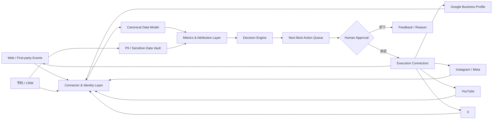

# クリニック・企業向け「SEO・UEO・MEO・SNS・予約/CRM統合」集客最適化SaaS 競合分析・製品戦略レポート

## エグゼクティブサマリー

本調査では、2026年10月下旬時点で、国内外の主要なSEO、ローカルSEO/MEO、AI検索最適化、SNS分析、店舗情報管理、CRM/予約管理サービスを横断し、**国内8社、海外8社の計16社**を重点比較した。

結論から言うと、本構想には十分な差別化余地がある。ただし、勝ち筋は単に「SEO＋MEO＋SNSを1画面にする」ことではない。国内ではCS-Cの「C-mo」がSEO・MEO・SNS・AI検索・自動コンテンツ配信まで統合し始めており、STOREPADはMEO・口コミ・SNS・予約・インバウンドをかなり広くカバーする。カンリーは13万店舗規模の店舗情報管理基盤を持ち、GMO TECHやGyro-nもMEOでは強い。一方、海外ではYextやSOCiが「location data＋reviews＋social＋AI visibility」をエンタープライズ向けに統合し、Semrush/AhrefsがSEO・AI検索、Sprout SocialがSNS、HubSpotがCRM/マーケティングの各レイヤーを押さえている。 citeturn21search2turn19search0turn11search11turn25search1turn3search2

したがって、狙うべき製品ポジションは次の通りである。

> **「検索順位や閲覧数を上げるツール」ではなく、Web・Google Maps・AI検索・SNSから予約/問い合わせ/来院までをつなぎ、次に何を変えれば“実集客”が増えるかを自動提案・安全に実行する“集患・集客OS”**。

特にクリニック市場では、一般企業向けマーケティングSaaSにはない**医療広告ガイドライン、要配慮個人情報、口コミ運用規制を製品レベルでガードレール化すること**が大きな差別化要素になる。医療機関のWebサイトも広告規制の対象で、治療効果に関する体験談等には規制があり、患者の病歴等は要配慮個人情報に該当する。 citeturn26search13turn26search5turn26search8turn26search25

もう一つ重要なのは、「リアルタイム」という製品表現である。すべての外部プラットフォームが秒単位・分単位のデータを提供するわけではない。例えばGoogle Business Profile Performance APIは**日次データが基本で、時間単位のPerformance指標は提供されない**。一方でGBPのレビューや情報更新通知、Xの投稿指標、YouTube Analytics等ではより短いサイクルで取得できる情報がある。したがって製品仕様としては、**「リアルタイム・準リアルタイム・日次」をデータソース別に明示しながら継続最適化する設計**が正確である。 citeturn27search4turn27search6turn28search1turn28search0

開発優先順位としては、最初から全媒体への自動投稿や完全自律AIを作るべきではない。最初に構築すべきものは、①共通データ基盤、②SEO/MEO/SNS/予約の統合ダッシュボード、③「次に何をすべきか」のアクションキュー、④MEO＋SEO＋UEOの改善提案、⑤予約/問い合わせへのアトリビューションである。その上でSNS投稿、口コミ返信、GBP更新、Web変更を人間承認付きで自動化する。

本レポートの工数試算では、**商用MVPは約31～50人月、開発費約3,700万～9,000万円、6～9か月程度**を一つの現実的なレンジと見積もる。さらに多店舗対応、予約/CRM連携、複数SNSの投稿機能、AIエージェント、実験・自動最適化まで含む本格版は**60～100人月、約7,200万～1.8億円程度**を想定する。これは外注/内製混成で1人月120～180万円として置いた概算であり、API利用料、営業・CS、コンテンツ制作、ISMS等の認証費用は別である。

競合比較の全23項目版CSVも作成した。

**[競合比較CSVをダウンロード](sandbox:/mnt/data/competitive_landscape_seo_ueo_meo_sns_2026.csv)**

## 調査範囲・前提と市場構造

### 本レポートにおける用語

ユーザー指定に従い、本レポートでは**UEO＝User Experience Optimization／ユーザー体験最適化**と定義する。具体的には、ページ速度・Core Web Vitalsだけでなく、ランディングページから予約・問い合わせまでの導線、フォーム離脱、CTA、コンテンツ理解性、モバイルUX、アクセシビリティ、予約完了率等を含む。

一方、2026年時点の競合各社が急速に取り込んでいる「AI検索最適化」は別軸として扱う。KeywordmapはAI OverviewsやChatGPT/Gemini等におけるブランド言及・引用・誤情報診断機能を拡張し、SEARCH WRITEは2026年10月19日にLLMO/GEOエージェントを正式提供開始、SemrushもAdobe買収後、SEOだけでなくGEO/AEO/agentic searchを重要領域にしている。 citeturn22search5turn22search8turn22search12turn24search0turn24search28

したがって、開発製品では最低でも次の四つを別々に測定すべきである。

| 領域 | 最適化対象 | 主な成果指標 |
|---|---|---|
| SEO | Google等の通常検索 | 非指名流入、検索CTR、順位、自然検索CV |
| UEO | Webサイト訪問後の体験 | CTA率、予約開始率、完了率、離脱率、表示性能 |
| MEO / Local | Maps・ローカル検索・GBP | Maps表示、電話、Webクリック、経路、予約、ローカル順位 |
| AI Visibility / GEO | ChatGPT、Gemini、AI Overviews等 | 言及率、引用率、Share of Voice、センチメント、AI referral |

この分離が重要なのは、「SEO順位が上がったが予約は増えない」「Instagram閲覧数は増えたが新患は増えない」「Maps表示は伸びたが電話しか増えない」といった現象を、同じ“集客成功”として扱わないためである。

### 市場は一枚岩ではない

現在の競合市場は、大きく五つのカテゴリーに分かれる。

**SEO/GEO intelligence**ではミエルカ、Keywordmap、SEARCH WRITE、Semrush、Ahrefsが強い。Keywordmapは競合検索市場分析からAI回答中の引用・ブランド評価まで広げ、SEARCH WRITEは分析だけでなく改善提案・タスク実行支援へ寄せている。 citeturn22search5turn22search12turn24search32turn25search0

**MEO/ローカル店舗運営**ではGMO MEO Dash!、カンリー、Gyro-n、STOREPAD、Yext、BrightLocalが中心である。カンリーは13万店舗導入・99%以上の継続率を掲げ、Yextは9百万超のlocationsを管理し、200超のpublisher/LLMへの直接配信を訴求している。 citeturn21search2turn25search1turn25search11

**SNS統合**ではSprout Socialが特に強く、投稿、Smart Inbox、競合分析、Listening、レビュー、SNS横断レポーティングを統合する。2026年の料金はEssentialsが年払い$79/seat/月、Standard $199、Professional $299、Advanced $399となっている。 citeturn25search2turn25search10turn25search20

**CRM/アトリビューション**ではHubSpotが強い。CRMとMarketing Hub、SNS、Campaign、イベント、リード/商談を接続し、Campaign APIではキャンペーン収益データを外部システムに取り出すこともできる。 citeturn4search18turn28search8turn28search2

そして**統合型ローカルマーケティングOS**として最も注意すべきなのが、国内ではC-moとSTOREPAD、海外ではYextとSOCiである。C-moは2026年にSEO・MEO・SNS・AI検索を統合し、写真などを起点にブログ、Google Maps、Instagram向けコンテンツを生成・投稿する方向に進化している。STOREPADもGoogle・Instagram一括投稿、口コミAI、多言語、予約等を統合している。 citeturn11search11turn19search9

**本調査範囲での重要な推論**は、これらのどの競合も「日本の医療広告コンプライアンス＋深いSEO＋MEO＋UEO＋SNS横断＋予約/CRM＋実来院成果」を中小～中堅クリニック向けに一つの製品で完全に閉じてはいない、という点である。したがって、この交差領域が有望なホワイトスペースである。 citeturn1search6turn19search9turn21search2turn25search1turn3search2

## 競合ランドスケープと比較

以下の「◎/○/△/×」はベンダー自身の公式分類ではなく、公開機能を基にした本調査の評価である。特にUEOは各社が同じ名称を使っているわけではない。

### 機能ポジショニング

| サービス | SEO | UEO | MEO | AI検索 | SNS | 予約 | CRM | 総評 |
|---|---:|---:|---:|---:|---:|---:|---:|---|
| ミエルカSEO | ◎ | ○ | △ | ◎ | △ | × | × | SEO/GEO特化 |
| Keywordmap | ◎ | ○ | △ | ◎ | ○ | × | × | 検索市場・競合データに強い |
| SEARCH WRITE | ◎ | ○ | △ | ◎ | △ | × | × | 「分析→次アクション」が強い |
| MEO Dash! byGMO | ○ | △ | ◎ | ○ | △ | ○ | △ | MEO運用深度が高い |
| カンリー店舗集客 | △ | ○ | ◎ | ○ | ○ | △ | △ | 多店舗情報管理が強い |
| Gyro-n | ○ | ◎ | ◎ | ○ | △ | △ | △ | MEO＋EFO＋医療支援が特徴 |
| STOREPAD | △ | ○ | ◎ | ○ | ○ | ◎ | △ | 構想にかなり近い |
| C-mo / C-mo AIO | ◎ | ○ | ◎ | ◎ | ○ | ○ | △ | 国内で最も直接的な競合候補 |
| Semrush | ◎ | ○ | ○ | ◎ | ○ | × | △ | 世界的SEO/AI可視性基盤 |
| Ahrefs | ◎ | ○ | ○ | ◎ | ○ | × | × | SEOデータ品質・監査が強い |
| Similarweb | ○ | △ | × | ○ | △ | × | △ | 市場・競合トラフィック分析 |
| Yext | ○ | ○ | ◎ | ◎ | ○ | ○ | ○ | 海外の統合型ローカルOS |
| BrightLocal | ○ | △ | ◎ | △ | × | × | △ | 低価格Local SEOに強い |
| SOCi | ○ | ○ | ◎ | ◎ | ◎ | △ | ○ | 多店舗AI運用 |
| Sprout Social | × | △ | △ | △ | ◎ | × | ○ | SNS統合のベンチマーク |
| HubSpot | ○ | ○ | △ | △ | ○ | ◎ | ◎ | CRM/成果アトリビューションの基準 |

Faber Companyはミエルカシリーズを展開し、公式サイトでは従業員80名、資本金1億円。ミエルカSEOは1,900社超の導入を掲げており、導入事例ではリード数1.7倍などの成果も紹介されている。 citeturn22search0turn15search8turn15search19

CINCは従業員114名、資本金等9.44億円を公表し、Keywordmapを中心に検索市場分析からGEO/LLMOまで急速に拡張している。公開事例には自然検索流入2倍、リライト記事PV20倍、広告費1,000万円削減などがある。 citeturn23search0turn15search6turn22search5

PLAN-Bはグループ265名、資本金1億円。SEARCH WRITEは2026年10月にLLMO/GEOエージェントを正式提供開始し、顧客事例には月間CVが前年比較で141%増加したケースがある。 citeturn23search1turn22search12turn17search0

### 会社規模・価格・導入実績

価格は年払い/月払い、ユーザー数、店舗数、オプションで大きく変わる。以下は公開情報が確認できた範囲の目安であり、調達時には再見積が必要である。

| 会社 / 本社 | 従業員規模・財務規模 | 対象業界 / サービス | 価格モデル | 代表的な導入・成果 |
|---|---|---|---|---|
| **Faber Company / 東京** | 80名、資本金1億円 citeturn22search0 | 全業種 / ミエルカSEO | 公開情報で月15万円～の例 citeturn15search4 | 1,900社超、リード1.7倍等 citeturn15search8turn15search19 |
| **CINC / 東京** | 114名、資本金等9.44億円 citeturn23search0 | 全業種 / Keywordmap | Light / Standard / Expert、見積 citeturn15search3 | 自然検索2倍、記事PV20倍、広告費1,000万円削減例 citeturn15search6 |
| **PLAN-B / 大阪・東京** | 265名、資本金1億円 citeturn23search1 | 全業種 / SEARCH WRITE | 個別見積中心 | 月間CV +141%の事例 citeturn17search0 |
| **GMO TECH / 東京** | GMO TECH連結237名、持株会社連結476名 citeturn22search3turn22search7 | 多店舗全般 / MEO Dash! | 個別見積 citeturn18search7 | 外国人顧客3倍超、問い合わせ1.5倍等 citeturn18search3 |
| **カンリー / 東京** | 資本金1億円、従業員は100～200名級の公開情報例 | チェーン/多店舗 / カンリー店舗集客 | 個別見積 | 13万店舗、継続率99%以上、事例で運用時間93%削減 citeturn21search2turn21search3 |
| **ジャイロン / 東京** | 32名、資本金1,756.46万円 citeturn10search0 | 店舗・医療 / Gyro-n | 低価格帯＋無料トライアルあり citeturn1search12 | MEO導入2,500社超 citeturn1search3 |
| **イクシアス / 東京** | 資本金6.73億円、従業員非公開 citeturn11search7 | 飲食・宿泊・美容・医療 / STOREPAD | 複数プラン、詳細見積 | 年間約900万円コスト削減、月510予約クリック等 citeturn19search1turn19search5 |
| **CS-C / 東京** | 371名、資本金7.73億円 citeturn21search0 | ローカルビジネス / C-mo | 個別見積 | SEO/MEO/SNS/AI検索を統合したC-mo AIOを展開 citeturn11search11 |
| **Adobe / Semrush** | Semrushは2026年4月にAdobeが買収。買収額約19億ドル citeturn24search0turn24search4 | 全業種 / Semrush・Adobe Brand Visibility | SEO+AI Search Pro+の公開例は年払い換算約$248/月～ citeturn2search0 | Enterprise SEO/AI visibility事例多数 citeturn24search36 |
| **Ahrefs / Singapore** | 149 teammates、非上場 citeturn24search17 | SEO/マーケティング / Ahrefs | $129 / $249 / $449 / Enterprise $1,499～/月 citeturn25search0 | SEO成長事例多数 |
| **Similarweb / Israel** | 上場企業、2026年売上ガイダンス約$314–318m citeturn12search0 | 市場・競合分析 / Web Intelligence | 公開プラン約$125/月～、Enterprise見積 citeturn2search14 | 大手企業の市場/競合インテリジェンス |
| **Yext / New York** | FY2026売上約$446.6m citeturn12search4 | 多店舗Enterprise / Yext | locations/製品単位の見積 | Fazoli'sでオンライン売上3.6倍の紹介例 citeturn24search23 |
| **BrightLocal / UK** | 非上場、詳細非公開 | SMB/代理店 / BrightLocal | 月$39前後～、年払い換算低価格表示あり citeturn3search7turn3search23 | 新規リード+70%、自然検索流入2倍等 citeturn3search3 |
| **SOCi / San Diego** | 非上場、詳細非公開 | Enterprise多店舗 / SOCi Genius | 個別見積 | 1,000+ enterprise brandsを支援 citeturn3search2 |
| **Sprout Social / Chicago** | 2026 Q2売上$123.8m citeturn12search14 | SNSチーム / Sprout Social | 年払い$79 / $199 / $299 / $399 per seat～ citeturn25search2turn25search4 | 30,000+ brandsを対象にSNS管理 citeturn3search20 |
| **HubSpot / Cambridge, MA** | 2026 Q2売上約$911.7m citeturn13search2 | SMB～Enterprise / Customer Platform | Free～。Marketing Hub Proは高価格帯月額SaaS citeturn4search2 | CRM・マーケ・売上を一気通貫管理 citeturn4search18 |

### 機能・API・強弱の比較

| サービス | 主要機能 / データ取得 | 公開技術情報 | 強み | 弱み | 模倣すべき点 | 差別化ポイント |
|---|---|---|---|---|---|---|
| **ミエルカ** | SEO、GSC、コンテンツ、AI検索流入/言及 citeturn15search9turn0search0 | 内部stack非公開 | 日本語SEO＋伴走 | Local/CRMが弱い | 課題→施策→検証 | 予約成果とMEOを接続 |
| **Keywordmap** | SEO競合、AI Overview、AI言及/引用/誤情報 citeturn22search5turn22search8 | 独自大規模検索データ | 市場構造分析 | 店舗/予約弱い | AI誤情報診断、SoV | Local＋来院に転換 |
| **SEARCH WRITE** | SEO分析、タスク、LLMO/GEOエージェント citeturn22search12 | 内部非公開 | 「次の行動」が明確 | データ統合範囲は限定 | Next Best Action | 実行APIまで閉ループ |
| **MEO Dash!** | GBP順位、競合、投稿、口コミ、insights、構造化データ citeturn18search24 | GBP/Yahoo/Apple連携 citeturn18search10turn18search17 | MEO深度 | SEO/SNS/CRM分断 | 多地点順位、一括更新 | SEO/SNS同時最適化 |
| **カンリー** | GBP/HP/SNS、改ざん監視、Apple等、CSV/API citeturn0search5turn0search8 | API連携SaaS | 大規模店舗管理 | 深いSEO弱い | 店舗マスタ、異常検知 | 医療特化＋実来院ROI |
| **Gyro-n** | MEO、SEO、口コミVOC、EFO、医療向け支援 citeturn10search0turn1search6 | 内部非公開 | UEO/EFOまで近い | SNS/CRM限定 | フォーム最適化、VOC | 全チャネル患者journey |
| **STOREPAD** | MEO、口コミAI、SNS投稿、多言語、予約 citeturn19search9 | API型統合 | 構想に近い | 深いSEO/CRMが弱い | AI口コミ、予約統合 | SEO＋UEO＋患者ID |
| **C-mo** | SEO/MEO/SNS/AI検索、自動コンテンツ配信 citeturn11search11 | 詳細非公開 | 国内最直接競合 | 医療/CRMは余地 | 1素材→多媒体配信 | 医療コンプラ＋成果学習 |
| **Semrush** | SEO、GEO、広告、Social、API citeturn24search32turn2search4 | 大規模検索データ | 世界級データ | 日本のLocal/医療弱い | Visibility統一指標 | 国内現場データ |
| **Ahrefs** | Site Audit、Rank、Brand Radar、GBP Monitor、API citeturn24search33turn2search21 | 大規模独自クローラ | SEOデータ品質 | CRM/予約なし | 監査、gap分析 | 非専門家向け自動実行 |
| **Similarweb** | 競合traffic/channel/AI、API v5 citeturn2search22 | 大規模推計基盤 | 市場ベンチマーク | 自社施策実行弱い | 市場share比較 | first-party成果中心 |
| **Yext** | Knowledge Graph、Listings、Reviews、Social、Scout、API/MCP citeturn25search1turn25search11 | Graph＋API＋AI agents | 正本データ＋200+配信 | Enterprise寄り | Single Source of Truth | 日本SMB/医療向け軽量化 |
| **BrightLocal** | Local rank、citation、reviews、API/MCP citeturn3search11 | REST/MCP | 安価でMEO深い | SNS/CRMなし | Geo-grid | 予約・SNS統合 |
| **SOCi** | listings/reviews/social/AI agents citeturn3search2 | SOC2、ISO27001/27701/42001 citeturn3search26 | 大規模自動化 | 日本向けローカライズ | 例外だけ人に上げるAI | 医療法規ルールエンジン |
| **Sprout** | 投稿、Inbox、Analytics、Listening、API citeturn25search20turn3search0 | 各SNS API＋Sprout API | SNS UX完成度 | SEO/MEOなし | KPI正規化、承認workflow | 予約KPIと統合 |
| **HubSpot** | CRM、Marketing、Campaign、Events、API citeturn28search2turn28search8 | REST/OAuth/versioned API | 成果まで閉じる | MEO弱い | lifecycle・attribution | 置換せず連携する |

この比較から、**模倣すべき競合は一社ではない**。実際には、

- SEARCH WRITEから「分析結果をアクションに変えるUX」
- Yext/Canlyから「店舗情報のSingle Source of Truth」
- STOREPAD/C-moから「一素材・一入力で複数媒体を運用」
- Sprout Socialから「SNS横断の指標正規化と承認ワークフロー」
- HubSpotから「予約・顧客・売上までのアトリビューション」
- Keywordmap/Semrushから「SEO/GEO競合可視性」
- Gyro-nから「フォーム最適化と医療向け配慮」

を組み合わせる戦略が最も合理的である。各機能の存在は上記一次情報に基づき、統合方法は本レポートの提案である。 citeturn22search12turn25search1turn19search9turn25search20turn28search8turn22search5turn1search6

## 勝てる製品設計と差別化

### North Starを「ヒット数」から「有効予約」に変える

本アプリの最大の設計原則は、**PV、検索順位、SNS閲覧数を最終目的にしないこと**である。

経営者・院長が本当に知りたいのは、

> 「昨日Instagramが何回見られたか」

ではなく、

> 「どの施策によって、新患予約が何件増え、どこに次の1時間・1万円を使えばさらに増えるか」

である。

したがってNorth Star Metricは、たとえば

**Confirmed New Customer/Patient Acquisition**

すなわち「新規有効予約・問い合わせ・来院数」とし、その下にSEO、MEO、SNS、UEOをドライバーとして置くべきである。

### 推奨する機能優先順位

| 優先度 | 機能 | 理由 |
|---|---|---|
| **P0** | OAuth/データ接続基盤、店舗・サイト・SNSアカウント統合 | 全機能の土台 |
| **P0** | 共通KPIモデル・データ鮮度表示 | 媒体間比較を可能にする |
| **P0** | 統合ダッシュボード | 最初の顧客価値を最短で出せる |
| **P0** | 予約/問い合わせイベント計測 | 「閲覧→成果」を閉じる |
| **P1** | MEO分析・GBP Health Score・ローカル順位 | クリニック/店舗の高意図顧客に直結 |
| **P1** | SEO監査・コンテンツ機会・AI検索visibility | 競合との差を把握 |
| **P1** | UEO/予約ファネル分析 | 流入増よりCVR改善が早く効く場合が多い |
| **P1** | Next Best Action | データを見るだけのSaaSから脱却 |
| **P1** | SNS統合Analytics | X/Instagram/YouTubeを経営KPIに接続 |
| **P2** | 口コミAI分類・返信支援 | MEOと顧客体験改善を接続 |
| **P2** | コンテンツ再利用・マルチチャネル投稿 | 運用工数を大幅に削減 |
| **P2** | CRM/予約システム連携 | LTV・来院までのROI計測 |
| **P2** | 医療広告Compliance Copilot | クリニック市場の強い差別化 |
| **P3** | 自動A/Bテスト | 因果を学習可能にする |
| **P3** | Guarded Autonomous Optimization | 人間承認付きで施策実行を自動化 |

重要なのは、**P3の完全自動化を先に作らないこと**である。SEOや医療広告では、AIが文章を書き換え続けること自体が価値ではない。間違った治療表現や診療時間の更新を自動公開すれば、マーケティング上・法令上のリスクが大きい。

むしろ、

**観測 → 診断 → 推奨 → 承認 → 実行 → 測定 → 学習**

の閉ループを作ることが価値になる。

Google Business Profile APIでは店舗情報管理、レビュー、Posts等をプログラムから扱うことができ、Performance APIではSearch/Mapsのimpressions、website clicks、call clicks、directions、予約等の指標を扱える。Performanceは日次中心なので、上図のMetrics Layerでは**各データにfreshness timestampを持たせるべき**である。 citeturn27search6turn27search10turn27search4

Instagram APIはBusiness/CreatorアカウントのInsightsを提供し、YouTube Analytics APIはviews、engagedViews、watch time、comments、likes、shares等を提供する。X APIではpublic_metrics、organic_metrics、non_public_metricsによりrepost、reply、like、quote、impression、profile click、URL click等を取得できる。 citeturn27search1turn27search11turn28search0turn28search1

ただし各SNSのAPIは指標の追加・廃止が発生する。Metaは2026年にもGraph APIの一部reach/impression系指標の変更・廃止を進めており、GBPにもAPI廃止履歴がある。したがって「媒体固有フィールドをUIに直接結び付ける」のではなく、**内部Canonical Metric Layerを一枚挟むことが必須**である。 citeturn27search5turn27search8

### 推奨する共通データモデル

最低限、次のエンティティを共通化する。

`Organization → Brand → Location → Channel Account → Content → Campaign → Session/Event → Lead/Booking → Customer/Patient Outcome`

たとえばInstagram Reel、Google Business Profile Post、Web記事をすべて`Content`として扱い、それぞれにcampaign_idとlocation_idを付与する。

これにより、

**Instagram Reel → Profile visit → Web session → 予約開始 → 予約完了**

と、

**Google Maps → Website click → LP → 予約完了**

を同じデータモデルで比較できる。

### 差別化の核心

最も強い差別化候補は、単純な機能数ではなく以下の五点である。

**第一は「予約・来院ベースのNext Best Action」**である。単に「このキーワードの順位が落ちています」ではなく、「この診療科×地域ではMaps順位低下と予約減少の相関が大きいため、GBPカテゴリ・サービス情報・レビュー返信を先に改善」と提示する。

**第二は「医療Compliance Copilot」**である。治療効果表現、体験談、ビフォーアフター、最上級表現、価格表示、広告/PR表示等を公開前にルール＋LLMで検査する。医療広告規制上、Webサイトも対象となり、治療効果に関する体験談等には明確な制限があるため、クリニック向けにはこのガードレールそのものが製品価値になる。 citeturn26search13turn26search5

**第三は「一素材から多チャネル展開」**である。CS-CやSTOREPADが既にこの方向へ進んでいるため、単なる生成AIでは差別化できない。 citeturn11search11turn19search9 そこで、同じ素材から「Web SEO記事」「GBP Post」「Instagram Caption」「YouTube Shorts説明」「X Post」を作るだけでなく、各媒体の結果を後から比較し、「次回はどの表現・サービス・地域テーマを増やすか」まで学習する。

**第四は「競合比較を予約成果につなげること」**である。Yext ScoutはGoogle・AI・競合情報をWin Rateとして可視化し、Semrush/Keywordmapもvisibility/share of voiceを強化している。 citeturn25search15turn24search12turn22search8 本製品ではそこから一歩進み、「競合に負けている検索テーマのうち、改善時の予約期待値が最も高いもの」を並べる。

**第五は「Human-in-the-loop」**である。AIにすべてを自動投稿させるのではなく、低リスク施策だけ自動化し、高リスク施策は院長/管理者承認にする。これは規制対応とエンタープライズ販売の両面で有利である。

## 開発計画・工数・コスト

以下は詳細要件定義前の**粗いプロダクト開発見積**である。国内エンジニア/PM/QA/デザインを含む混成チームで、1人月120～180万円を目安とした。既存BI製品を埋め込むか、自社チャートを全て実装するかでも大きく変わる。

### 商用MVP

| ワークストリーム | 工数目安 |
|---|---:|
| マルチテナント認証、RBAC、OAuth/token管理 | 3～4人月 |
| Google/SNS系Connector群 | 4～6人月 |
| canonical data model、ETL/ELT | 3～5人月 |
| Web/SEO/UEO分析 | 4～6人月 |
| MEO/GBP分析 | 3～5人月 |
| SNS統合分析 | 3～5人月 |
| KPIダッシュボード | 3～5人月 |
| Recommendation Engine v1 | 3～5人月 |
| 予約/CRM基本連携 | 2～4人月 |
| Security/Admin/Audit/Privacy | 2～4人月 |
| QA、負荷試験、CI/CD、Observability | 3～5人月 |
| **合計** | **約31～50人月** |

これを6～9か月で実装する場合、平均5～8人程度の専任チームになる。

**概算開発費：3,700万～9,000万円程度。**

幅が大きいのは、特にSNS/GBP API審査、多テナント認証、予約システム連携、データ品質保証、管理画面、QAの要求レベルが変わりやすいためである。GBP API自体は登録ユーザーに対して無償だが、APIアクセス申請やquotaがあり、Performance APIでは標準300 QPM等の制約が設定されている。 citeturn27search14turn27search18

### 本格商用版

次の追加機能まで含める場合、さらに30～50人月程度を見るべきである。

| 追加領域 | 追加工数目安 |
|---|---:|
| AI/GEO visibility tracking | 5～8人月 |
| マルチチャネル生成・投稿 | 5～8人月 |
| 口コミAI/VOC/返信workflow | 3～5人月 |
| 本格CRM/予約integration framework | 5～8人月 |
| Attribution / Incrementality / Experiment | 4～8人月 |
| Compliance Copilot | 3～6人月 |
| Agentic Next Best Action | 4～7人月 |
| Enterprise SSO・SCIM・監査・詳細権限 | 3～5人月 |

したがって、**初期MVP＋本格版で60～100人月、約7,200万～1.8億円**程度が妥当なレンジになる。

プラットフォーム側APIの価格・契約変更、LLM inference、ローカル順位取得、競合SERP取得、メール/SMS、データウェアハウス、ログ保管費はこの数字に含めていない。

### 推奨技術構成

内部技術構成は、最初からマイクロサービスを細分化し過ぎる必要はない。まず**modular monolith＋非同期job architecture**が適する。

フロントエンドはReact/Next.js、API layerはTypeScript/NestJSまたはPython/FastAPI、主DBはPostgreSQL、分析基盤はBigQuery等のcolumnar warehouse、バックグラウンド処理はPub/Subやqueue＋worker、OAuth tokenはKMS/Secrets Manager相当で暗号化する構成が現実的である。

Google系API比率が高いことを考えるとGCPは自然な候補で、Cloud Run、Pub/Sub、BigQuery、Cloud SQL、Secret Managerの組み合わせは運用負荷を抑えやすい。ただしAWSを既に使っているなら同等構成で問題ない。

非常に重要なのは、**マーケティング分析warehouseと患者PII vaultを論理的に分離すること**である。SEOやSNS分析に患者の診療内容を流す必要はない。

## データ・法令・セキュリティ設計

クリニックを対象にする場合、この部分は後付けではなくMVP要件である。

### 個人情報保護法

個人情報保護委員会は、病歴等を含む情報を「要配慮個人情報」と位置づけており、その取得には原則本人同意が必要で、要配慮個人情報についてオプトアウト方式による第三者提供は認められていない。また、一定の漏えい等の場合には個人情報保護委員会への報告や本人通知が必要となる。 citeturn26search8turn26search25

さらに個人データの第三者提供は原則として本人同意が必要であり、医療・介護分野には専用ガイダンスも存在する。 citeturn26search19turn26search4

したがって、予約データを分析基盤へ取り込む際は、原則として

`booking_id / location_id / campaign_id / new_or_existing / booking_status / timestamp / revenue_band`

程度で十分であり、診断名、症状、自由記述、処方内容などをマーケティングwarehouseへ流すべきではない。

患者氏名・メール・電話番号をどうしても保持する必要がある場合は、別vaultに置き、分析側にはpseudonymous IDのみを流すべきである。

海外クラウドや海外SaaSへ個人データを移す場合には、外国にある第三者への提供に関する個人情報保護委員会のガイドラインを前提に、提供先国、保護制度、契約、本人への情報提供等を設計段階で確認する必要がある。 citeturn26search0

### 医療広告規制

クリニック向け機能では、SEO記事やSNS投稿を生成AIが自動生成して即公開する設計は危険である。

厚生労働省は、美容医療を含む医療機関のWebサイトにも広告規制が及び、治療効果に関する体験談等が禁止対象になることを明示している。医療機関ネットパトロールでも、体験談やビフォーアフター等が監視対象になっている。 citeturn26search13turn26search5

そのためCompliance Engineでは少なくとも、

| リスク | システム対応 |
|---|---|
| 患者体験談・治療効果の表現 | 自動検出し公開blocking |
| 「絶対」「必ず」「日本一」等 | 要レビュー |
| ビフォーアフター | 必要情報の有無を検査、原則Human Review |
| 治療費 | 価格情報の整合性確認 |
| 自由診療 | リスク/副作用等の必要表示check |
| 医師名・資格 | master dataとの一致確認 |
| AI生成内容 | 出典・承認者・versionをaudit log化 |

という運用を入れるべきである。

### 口コミ・ステマ

消費者庁は2023年10月1日からステルスマーケティングを景品表示法の規制対象としている。口コミ投稿についても、たとえば「星5を付けること」を条件として事業者が投稿内容を実質的に決定した場合、「事業者の表示」と扱われ得る。 citeturn26search6turn26search2

Google Mapsも、割引・無料提供等のインセンティブと引き換えにレビューを投稿・変更・削除させる行為をfake/misleading contentとして禁止している。 citeturn26search3turn26search15

したがってアプリに「★5レビューを増やすAI」のような機能を実装するべきではない。

実装すべきなのは、

**「来院/利用者に中立的にレビュー投稿を依頼する」**

機能と、

**「ポジティブ/ネガティブを問わず同一条件で依頼する」**

仕組みである。

レビュー依頼テンプレートにもコンプライアンスチェックをかける価値がある。

### セキュリティ要件

最低でも、OAuth token encryption、least privilege、tenant isolation、RBAC、MFA、audit log、IP/device anomaly detection、encrypted backups、key rotation、data retention、subprocessor registry、breach runbookをMVP段階から入れるべきである。

特にGoogle/Meta/X/予約システムのrefresh tokenは「集客データ」ではなく**顧客の各サービスを操作できる資格情報**なので、通常のanalytics dataより厳密に扱う必要がある。

SOCiがSOC 2 Type IIだけでなくISO 27001、27701、42001まで訴求していることは、Enterprise顧客がAIマーケティングSaaSにも情報セキュリティ・privacy・AI governanceを要求し始めていることを示す一例である。 citeturn3search26

## KPI・導入ロードマップ・マーケティング戦略

### KPIダッシュボード設計

推奨する画面構造は「媒体別」から始めないことが重要である。

最初の画面は院長・経営者向けに**成果から逆算**する。

#### Executive View

| KPI | 意味 |
|---|---|
| 新規予約 / 新規問い合わせ | North Star |
| 予約完了率 | 流入品質＋UEO |
| チャネル別予約貢献 | SEO/MEO/SNSの成果比較 |
| 新規顧客/患者獲得単価 | 有料施策を含む場合 |
| Organic / Local / Social Assisted Conversions | Last-click以外の貢献 |
| Location Visibility Score | ローカル可視性 |
| AI Visibility / Share of Voice | AI検索上の存在感 |
| Review Health | 評価・件数・鮮度・返信 |
| Data Freshness | 各APIデータの更新時刻 |

次にチャネル詳細を置く。

**SEO**ではimpressions、clicks、CTR、順位、non-brand query、landing-page CV、AI referral、技術エラー。

**MEO**ではSearch/Maps impressions、website clicks、call clicks、direction requests、booking actions、local rank grid、review velocity、response time、profile completeness。Google Business Profile Performance APIはSearch/Maps別desktop/mobile impressionsやwebsite/call/direction等の日次指標を提供する。 citeturn27search10turn27search4

**Instagram/X**ではimpressions/viewsだけではなく、engagement rate、shares、saves、profile clicks、URL clicks、video completionを重視する。Instagram Insights APIはBusiness/Creator account/mediaの分析データを提供し、X APIはpublic/non-public/organic metricsでimpressionやURL click等を扱える。 citeturn27search1turn28search1

**YouTube**ではviewsよりもengagedViews、watch time、average view duration、shares、comments、subscribers gainedとWeb/予約への遷移を重視する。これらはYouTube Analytics APIのcore metricsとして提供されている。 citeturn28search0

最下段には必ず**Action Queue**を置く。

例：

| 推奨アクション | 期待影響 | Confidence | 工数 | リスク |
|---|---:|---:|---:|---|
| 「渋谷 内科」のGBPサービス情報修正 | 高 | 82% | 10分 | 低 |
| 診療ページtitle/H1改善 | 中～高 | 74% | 20分 | 低 |
| Instagram ReelをGBP Postへ再利用 | 中 | 69% | 5分 | 低 |
| 予約フォームfield削減 | 高 | 76% | 2h | 中 |
| 自由診療ページ文章変更 | 高 | 63% | 1h | **高・医療承認必須** |

ここが競合との差別化の中心になる。

単なる「dashboard」ではなく、**priority queueを売る**べきである。

### Attributionの考え方

Last-clickだけではSNSを過小評価しやすいため、

`First touch / Last touch / Assisted / Position-based`

を少なくとも切り替え可能にする。

将来的にはlocation単位で、

> 「Instagram閲覧 → 7日以内にブランド検索 → Maps → 予約」

のような経路をprivacy-safeな範囲で集計する。

個人を再識別することを目的にせず、同意・利用目的・最小化を前提としたファーストパーティイベント中心の設計にする。

### フェーズ別ロードマップ

| 時期 | 製品フェーズ | 主な成果 |
|---|---|---|
| **開始～6週** | Foundation | 5～10社のdesign partner、法務/データ設計、KPI定義 |
| **2～4か月** | Analytics MVP | GBP＋Web＋主要SNS＋予約の統合dashboard |
| **4～6か月** | Intelligence | SEO/MEO/UEO score、競合比較、Next Best Action |
| **6～9か月** | Workflow | 承認、口コミ、投稿、予約/CRM連携、alert |
| **9～12か月** | AI Copilot | コンテンツ生成、Compliance Check、施策提案 |
| **12～15か月** | Guarded Automation | 低リスク変更の自動実行、experiment engine |
| **15か月以降** | Data Moat | 業種/地域benchmark、incrementality、予測最適化 |

最初のdesign partnerには、単店舗だけでなく「2～10院程度の医療法人」と「10～50拠点程度の一般企業」の両方を入れるとよい。単店舗だけで設計すると、後からlocation master、権限、bulk update、approval hierarchyを作り直す可能性が高い。

### GTMとマーケティング戦略

初期ICPは**Web集客は既にしているが、Google Maps、SNS、Web、予約データが分断されている事業者**がよい。特にクリニックでは「Web制作会社、MEO会社、SNS運用会社、予約システムが別々」という状態を狙う。

販売メッセージは、

> 「SEOツールです」

より、

> **「どの施策が予約につながったかを一画面で把握し、明日やるべき施策を自動で提示する」**

の方が経営者に伝わりやすい。

#### 仮説価格

市場検証用の初期仮説としては、

| プラン | 仮説価格 | 主対象 |
|---|---:|---|
| Starter | 月3.98万円前後 | 1拠点・基本Analytics |
| Growth | 月7.98万円前後 | SEO/MEO/SNS＋Action Engine |
| Clinic Pro | 月9.8～14.8万円 | Compliance＋予約/CRM＋AI |
| Multi-location | 月14.8万円～＋拠点課金 | 医療法人/チェーン |
| Enterprise/API | 個別見積 | 多店舗、代理店、OEM |

程度からWTPを検証するのが合理的である。これは市場の確定価格ではなく、競合の低価格MEO単機能から月10万円超のSEO/Enterprise SaaSまでの価格差を考慮した**事業仮説**である。実価格はdesign partnerへのインタビューとPOC conversionで決めるべきである。Semrush、Ahrefs、Sprout等でも機能・ユーザー数・Enterprise要件で価格が大きく階層化されている。 citeturn2search0turn25search0turn25search2

最初から安売りするより、「分析だけ」と「実行支援/Compliance」を明確に分けた方がよい。

### 最も有効な獲得戦略

初期は広告より**Free Audit → Benchmark → POC**が適している。

ユーザーがドメインとGBPを接続すると、

「SEO Health 62/100」
「Local Visibility 48/100」
「Review Health 71/100」
「Booking Funnel 39/100」
「AI Visibility 22/100」

のような無料診断を返す。

その上で、

> 「現在確認できる改善機会は月17件。このうち推定インパクト上位3件を実施するには有料版」

というPLG型導線を作る。

代理店・Web制作会社・医療コンサル・予約システム事業者には**white-label/API/OEM**を提供する。これは営業組織を短期間で巨大化させず顧客数を増やす手段になる。

### 長期的なデータモート

最も価値の高い資産は、AIモデルそのものではない。

長期的なmoatになるのは、

> **「どの業種・地域・チャネル・状態で、どの施策を実施すると、何日後に予約/問い合わせが何%動いたか」**

という縦断データである。

顧客データを混ぜて個人単位で利用するのではなく、privacy-safeに集計・匿名化したbenchmarkとして、

「歯科×都市部×評価4.0未満ではレビュー返信速度改善の優先度が高い」
「美容系ではInstagram閲覧増より予約LP CVR改善の限界効果が高い」
「地域名＋診療科ではSEO順位よりLocal Packの改善が先」

といった**Action Outcome Model**を構築できれば、単なるdashboardベンダーから「集客意思決定エンジン」へ進化できる。

競合各社がAI visibility、agentic marketing、Next Actionへ急速に動いていることからも、今後の競争軸は「データを見せられるか」ではなく「何をすべきかを正しく決め、実行まで安全につなげられるか」に移っている。YextはScoutとagents、SOCiはagentic local marketing、SEARCH WRITEはLLMO/GEOエージェント、Adobe/SemrushはAI search/brand visibilityへ拡張している。 citeturn25search1turn3search2turn22search12turn24search28

したがって、本構想の最終的な製品定義は、

> **「SEO/MEO/SNSを分析するアプリ」ではなく、Web・Maps・AI検索・SNS・口コミ・予約データを一つの顧客獲得グラフに統合し、法律・ブランドルールを守りながら、最も期待増客効果の高い施策を継続的に選択・実行・学習する“Customer Acquisition Operating System”**

とするのが、国内外の既存競合との最も明確な差別化になる。